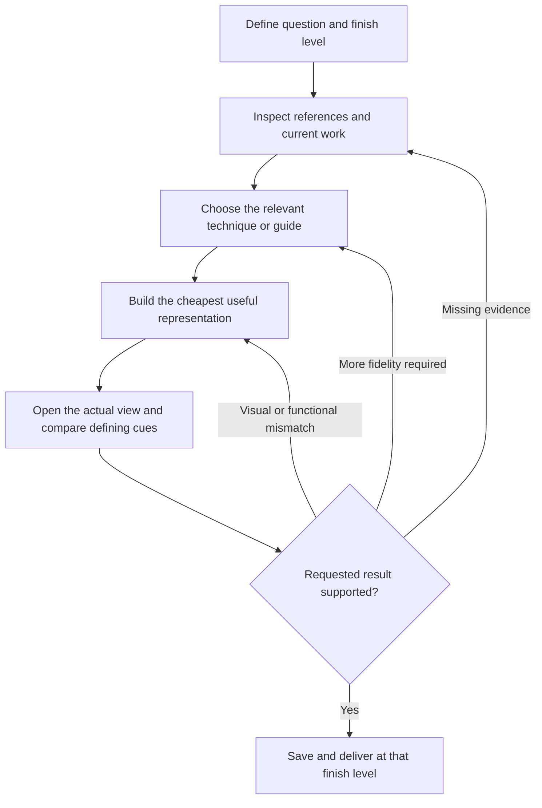

# Blender Modular Scenes

Develop the intended image or experience while keeping assets independently editable.
Modularity is an asset-design strategy within production; it does not prescribe separate
files or replace art direction. Choose tools to resolve the next design question.

## Start at the requested finish level

Identify target views, scale, quality priorities and delivery constraints.
A blockout, camera/light study or motion previs
can be complete: stop when it answers the requested question. A production request needs the
corresponding finish. For a review, inspect and recommend; for an authorized refactor, preserve
a recoverable baseline. A local edit does not require restarting production or new paperwork.

Before modifying Blender, identify the intended session/file, actual runtime version, units,
mode and relevant collections using the available execution channel. Preserve unsaved work
before substantial changes; save a useful scene checkpoint before complex evaluation or batch
edits. A generator alone is not a saved scene.

**Switch Blender modes in blocks.** Finish the current batch of edits before switching. Across a mode change, keep bone names, vertex indices while topology is stable, and copies of any numeric values or vectors you need (`head.copy()`, `tail.copy()`). After switching, look up each bone again by name in the appropriate collection (`rig.data.edit_bones` in Edit Mode, `rig.data.bones` for rest bones, `rig.pose.bones` for pose controls). For mesh edits, reacquire the live `bmesh.from_edit_mesh(mesh.data)` on entering Edit Mode, or `mesh.data.vertices[i]` in Object Mode. Discard old `EditBone`, vertex, BMesh element and live vector references when leaving their mode.

**Build an animation in stages.** Give yourself one visible change, a test for success and a result to preserve. Key the first visible change, save it and reopen that file in the same call. At each later pass, rerun the accepted checks, including signed travel and planted contact where relevant. Repair the first regression, then choose the next unfinished part of the brief. Continue through final playback and verification in the same request.

The [staged animation guide](references/techniques/motion-blocking.md#choose-your-next-task) gives examples and measurements. In Pi, use the same `read` tool that opens `SKILL.md`, with `path` set to `references/techniques/motion-blocking.md` under the loaded skill directory. Use `execute_blender_code` for edits and measurements inside Blender.

**First save for a new Rigify walk.** For a standing Rigify human travelling from A to B, get the generated rig name and skinned mesh name from the scene. Make the first authoring call a playable checkpoint with `save_walk_blockout(rig_name, mesh_name, output_path, distance=distance)` from the [Rigify travel example](references/techniques/rigify-travel.md). It checks IK and facing, builds the walk, saves, reopens and measures the actual body and feet. For a supplied walk, begin with the [read-only motion check](references/techniques/rigify-travel.md#review-the-saved-walk). Use the failing frame to choose what to repair.

**Save and check a requested `.blend`.** Pass the exact absolute output path from the task to [save_and_reopen](scripts/blend_file.py). Run this in Blender with the actual skill path and output path:

```python
from runpy import run_path
save_and_reopen = run_path("/absolute/path/to/blender-modular-scenes/scripts/blend_file.py")["save_and_reopen"]
print(save_and_reopen(output_path))
```

The helper returns the verified path after loading the saved file from disk. Look up the mesh, rig and controls again by name in the reopened scene before testing a pose.

For an existing asset, use the [bounded edit route](references/existing-file-workflow.md):
confirm the loaded scene and named target, change/evaluate one sample, then save.
For a head turn or tilt on an existing Rigify rig, read [Rigify head direction](references/techniques/rigify-head-direction.md) before choosing rotation axes. Check the direction of the evaluated face and crown.
For a **character walking on foot**, start with [character walking](references/character-walk.md). Block a whole stride and its acting choice, then watch the full figure at playback speed. For a step between two supplied poses, [humanoid animation](references/humanoid-animation.md) covers `capture_step` and `review_step`. It also covers a turn, reach or rise. For a new pair of IK endpoint poses, use [Rigify IK animation](references/techniques/rigify-ik-animation.md).
For a character noticing something and then acting, use [time the look before the response](references/animation-workflow.md#time-the-look-before-the-response).
For one-sided animation, call [`control_sides`](scripts/techniques/motion.py) in the starting pose. Give it the rig, a midline landmark, a landmark ahead of it, and both candidate control names. Use the returned side to test a small motion on the visible surface. [Landmark example and motion checks](references/animation-workflow.md#timing-spacing-and-contact)

Save an editable blockout as soon as the main action reads. For mesh motion, call `save_and_reopen(output_path, motion_sample=(mesh_name, vertex_index, start_frame, moving_frame))` with a visible moving point at two different poses. Return to the starting pose with `scene.frame_set(start_frame)`. Keep the working Action assigned while refining timing and contact. Ordinary transform keys work with `keyframe_insert`; customizing F-Curves can wait until the first playback.
For a background `.blend` edit, the bundled [read-only probe](scripts/api_probe.py) provides
that first check without writing an inventory script. Substitute and quote the actual paths:

```text
blender --background --factory-startup --disable-autoexec INPUT.blend --python-exit-code 1 --python SKILL/scripts/api_probe.py -- --expect-file INPUT.blend --object TARGET --output-json OUTPUT/probe.json
```

To find a `bpy.ops` operator from an enabled add-on, its arguments or its availability in the current context, call the bundled `find_ops` in live Blender. Substitute the actual skill path and your search terms. [Operator search](references/api-diagnostics.md#find-a-registered-operator)

```python
import runpy
find_ops = runpy.run_path("/absolute/path/to/blender-modular-scenes/scripts/api_probe.py")["find_ops"]
print(find_ops("words describing the operation", limit=4))
```

For identification alone, when `total == 1` and the row supplies every requested ID, parameter and poll value, answer the user immediately and stop. A false poll answers the availability question. Follow up only on missing or ambiguous information.

Repeat `--object` for another relevant target. For a named node/socket or unfamiliar member,
use the [scoped queries](references/api-diagnostics.md); extend inspection only for an unresolved
dependency. A material edit need not inspect an inactive render engine's sample settings.
For gaps/openings, use the [spatial probe](references/techniques/assembly-fit.md).
Choose one discriminating observation; separate stored state, evaluated effect and a failed probe.
The [execution route](references/blender-methods.md#scripted-execution-and-inspection) explains
argument order and exit status when adapting the command. Load the input before running its script.

## Building a character rig

- As soon as the mesh is first bound, call `save_and_reopen(output_path)` before posing or refining the rig. Keep the input file intact.
- Before a pose test, record the control transforms and custom properties you will change. Restore only those values afterwards. Preserve the rig's drivers and animation data. `rig.animation_data_clear()` removes its drivers.
- Reopen the saved rig and try an ordinary bend with the animator's controls. From the side, check which way the joint moves relative to the line from limb root to endpoint and the character's facing direction. Compare the deformed surface with the intended anatomy on both sides. Restore the requested delivery pose.

## Iterate from evidence to the next useful representation

Revisit these stages as evidence changes; they are not approval stops.



1. **Extract visual evidence.** Keep relevant images accessible. Identify proportions,
   construction, material response, composition and uncertainty. Translate a defining cue
   into a construction decision: for example, connected stone planes or leaf groups and gaps.
   A matching palette alone does not establish reference fidelity.
2. **Make the first view independent.** For new forms, run a small mass, camera/view and
   rough-light stage before secondary detail or a full generator. Its first image must not
   wait for finished materials, leaf prototypes or final topology. Compare silhouette, scale,
   relationships and framing; save a useful checkpoint. Proxies may coexist in layout studies.
3. **Prove the important sample before multiplying it.** Test a representative asset or
   connected kit slice at the requested finish level. Inspect its shape/joins in a useful
   diagnostic view and its appearance in the target view. For a final look, prove the
   [surface/light pairing](references/texture-authoring-workflow.md#prove-the-surface-before-spreading-it).
   For a generator or shared helper, vary a meaningful input and compare requested dimensions
   or counts with the evaluated output. Keep the comparison and remaining mismatch in existing
   notes or images; a comment saying 'proven'
   or a completed checklist is not evidence. For a new or changed solid-construction helper,
   check [dimensions and shell orientation on one sample](references/techniques/mesh-orientation.md)
   before repeating it. Fix the defining cue before expanding the family.
4. **Integrate incrementally.** Build primary forms, then secondary structure and surface
   detail. Review assets alone and in context; replace proxies progressively. Develop UVs,
   materials, rigging and FX alongside the geometry decisions they depend on. Reconsider a
   source or representation when iteration adds complexity without improving the target view.
5. **Resolve and deliver.** Compare production views/behavior with the brief.
   Distinguish built, visually reviewed and ready for the requested use.
   A successful bake/script does not certify the image or complete unrelated pending stages.

## Read the branch when the operation becomes concrete

For a new scene or substantial redesign, read [the production map](references/production-pipeline.md).
For a known operation, go directly to its [technique module](references/technique-index.md):
hard surface, animation, rig/deformation, GN patterns, particle state/cache, material responses, bake/UV, light/image, delivery or API diagnostics. Read the short interface and
the implementation you need. Use the discipline guide below when choosing a method or resolving
a boundary the technique does not cover. A local operation does not require reading an entire
guide and a whole asset first. Stop browsing when the next operation and its check are clear;
open another section when a concrete dependency or failed check calls for it.

| Next decision | Read now |
| --- | --- |
| Modify a supplied scene; expected content seems missing | [Existing-file workflow](references/existing-file-workflow.md); [API probe](references/api-diagnostics.md) for loaded identity and named controls |
| Opening/radius, shell thickness, constructed surfaces | [Hard-surface techniques](references/technique-index.md#hard-surface); [modeling](references/modeling-workflow.md) for broader form decisions |
| Recover a texture/asset from photos; camera projection or photogrammetry | [Reference-derived assets](references/reference-derived-assets.md): choose the route by source evidence and required views |
| New form/look or missing visual evidence | [Reference workflow](references/reference-workflow.md): find and actually view images; extract construction cues |
| Apartment/house layout and circulation | [Architectural layout](references/architectural-layout.md): first shell/view, floor levels, room routes and stairs |
| Tile layout, grout, backsplash cuts and counter junction | [Tile field and junction](references/techniques/tile-field-junction.md): metric layout and material response |
| Kitchen, storage or another interior composition after blockout | [Interior composition](references/interior-compositions.md): one assembled module, surface-family routes, local reuse and closed/open use states |
| Other layout, framing, light/value study or bounded video-to-graybox | [Blockout, camera and light](references/blockout-camera-light.md), including its bounded storyboard route |
| Reusable kit, family boundaries or joins | [Modular design](references/modular-design.md) |
| Rock/boulder shape, strata, weathering or a rock family | [Rock recipes](references/rock-recipes.md) |
| Plant shape and foliage; dense shrubs or clipped crowns | [Vegetation](references/vegetation-workflow.md); [shrub recipes](references/shrub-recipes.md) for compact canopies |
| Row/grid/ring placement or per-instance material variation | [GN techniques](references/technique-index.md#geometry-nodes-and-repeated-placement) |
| Broader procedural geometry, surface placement or node deformation | [Geometry Nodes](references/geometry-nodes-workflow.md); [scatter](references/scatter-workflow.md) for placement rules |
| Wood grain, framed timber, finish or striped procedural wood | [Board grain and finish](references/techniques/wood-grain-frame.md): local axes, face/cut evidence, sample before reuse |
| A known surface mix, thickness tint, glass/cloth transmission, embossed upholstery or plastic finish | [Material techniques](references/technique-index.md#material-responses) |
| Broader materials or procedural textures | [Shader nodes](references/shader-nodes-workflow.md); [composition](references/material-composition.md) for layers/optics; [surface families](references/surface-families.md) for common substances |
| Editable horn, root, hose or rail with a changing section | [Editable sweep](references/techniques/editable-sweep.md), two Bézier curves and a Geometry Nodes modifier |
| Raise or lower a local feature while preserving surface contact | [Fitted lattice and region lift](references/techniques/lattice-region.md), editable cage and modifier |
| Topology, sculpting, modifiers or curves | [Modeling](references/modeling-workflow.md), [modifiers](references/modifiers-workflow.md) or [curves](references/curves-workflow.md), according to the operation |
| Spin, pitch-coupled travel, an FK gesture or blink | [Animation techniques](references/technique-index.md#animation); [animation workflow](references/animation-workflow.md) for camera motion, wind or broader clip design |
| IK bend plane, matched pickup/release or IK → FK, visual bake, weights/twist or pose-driven shape | [Rig/deformation techniques](references/technique-index.md#rig-and-deformation) |
| Fit a Rigify Basic Human, bind a humanoid mesh or pose the hand with IK | [Rigify metarig, skin and IK](references/techniques/rigify-basic-human.md) |
| New articulation or faulty deformation | [Rigging](references/rigging-workflow.md) / [deformation](references/deformation-workflow.md), according to the problem |
| Known bake target/projection/field transfer or UV strip/density/padding | [Bake and UV techniques](references/technique-index.md#bake-and-uv) |
| Broader UVs, painting/maps or texture baking | [UV layout](references/uv-workflow.md), [texture authoring](references/texture-authoring-workflow.md) or [baking](references/baking-workflow.md), with the actual consumer defined |
| Fractional births/ID, survivor update, particle contact/fade, GN replay or Hinge/cache | [State/motion techniques](references/technique-index.md#state-and-motion) |
| Particles, specialist solvers or hair/fur | [Particles](references/particles-workflow.md), [simulation](references/simulation-workflow.md) or [grooming](references/grooming-workflow.md); choose only the relevant solver |
| Light isolation, EXR/PNG exposure, pass assembly, alpha or Cryptomatte | [Light/image techniques](references/technique-index.md#light-and-image) |
| EEVEE cel palette bands or independent outline weight | [Cel techniques](references/technique-index.md#cel-shading-and-contours) |
| Shot lighting, render quality/output or image assembly | [Lighting](references/lighting-workflow.md), [rendering](references/render-workflow.md) or [compositing](references/compositing-workflow.md) |
| Known linked override update, Append/Pack snapshot, owner-relative resource or relocation proof | [Native delivery techniques](references/technique-index.md#export-and-native-delivery) |
| Shared assets, catalogs, linked updates or portable native projects | [Asset libraries](references/asset-library-workflow.md) for publication/ownership; [project handoff](references/project-handoff.md) for dependencies and clean relocation |
| GLB object scope, clip/timebase, payload or surface comparison | [GLB delivery techniques](references/technique-index.md#export-and-native-delivery) |
| Interchange, target import, LOD/collision/lightmaps or budgets | [Export](references/export-workflow.md) with the selected [format](references/export-formats.md); [performance](references/performance-workflow.md) for measured consumer cost |

For cel shading, passes/mattes, footage integration and other routes, use the
[method selector](references/blender-methods.md). Its implementation notes also cover scripted
API access and measurement. Consult [recent features](references/recent-blender-features.md)
only for a relevant capability/version question; verify the actual runtime and current API.

## Keep editable sources and reliable implementations

Give reusable assets stable sources and useful interfaces: scale, pivot/axes, bounds/fit,
attachment points, materials and permitted variation. Separate assets where reuse, replacement,
motion or delivery benefits; shared datablocks, collections and node groups can be modules.
Keep dependencies acyclic and scene-level layout/cameras/light outside asset internals.
Preserve editable sources when producing applied, realized or optimized variants.

For one reusable operation, use the [technique index](references/technique-index.md).
For a combination, use the [recipe index](references/recipe-index.md). Read the needed interface
and small implementation, then prove one changed pose, relation or parameter in the evaluated
result and target view before expanding it. The [bundled scenes](references/implementation-examples.md)
provide editable examples with relative paths. Save your edits in the user's project. Examples do not
prescribe the design or certify a new result. When adding a reference asset, follow
[asset → extraction → verification → skill](references/example-extraction.md).

For room planning, UV and texture work, Geometry Nodes, cel shading, cartoons, light and compositing, the [scene catalog](references/early-examples.md) pairs each editable example with a preview and a change to try.

For projects using the bundled file-based manifest, follow [its contract](references/manifest-contract.md)
and existing freshness/ownership gates. That profile's one-file-per-node rule is not a general
definition of modularity. Otherwise use the project's established dependency/review records.

- Bound generators through [procedural geometry](references/procedural-geometry.md) before
  expensive evaluation; measure expanded cost and retain instances/curves when appropriate.
- For scripted nodes, verify **active socket/connection → read-back value → evaluated effect**
  using [Blender methods](references/blender-methods.md#resolve-active-node-sockets-and-prove-their-effect).
  A stored value on an inactive input is not a working control. Shader layers likewise need
  a visible contribution through the actual output.
- Probe unfamiliar API calls in a small disposable case. After failure, isolate and repair
  that case before rerunning dependent construction. Use live inspection and matching official
  documentation rather than successive guesses. Preserve the prior useful scene.
- Make helper transforms and rebuild behavior explicit: source-local versus world coordinates,
  which transforms are applied, owned objects replaced versus modified, and a clean starting
  state. Test a relevant source/host transform; repeated stage runs must not silently compound
  subdivisions or deformation. A destructive stage may require restoring its checkpoint.
- For batch jobs, resolve output paths against the saved project, keep complete logs and
  propagate script failures. Reopen this run's output instead of accepting a stale file.
  Before a full simulation bake, check the critical geometry/contact and a short interaction;
  unrelated final shading need not precede a simulation study.

## Check the deliverable at its intended use

Inspect images at blockout, sample, integration and delivery decisions. Compare with references
at the target size and fix the largest mismatch. Measure what the task requires: evaluated
dimensions, [surface/fit](references/modeling-workflow.md#surface-quality-and-handoff), motion,
UV/shading, dependencies and budgets. Thickness, winding, manifoldness and contact are separate
properties. Distinguish viewport from production output and Blender cost from target runtime cost.

Use [project handoff](references/project-handoff.md) to save dependencies and verify a clean destination. Verify
cache replay when required and [target import](references/export-workflow.md) for an export. Test linked-asset updates in a
controlled copy. For Unity use [Unity handoff](references/unity-handoff.md).
Report finish level, files, changes, checks actually performed and remaining limitations.
The bundled scripts check declared facts/freshness; they do not judge art or enforce an agent's
behavior. See [provenance and validation limits](references/provenance.md).
