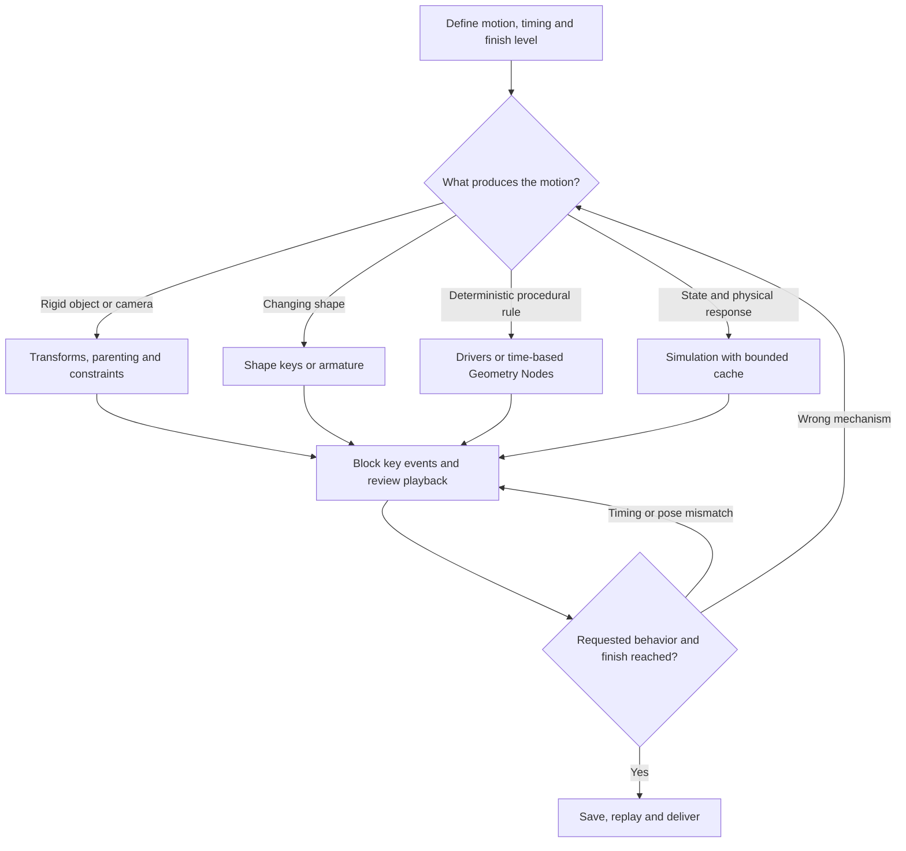

# Animate the intended behavior

Use for object motion, mechanical assemblies, characters, camera motion, shape change or
simulation. Establish the motion reference, purpose, duration, frame rate, frame range,
important poses/events and delivery format. A motion blockout or camera previs can itself
be the requested finish level; static tasks do not need animation by default.

For a shot with several interacting parts, use the [staged animation guide](techniques/motion-blocking.md#choose-your-next-task) to set your own small tasks and carry the checks from each accepted pass into the next one.

On a ready asset, resolve the next motion relation before writing a broad inspector:
[constant speed](techniques/constant-rotation.md), [thread-pitch coupling](techniques/pitch-coupling.md),
[FK pose/phase](techniques/fk-phase.md) or [graphical blink](techniques/driven-blink.md).
These small interfaces/code examples can be read independently. Use [recipes](animation-recipes.md)
when combining them; full motor/Momo assets are optional integration context.
Before writing an inspector for control ownership, assigned Action slots or uncertain RNA
names, try the [scoped API probe](api-diagnostics.md): it runs directly with an object/bone
name, or imports into an existing script. No custom serializer is needed.
Inspect only the controls, coordinate spaces and existing animation that affect that relation,
then evaluate one changed sample. Do not spend the motion budget repairing unrelated inventory fields.
Once that sample behaves as intended, save an editable checkpoint before broad diagnostics or
secondary motion; a failing reporting helper should not discard an already working pose/relation.

For control hierarchies, constraint spaces, IK/FK or rig delivery, read
[rigging](rigging-workflow.md). For skin weights, shape keys, joint quality or cages, read
[deformation](deformation-workflow.md). This branch owns motion/timing and animation data;
a successful key insertion does not establish a usable rig or a well-deformed surface.



For constrained-bone delivery, the [visual pose bake card](techniques/visual-pose-bake.md)
provides a small native example and separate checks for sampled frames and interpolation.

## Choose the smallest suitable mechanism

| Need | Practical setup | Validation |
| --- | --- | --- |
| Door, piston, wheel or rigid prop | Set the true pivot; parent moving parts to a controller/Empty; key transforms or constraint influence | Full motion envelope, clearance, inherited scale and unintended double transforms |
| Camera or object following a route | Follow Path plus deliberate aim/roll control | Travel speed, target framing, axis alignment and roll throughout the shot |
| A few designed shape changes | Shape keys on a compatible fixed topology | Basis and extremes, unwanted volume changes and modifier interactions |
| Articulated/deforming character | Armature, suitable rest pose and bone axes, weights, IK/FK as needed | Extreme poses, joint collapse, weight leakage and IK/FK transitions |
| Repeatable relationship | Driver or frame/time-based GN parameter | No dependency cycles; correct units, frame rate and readback at sample times |
| Cloth, hair or physical interaction | Appropriate simulation system with initial/rest state, constraints and collision | Stability, cache reproducibility and target renderer/export support |

For reusable assets, keep rig/control ownership in the asset and shot-specific motion in the
intended instance/override or animation source. Keying shared data may animate every user of
that data. Decide this intentionally before adding keys. Apply no blanket transform reset to
an existing rig, constraint system or animated object.

## Timing, spacing and contact

For a walking character, use [character walking](character-walk.md) to block a complete stride, choose the acting cues and review at speed. For a character moving between existing poses, use [humanoid animation](humanoid-animation.md) to establish planted intervals and key the intervening events.

1. **Identify the action in the shot.** What starts it, what carries the weight, and what should stay in contact? For a one-sided brief, get the controls on the intended physical side in the starting pose. Use the helper below. Test the candidates on matching patches of the evaluated surface, then restore the pose. Confirm that each sampled point lies on the named body part in neutral. For a ground contact, start on the underside of that part.
2. **Block the events that change the motion.** Choose readable silhouettes for the start, the main change of direction or contact, and the finish. Place them in seconds at the scene's effective frame rate (`fps / fps_base`). Put a breakdown between two poses to choose the path. For a weight transfer, move the body's mass toward the current support as the other contact releases, then show the new support accepting the load. A driven mechanism can use its actual pivot and drive speed.
3. **Give each phase its pace.** Compare the distance a visible point travels over equal frame intervals. Close spacing reads as slow, wide spacing as fast. Decide where force builds, where motion is fastest, and how it stops. A falling object accelerates into impact; a deliberate placement slows before contact. Give a flexible follower time to catch up if the joint or material permits. Rigidly coupled parts keep their mechanical timing. Key the few channels that express the difference.
4. **Check the saved clip.** Preserve the last playable Action when trying an alternative. For mesh animation with stable vertex indices, pass a moving surface vertex and two distinct poses to [save_and_reopen](../scripts/blend_file.py). For a round trip, sample the start and an extreme within the action. Play a lightweight preview at scene FPS to judge rhythm and silhouette. Scrub a frame at a time around contact and reversals. During a planted interval, measure a point on the deformed surface relative to its support for both slide and lift. For a roll or pivot, track the portion touching at that instant. Fix the largest visible error and replay. If playback is unavailable, report which sampled frames or trajectories you checked.

Stepped keys can clarify pose timing during blocking. Use the Dope Sheet to adjust event times and the Graph Editor to shape the spacing between them. Inspect the resulting arc from the shot view. Check rotation wrapping when a joint flips between two plausible poses. [Blender Studio animation fundamentals](https://studio.blender.org/training/animation-fundamentals/)

For `control_sides`, use a central point between the two sides and a point toward the subject's face or direction of travel. Supply actual pose bone names or measured world positions for these landmarks. For a standing biped, a point halfway between the heels and a point halfway between the toes define forward. Supply the subject's world up direction if it is tilted. The helper groups the candidate heads using `up.cross(forward)`. A central or crossed controller needs a reversible pose test to identify the driven surface.

```python
from runpy import run_path
control_sides = run_path(skill_path + "/scripts/techniques/motion.py")["control_sides"]
print(control_sides(rig, midline_landmark, forward_landmark, candidate_names))
```

Use NLA when clips need reuse, sequencing or blending. Check active Action versus NLA
contributions, strip ranges, influence and extrapolation to avoid double evaluation or stuck
poses. For a loop, inspect position and velocity continuity across the boundary and make sure
the delivered frame range does not unintentionally repeat a held endpoint.

## Time the look before the response

When a character notices something and decides to act, make one moment readable with the gaze directed at the target while the responding hand or body is still carrying on with its previous action. If the rig has no eye controls, use the facing direction of the head relative to the chest. Keep the walk and breathing alive through this beat. For a friendly wave at 24 fps, try holding the readable look for about a quarter second before the hand leaves its swing. Play it once at speed and shorten or lengthen that beat to suit the intention.

Mark the first departure from the previous action as the response onset. In a wave this is the lift from the hip, often several frames before the wrist sweeps sideways. Moving the existing lift and return later on the timeline is a timing edit. Preserve the authored head angles, gesture poses, arcs and planted contacts. Move the affected keys and their handles together. If an IK wrist is keyed in world space while its shoulder travels, sample the original gesture relative to that shoulder and place the same offsets at the new times in the moving body frame. Otherwise a delay can pull the hand behind the body. Allow enough time to complete the response.

Reopen the edit and compare it with the source at the same fps and camera. Find the first sustained change in gaze, the first frame clearly facing the target, and the first deliberate response relative to the body. Measure the interval from the readable look to the response in frames and seconds. Then watch without the brief: can a viewer describe what drew the character's attention before the gesture began?

## Use the current animation data model

For simple scripting, key the intended property on its owning datablock with `keyframe_insert`
and read back the resulting animation assignment and evaluated values. Object transforms,
camera focal length, material properties and shape-key values can have different owners.
Do not insert keys onto whichever object happens to be active.

For example, for an explicitly selected test/controller `owner` with no conflicting animation,
key one translation channel and inspect its current Action slot. Adapt values/timing to the
brief; this is a scripting pattern, not a required animation style:

```python
from bpy_extras import anim_utils

for frame, height in [(1, 0.0), (25, 2.0)]:
    owner.location.z = height
    owner.keyframe_insert(data_path='location', index=2, frame=frame)
adt = owner.animation_data
channelbag = anim_utils.action_get_channelbag_for_slot(adt.action, adt.action_slot)
fcurve = channelbag.fcurves.find('location', index=2)
```

Set interpolation for the intended motion and sample evaluated world transforms at intervening
frames. The stored keys alone cannot prove the effect of constraints, parenting or NLA.
For a diagnostic manual control edit, existing keys/drivers can overwrite the value during
frame evaluation or rendering. Key the intended change, or isolate/mute the relevant animation
on a diagnostic copy. Read back the evaluated result after the operation that produced the
image; a successful pre-render assignment does not prove the image shows that changed pose.

In current slotted Actions, verify both `animation_data.action` and `action_slot`. Access
F-Curves through the relevant slot's channelbag; Blender 5.0 removed the legacy
`action.fcurves` access. The helpers in `bpy_extras.anim_utils` can retrieve/create the
channelbag. Do not assume the data model's layers imply unrestricted animation layering;
check what the installed version supports. See the
[5.0 API migration notes](https://developer.blender.org/docs/release_notes/5.0/python_api/)
and [animation data model](https://developer.blender.org/docs/features/animation/animation_system/layered/).

When animating GN controls, derive the RNA path from the installed modifier/input interface.
Blender 5.2 changed these paths; old keys/drivers can silently address an obsolete property.
Read back values and evaluate at several frames instead of accepting successful key insertion.
The [feature guide](recent-blender-features.md) tracks this compatibility boundary.

## Procedural motion and simulation

For populations with emission, lifetimes and interactions, choose a route through
[particle effects](particles-workflow.md). Custom stateful graphs use
[particle simulation nodes](particle-simulation-nodes.md); static scatter and analytic motion
do not require a physics solver.

Use frame/time-driven evaluation when the result should be directly reproducible at any time.
Use Simulation Zones or a physics system when the next state depends on previous states.
Keep source IDs/seeds stable for animated scattering; changing point count or topology can
produce popping even if object transforms are smooth.

For solver-specific starting patterns and cache/contact decisions, use
[specialist simulation](simulation-workflow.md) or [grooming](grooming-workflow.md).
For simulation, bound geometry, time range, substeps and cache storage. Set rest state,
pinning/constraints and collision thickness deliberately; test a low-cost segment before the
full range. Reset/rebake after relevant source/settings changes. Distinguish seeking to a frame
from evaluating the preceding simulation; verify a saved cache from a fresh/reopened session.
Experimental tools require an isolated test and a supported fallback for the actual target.

## Review over time, not only at keyframes

Inspect playback at the intended rate; skipped-frame playback is not a faithful timing or
performance measurement. Use a low-cost preview sequence when needed. Sample the start, end,
extremes, transition points and in-between frames, then review continuous motion for collisions,
sliding, jitter, flips, popping and loop seams. Verify camera framing, material changes and
production motion blur if relevant. For cel/toon work, also inspect band crossings and line
continuity through [cel shading](cel-shading-workflow.md). For saved render sequences, prove
the source-frame mapping in [compositing](compositing-workflow.md#verify-the-saved-result);
an animated scene does not ensure its image input advances. Restore the intended working
frame after diagnostics.

For a smooth gesture, record a visible point relative to the body part that carries it, such as a wrist relative to the shoulder. Compare successive frames through the transition. If most of the travel happens in a single frame, inspect the keys on either side of it. After a repair, compare the path again and check a point that should have stayed still. For an impact or a deliberately held pose, judge that spacing against the intended beat. When reporting a repair, cite the observed value or frame from each saved pass. If a check passed on the first draft, report it as verified.

For a character moving between marks and poses, record the source stance, requested destination and endpoint landmarks before keying. Reopen a playable blockout and measure those targets on the body and feet. Use the earliest failing frame to identify which control owns the error. Edit that interval, reopen the result, and repeat the same checks on the whole clip. The [Rigify travel example](techniques/rigify-travel.md) shows this loop for a walk ending in a held pose.

Deliver clips/rigs/caches only as requested and use [export acceptance](export-workflow.md#carry-motion-as-an-explicit-product)
for target imports: clip identity, time in seconds, rest pose and intermediate evaluated states. Blender
constraints, drivers and procedural simulations may need baking for a target; preserve the
authoring setup and compare the baked result. The bundled geometry audit is a static sample,
not an animation validator: it cannot certify timing, clip ownership or cache replay.

[Follow Path manual](https://docs.blender.org/manual/id/5.2/animation/constraints/relationship/follow_path.html)
describes the two path controls and axis/offset behavior; inspect the installed constraint.
