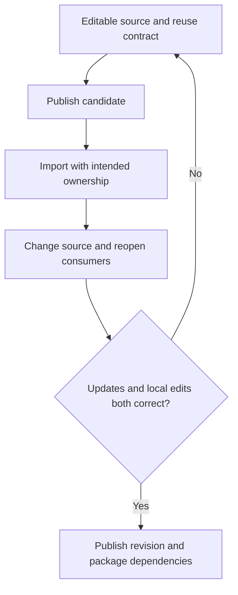

# Asset libraries: publish a reusable source and choose its update behavior

Use for Asset Browser organization, shared native assets and linked-asset updates. Start with
[modular design](modular-design.md) for the reuse boundary and [project handoff](project-handoff.md)
for portable delivery. A catalog entry is discoverable data, not evidence of finished geometry,
portable dependencies or suitability for every scene.

For a bounded known operation, use [linked override updates](techniques/linked-override-update.md)
or [Append/Pack snapshots](techniques/native-snapshot-ownership.md). They have different
ownership/update contracts; choose the relationship below when it is not already decided.

## Define the reusable unit

Choose the datablock that the consumer needs: an object/collection assembly, material, node
group, world or supported action/pose asset. A collection is often useful for a multi-part prop
or rig; a single material does not need an elaborate file hierarchy. Keep source-owned internals
and dependencies coherent, with shot placement, cameras and lighting outside the asset unless
they are intentionally part of it. Agree on scale, origin, orientation and exposed controls.

Keep a stable asset identity and a meaningful revision in the project's existing record. Give
the consumer a clear authoring source and published state. Before publication, try the asset
in a clean consumer with the intended import method; check scale/pivot, parameters, required
resources and a representative visual view. Record defects instead of hiding them in a preview.

## Select the relationship to the source

Inspect the installed Asset Browser/import API; names and defaults vary by version. The current
[Blender Asset Browser guide](https://docs.blender.org/manual/id/5.2/editors/asset_browser.html)
describes Link, Append and Pack. Older Append (Reuse Data) instructions are not a universal
description of current UI behavior.

| Consumer need | Route and consequence |
| --- | --- |
| Receive source updates; only shot placement changes | Link, often through a locally placed collection instance |
| Receive updates and retain supported local edits/animation | Link with a coherent Library Override hierarchy |
| Own an independent editable variant | Append; later library edits do not propagate automatically |
| Retain a fixed linked-data snapshot without a live source dependency | Pack where supported; inspect external resources separately |

Collection instancing is distinct from import ownership. Realizing an instance, making data
local or overriding it changes different relationships. Choose the smallest change that supplies
the required editability. Verify repeated import and mesh/material reuse rather than inferring
them from a button label. A packed linked asset is not automatically an editable local copy.
See [library preferences](https://docs.blender.org/manual/nl/5.2/editors/preferences/asset_libraries.html)
for defaults and online-library restrictions; do not change persistent user preferences merely
to run a disposable test.

## Make the asset findable

Mark the intended datablock as an asset, provide a useful description/tags and an honest preview,
then save the library. Preserve source/license attribution for reused third-party content.
Choose catalogs for the user's retrieval needs; tags can express cross-cutting traits.

Catalog identity is a UUID stored on the asset; the readable path is not a filesystem path or
an asset version. Retain the UUID when renaming/reorganizing a catalog. Save and deliver the
library's `blender_assets.cats.txt` alongside its blend files. Combining libraries requires
preserving catalog identities and resolving conflicts, not blindly replacing the destination
file. Check the selected library in Asset Browser, search/filter and inspect the actual preview;
successful `asset_mark()` alone does not prove UI discovery. See the
[catalog specification](https://developer.blender.org/docs/features/asset_system/backend/asset_catalogs/)
and [catalog saving](https://docs.blender.org/manual/id/5.1/files/asset_libraries/catalogs.html).

## Update linked consumers without losing local work

[Library Overrides](https://docs.blender.org/manual/en/latest/files/linked_libraries/library_overrides.html?highlight=library+overrides)
retain supported edits while unmodified properties follow the source. Keep related objects and
dependencies under a clear linked root. Override the necessary hierarchy rather than building
unrelated partial overrides. Not every property or Edit Mode operation is supported.

For a meaningful update test, use two consumer scenes with different placements or animation.
Change source geometry and, when relevant, add a hierarchy member. Reload/reopen consumers and
verify both propagation and preservation of local edits at multiple times. Check dependency
remapping as well as visible geometry. Preserve stable names/data identities when updates rely
on them; deleting/recreating a rig, socket or material can break consumers despite similar looks.

Hierarchy resync may remove conflicting overrides. Inspect warnings and compare with a saved
baseline before accepting the update. Resync Enforce can discard pointer overrides; it is a
recovery operation requiring a controlled copy and comparison, not a routine refresh button.
Test rig pose/animation and constraints when those are the actual consumer edits.

Use pinned releases where reproducibility matters; use a stable update path only when its
consumers are intended to follow revisions. Keep a recoverable previous release and a concise
compatibility/change note. Source editing and publishing are separate decisions. Blender Studio's
[publication/ownership model](https://studio.blender.org/tools/addons/asset_pipeline) is one
implementation; its add-on and task-layer layout are not required for ordinary projects.

Worked example: [linked updates and clean project relocation](techniques/clean-project-relocation.md).
Read the chosen card's evidence and limitations before adapting it.
