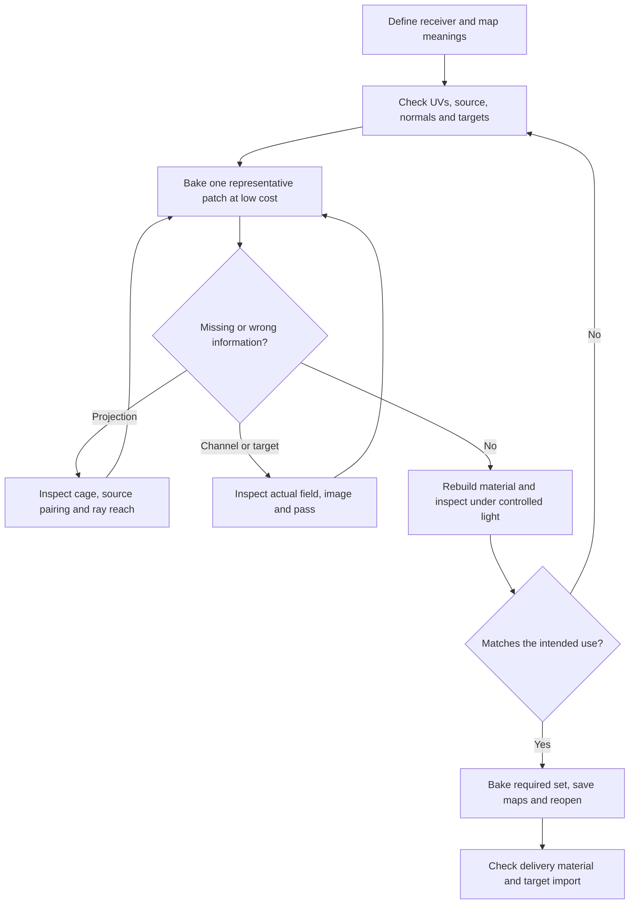

# Baking: transfer the intended surface information

Use when transferring high-resolution detail, flattening a procedural/material result into
maps, producing mesh maps for texturing, or delivering a supported texture set. Identify what
the receiver needs before choosing passes. Texture baking, applying geometry modifiers,
GN Bake and simulation caches are different operations. A material that can remain procedural
does not need a texture bake merely because baking is a production stage.

For surface design and painting use [texture authoring](texture-authoring-workflow.md);
for the receiving shader use [shader nodes](shader-nodes-workflow.md). This guide expects a
usable destination UV layout for image bakes. Use [UV layout](uv-workflow.md) for creation,
seam design, density and packing; check its required output below before committing a bake.

## Define the transfer contract

Record the meaningful choices in existing asset notes: source and receiver, geometry revision,
map roles, UV map/tiles, dimensions, channel meanings, color encoding, normal convention,
precision, padding, destination paths and intended renderer/importer. Include displacement
scale/midlevel or a deliberate lighting dependency when relevant. Constants do not automatically
need images, and a target's required channel pack is not necessarily the authoring format.

| Desired result | Route and limitation |
| --- | --- |
| Fine shape from another mesh | Selected-to-active projection to the receiver; keep enough receiver geometry for silhouette, depth and deformation |
| Existing procedural/material parameters | Sample the source parameter fields into the destination UVs; isolate each intended value from lighting and shader closures |
| Sculpt detail on one Multires object | Consider Bake from Multires; verify the low/high levels and supported scalar/vector displacement or normal output |
| AO, IDs or other authoring masks | Generate the maps the texturing approach consumes; choose geometry grouping and distance deliberately |
| Prelit surface or lightmap | Bake the requested lighting contribution with a compatible UV/use contract; document that changes to lights, geometry or placement can invalidate it |

An arbitrary Blender shader cannot generally be reduced losslessly to a basic PBR texture set.
Agree on the useful approximation for view-dependent effects, layered closures, transmission,
coat, SSS or procedural displacement; verify it in the destination. Blender's bake types and
projection controls are described in [Cycles baking](https://docs.blender.org/manual/id/5.2/render/cycles/baking.html).

## Make a small bake valid before scaling it

Use a patch that exposes the likely failure: a hard edge, deep recess, thin wall, close neighboring
part, mirrored region or multiple material slots. Save the source and settings before an expensive
bake. Bound texture count, tile count, image precision and geometry evaluated for rendering.
Memory includes working buffers and source geometry; compressed file size is not a RAM estimate.

The receiver needs the intended UV map, material assignment and evaluated surface. Check
zero-area islands, out-of-tile coordinates, overlap and padding against this bake's contract.
Intentional shared/mirrored UVs can suit repeated textures but cause conflicting unique bakes;
isolate competing writers on a derived bake setup. A high mesh need not have UVs for a geometric
normal bake, but its image-based source material needs working source coordinates.

Stabilize receiver topology, triangulation, UVs and split/custom normals for a tangent-space
normal bake. Keep them consistent in the exported receiver and importer. Do not triangulate or
apply every editable source blindly; use an appropriate derived version and compare it.
Split-normal edges commonly need UV separation for distinct samples and padding; every UV seam
does not need to become a hard shading edge. Inspect mirrored tangents in the target.
See [baking visualization](https://experienceleague.adobe.com/en/docs/substance-3d-painter/using/baking/baking-visualization-settings)
for explicit hard-edge/seam diagnostics, and [modifiers](modifiers-workflow.md) for derived geometry.

For a concrete operation, start with [image targets](techniques/bake-image-target.md),
[high-to-low projection](techniques/bake-projection.md), or [raw field transfer](techniques/bake-field-transfer.md).
These small examples avoid loading the historical whole-scene fixture.

## Control the actual image destination

For Cycles image baking, make the receiver active and select only the intended source/receiver
set when using Selected to Active. Verify mode and visibility/evaluation state rather than
assuming the Outliner's appearance defines participation. For a self-bake, turn projection off.

Assign the intended writable image to the **active and selected Image Texture node in every
receiving material being baked**. Selecting an image in the Image Editor or changing the active
object is not sufficient. In Blender 5.0+, node selection matters explicitly; see
[5.0 rendering changes](https://developer.blender.org/docs/release_notes/5.0/rendering/).
Use temporary top-level target nodes where nested materials make the destination ambiguous.
They need not feed the visible shader. Keep the destination image out of the source being
sampled; otherwise a circular dependency can replace the intended content with feedback.

Use separate images for distinct maps/sets unless sharing is deliberate. Clear for a fresh bake;
when accumulating disjoint contributions into one atlas, clear once and preserve prior regions
on subsequent passes. Account for their padding too. Test an actual second material/region or
UDIM tile before expanding a batch. An image named with `<UDIM>` is not proof that all required
tiles were created, written and reloaded. Inspect warning text and occupied pixels even after
the bake operator reports success.
Do not use alpha alone to prove coverage: a skipped region can still be opaque. Compare known
expected regions and values in the relevant channels, allowing legitimate zero-valued content.

When scripting, set or inspect the bake operator's relevant settings explicitly, including UV
override, pass filter, target, clear state and projection. Scene settings, operator arguments and
an existing UI context can differ. Do not reuse sticky settings accidentally. Consult the live
operator RNA and [BakeSettings](https://docs.blender.org/api/5.2/bpy.types.BakeSettings.html).

## Resolve projection locally

Inspect the source and receiver together, including their scale, pose and surface directions.
Choose ray reach or an explicit cage that covers the intended high surface without sweeping
through another part. Increasing distance globally can replace misses with incorrect hits.
At a stubborn corner, inspect the projection direction and geometry; more samples cannot fix it.

A custom cage must retain the receiver's required topology/order correspondence; make it from
the correct receiver revision and move its surface without remodeling its topology. Inspect
concavities and intersections. Keep cage data and pairing reproducible. Temporary separation
or per-part bake sets can prevent cross-projection; do not silently change the final assembly.
For contact AO, isolation changes the meaning of the result, so choose occluders separately.
External bakers may offer name matching or skew correction; do not assume Blender implements
their selection rules. [Adobe's common baker parameters](https://experienceleague.adobe.com/en/docs/substance-3d/bakers/bakers-settings/common-parameters)
and [mesh-map settings](https://experienceleague.adobe.com/en/docs/substance-3d-painter/using/baking/mesh-map-settings)
explain these alternatives; no external application is required by this workflow.

## Bake values according to their meaning

| Map | Useful setup and acceptance check |
| --- | --- |
| Base color | Transfer the intended unlit color. Diffuse Color with direct/indirect disabled is useful only where it represents the material; do not assume it recovers the authored base color of metals or arbitrary shader mixtures. |
| Roughness / metallic / masks / opacity | Transfer the resolved scalar field. A roughness pass may suffice; an isolated field-to-Emission transfer is useful for an explicit parameter or mask. Check numeric values, not just a grayscale thumbnail. |
| Tangent normal | Use the normal bake's space and axis convention; reconstruct through Normal Map with the same UV basis. Validate +Y/-Y once across baker, image and importer, with no duplicate green inversion. |
| Height / displacement | Specify what distance or offset is encoded, its space, zero/midlevel and units. Use sufficient precision for the range. Vector displacement is not a tangent normal map. Test actual displacement and bounds. |
| AO / curvature / IDs | Treat as geometry-derived inputs or target-defined channels. Preserve categorical IDs without destructive color transforms. Decide contact scope and distance; AO is not automatically part of base color. |
| Combined / lighting | Treat as a deliberately prelit output. It is not a general substitute for base color, and relighting can double-count illumination. |

For field-to-Emission transfer, route the actual color/scalar field into a unit-strength Emission
on a temporary source-material copy and bake Emit. Reconstruct masks/mixes upstream if necessary;
connecting a whole BSDF closure is not the same operation. Restore source outputs afterwards.
This is a workflow option, not a mandatory replacement for supported passes.

Set image interpretation for its role before baking and after loading: color encoding for
colors, Non-Color for numeric maps. Keep view transforms/exposure out of material data exports.
Use a known patch to check numeric transfer in a declared space; raw pixel buffers may differ
between image types and loading stages. See [image save/color settings](https://docs.blender.org/manual/ar/5.2/files/media/image_formats.html).

Padding must support filtering and the intended downsample/mip range; there is no universal
pixel margin independent of resolution, island spacing and target usage. Compare Extend with
Adjacent Faces where appropriate. Inspect a reduced-size textured model, not only full-size
islands. Clean misses and wrong hits before raising sample count/resolution. Increasing samples
can reduce stochastic noise, but does not repair wrong normals, a wrong target or projection skew.

## Save and prove the receiving result

Save or deliberately pack each modified image, then save the blend. A saved scene is not proof
that external image edits were written. Reopen the saved maps and construct the receiving
material from those files, hiding the source geometry. Inspect a close view, grazing highlights
and the intended viewing distance; compare with the source under the same light. A normal map
cannot reproduce missing silhouette, geometric occlusion or parallax by itself.

| Visible failure | First useful distinction |
| --- | --- |
| Black, unchanged or incomplete regions | Wrong image/material node, source visibility/selection, clear behavior, no valid UV coverage or projection miss; a legitimate zero value is not automatically a failure |
| Foreign detail or streaks | Neighboring source hits, cage intersections, ray direction/reach, skew or overlapping writers |
| Seams under moving light | Tangent/triangulation/normal mismatch versus UV filtering/padding; inspect each independently |
| Color or roughness changes after reload | File encoding, data interpretation, channels, view transform accidentally baked, or stale/unsaved image |
| Detail absent in final view | Insufficient pixels, filtering/compression, normal convention or missing geometric support |

Retain editable high/source materials, receiver, projection setup and maps needed to reproduce
the result. Changes to topology, UVs, shading normals, source fields or projection can invalidate
affected bakes. Check files/tiles, channel semantics and target import where requested; state
which of those checks were actually performed. Reopening in Blender alone is not exporter validation.

Worked example: [a measured high-to-low bake](techniques/bake-projection.md).
Read the chosen card's evidence and limitations before adapting it.
