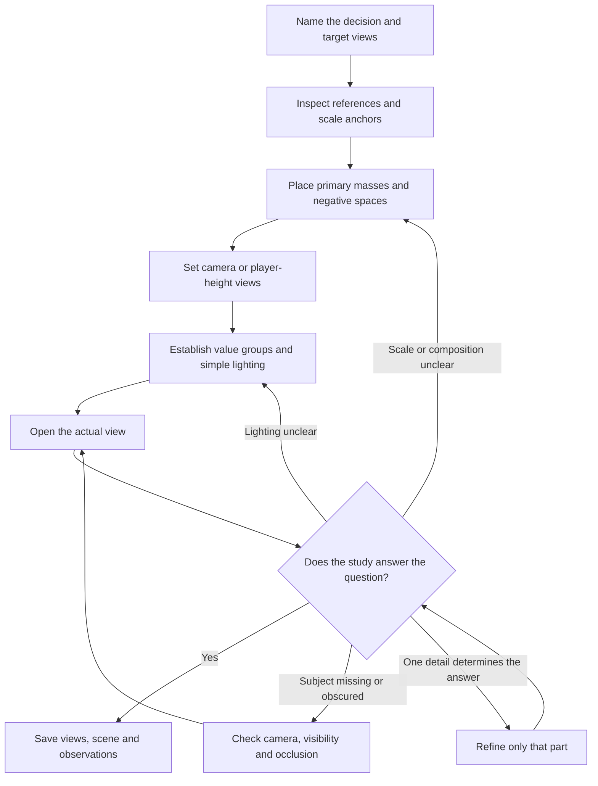

# Blockout, camera and light as a deliverable

Use when testing a scene idea, proportion, layout, framing, traversal or mood. State which
decision the study must support and which views are needed. Fidelity should be sufficient to
answer that question; a convincing graybox can complete the task.
For production light/camera refinement use [lighting](lighting-workflow.md); for engine,
quality and output problems use [rendering](render-workflow.md). These branches become useful
when their decisions matter, not automatically after a completed blockout.

## Build only the informative geometry

Use mesh primitives for volumes, simple profiles/curves for paths, and instances for repeated
rhythms. Establish real dimensions and a familiar scale anchor before detail. Give functional
areas meaningful names, including circulation, openings and clearance envelopes when relevant.
Preserve the negative spaces: a room's empty volume and a vehicle's wheel gaps can define its
readability as much as its solids.

Edit Mode extrusions/insets can establish an architectural shell quickly; Mirror or repeated
instances can test symmetry and spacing. Use rough sculpt masses for organic silhouettes.
Choose which objects need to be separate for convenient change; do not turn a proxy into a
production asset library merely to obey a hierarchy. Leave small hardware, dense bevels,
finished topology and final UVs out unless they decide the assessment.

Execute and save a small useful layout before authoring the rest of its generator. For an
architectural study, a shell, representative opening and named view can establish that first
checkpoint; extend it with room divisions, furniture envelopes and the checks the brief needs.
Keep both the save and its first view independent of a newly written validation suite:
a checker failure should leave an inspectable scene/image and an explicit unverified check.
Parse a generated Python stage before running it, then inspect its actual saved view before
expanding construction. If custom checks keep growing, capture the checkpoint's view before
adding another checker; a camera object in the file is not a reviewed image.
For an engine/API uncertainty, use the [scoped diagnostic route](api-diagnostics.md#choose-the-smallest-discriminating-check)
when it blocks this view. Surface graphs, leaf libraries and full populations can follow the
working checkpoint when required by the requested finish.

For a defining asymmetric prop, mark its front and attachment face on the proxy. Check the
visible front/side balance against the reference before adding hardware; a plain cube can
hide a wrong orientation until late detailing.

## Establish the viewpoint deliberately

For a photo/concept match, establish image aspect ratio, camera height, focal perspective and
framing before distorting geometry to match pixels. Use an orthographic camera for a dimension
or silhouette comparison when appropriate; use perspective for the intended spatial experience.
For free-view environments, inspect representative player paths and reverse views as well as
the hero angle. A successful fixed shot does not establish a reusable 360-degree asset.

Keep named cameras/views for comparable iterations. A tracking constraint with an Empty target
can make camera aiming editable; inspect orientation and roll. Check near/far clipping and
occlusion before diagnosing missing geometry. Keep depth of field and motion blur conservative
during layout review so they do not conceal fit and proportion errors.

## Use lighting to test the scene

Separate a neutral form-check setup from the intended mood when needed. Workbench/material
preview can assess silhouette and value grouping, while a quick EEVEE or Cycles render tests
actual scene lights and materials. Choose according to the question and available hardware;
record the renderer, view transform, exposure and output size for meaningful comparisons.

Start with the dominant light direction, broad shadow masses and a restrained palette. Area
lights help evaluate broad highlights, a Sun can test directional outdoor light, and a World
setup can establish environment contribution. Introduce additional lights to answer a visible
problem or support the reference, rather than brighten every dark area. Use rough material
families when glass/metal or emission is essential to the assessment; no unique texture set
is needed simply to distinguish categories.

## Architectural layout studies

Use the focused [architectural layout route](architectural-layout.md) for apartment/house
plans, floor levels, readable sections, occupied routes and stairs. It connects the first
shell sample and saved view to the existing topology/fit probes before expanding the layout.

## Review and stop at the intended level

Inspect the target image at presentation size and a diagnostic view for scale/layout. Compare
focal hierarchy, silhouette, proportions, light direction, readable paths and major overlaps
against the brief/references. Measure only what affects the decision, such as doorway width,
camera clearance or overall size. Fix the largest uncertainty before adding secondary detail.

Deliver the editable study, relevant saved images and a short account of what it establishes
and what remains an assumption. Label proxy geometry and temporary materials clearly. Reopen
the saved study and verify the required views/resources. A study can be complete without
passing criteria intended for a final asset kit, texture bake or engine release.

## Video reference to a bounded storyboard

Agree or choose a small panel budget that fits the requested interval and decisions. Separate
three costs: source images extracted/viewed, final storyboard panels, and rendered preview or
control frames. Six panels can describe a short sequence without limiting its animation to
six images. Keep this budget task-specific; do not impose that number on every video.

Inspect clip timing, aspect and cuts before building. Start with a sparse overview and use the
remaining inspection budget near action changes, contact, occlusion and shot boundaries.
Choose panels for those events rather than equal spacing alone. For each keep source index/PTS,
shot, visible action/camera evidence and the corresponding scene time. With rational or variable
frame rates, use actual timestamps/time base; distinguish zero-based source indices from scene
frame numbers. State any resampling and its timing error.

Treat a hard cut as an edit between views, not an interpolated camera move. Camera markers or
separate shot scenes can express this; test the last sample before and first after the cut.
If a proxy uses a shot-specific pose/scale adjustment to match a view, keep it confined to that
shot. Interpolation toward the next shot's adjustment can corrupt the preceding shot even when
both selected panels look correct. Check adjacent samples and subframes after such a change.
Native [camera markers](https://docs.staging.blender.org/manual/en/latest/animation/markers.html)
can switch the active camera. Within each shot, distinguish actor motion from camera movement.
An uncalibrated camera match is an approximation; unseen geometry and physical scale remain
assumptions. A useful fixed-view prototype need not claim a solved camera or complete character.

Build the dominant masses, framing and pose before secondary detail. Retain small features
when they determine identity or action: a crown silhouette, gaze proxy or hand contact may
matter more than the background's ornament. A whole-character tilt can move planted feet
through the floor; separate support from the moving body when the observed action requires it.
Check contact and occlusion through the motion, including from a second diagnostic view, while
comparing the actual reference/prototype at matched times and aspect. A technically reproducible
scene can still miss the shot's composition or action.

## Gray prototypes as neural-rendering inputs

Identify the intended consumer when known: gray video, depth, edges, pose, masks and reference
appearance are different inputs. Model-specific frame counts, dimensions and conventions belong
to that handoff. Without a selected consumer, deliver an editable study and clearly described
generic guides; do not claim that a particular neural workflow has been tested. Official
[control-video examples](https://docs.comfy.org/tutorials/video/wan/fun-control) illustrate why
the control sequence's frame count must match the requested generated sequence.

Keep gray RGB, depth and masks aligned in camera, time, crop and resolution. Use the
[pass/matte guide](compositing-passes-and-mattes.md) for data semantics. State depth definition,
units, valid/background values and any fixed display mapping; per-frame normalization can make
an unchanged distance vary across a clip. Retain useful raw data separately from a visualization.
Keep categorical IDs stable, provide their lookup and avoid color transforms or interpolated
resizing that invent IDs. An object-label palette is not automatically a model's semantic palette.

If producing guides with a custom geometric sampler, match the rendered evaluated geometry,
camera/clipping and visibility. Prefer its evaluated loop triangles over independently
triangulating nonplanar polygons; validate sample rays/IDs against the scene and inspect edges.
State sampling differences from an antialiased gray render. Do not derive depth from gray
brightness or treat the mere existence of a map as proof of alignment.

Label sparse key-panel guides as sparse. A complete control video may require the same data
for every output frame and separate processing per shot. Reopen the saved prototype, rerender
non-sequential moments and verify a meaningful control change before handoff. Actual neural
generation, temporal consistency and consumer import remain separate checks when requested.
