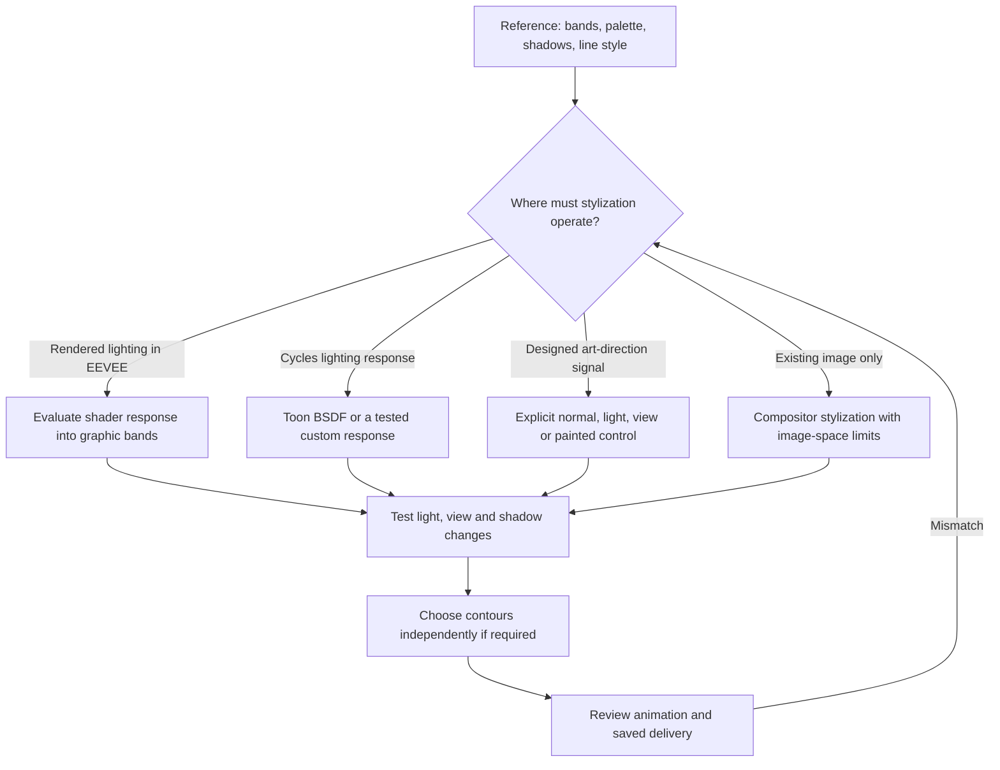

# Cel shading and graphic contours

Use for cel/toon shading, graphic light bands, stylized highlights and outlines. Start with
[shader nodes](shader-nodes-workflow.md) for material fundamentals and
[compositing](compositing-workflow.md) when finishing rendered images. Cel shading is an art
direction with several implementations; a constant Color Ramp is one tool, not the definition.

For the EEVEE band route, use [neutral signal → palette](techniques/cel-palette-bands.md); for line weight, use [independent contours](techniques/freestyle-contours.md). These short mechanisms do not require loading a whole character builder.

## Define the look and where it must work

Actually inspect [visual references](reference-workflow.md). Extract the intended light/shadow
shapes, palette, transition hardness, highlight treatment, contour hierarchy and treatment of
cast shadows. Distinguish a few flat bands from painterly gradients, rim lighting or a final
posterization effect. Define renderer, camera range, motion, resolution and target delivery.
One pleasing still does not establish a relightable or temporally stable toon material.

| Route | Useful control | Important boundary |
| --- | --- | --- |
| EEVEE Shader to RGB | Convert a chosen BSDF's lighting response into colors/bands, often with a Constant ramp | EEVEE-specific; use verified Combined output rather than assuming ordinary lobe-pass reconstruction works |
| Cycles Toon BSDF | Designed diffuse/glossy angular response, Size and Smooth | Cycles-specific; not an automatic exact N-color palette or an equivalent replacement for an EEVEE graph |
| Authored signal such as normal dot light direction | Stable, explicit artistic thresholds independent of renderer light evaluation | Coordinate spaces and light direction must agree; this signal alone has no occlusion, cast shadows, attenuation or indirect light |
| Compositor quantization/edge treatment | Restyle a delivered image or a purpose-rendered signal | Final luminance mixes surface color, lighting, texture and exposure; it cannot reliably recover each of those from beauty |

Prove the selected route in the installed engine before decorating the graph. Do not switch
renderers and assume identical appearance. If a reusable target shader is needed, implement
and validate the corresponding logic there; baking one view/light state cannot preserve
arbitrary relighting or view-dependent bands.

## Rounded, restrained cartoon characters

When the brief calls for smooth, simple forms, prioritize silhouette, connected volumes,
large color regions and readable shadow shapes before small details. Check the face in profile
as well as the hero view: attached cheek or muzzle patches can conceal an unresolved head
volume. Use surface color/masks for markings; add geometry when relief or silhouette needs it.
This is a conditional art direction; angular or faceted references call for different choices.

Allocate geometry to visible curvature, expression and any required deformation. A low-poly
budget does not itself require a faceted appearance. Judge the evaluated silhouette and cost,
including modifiers; smooth normals alone cannot repair a polygonal outline or self-shadow.
Keep a compact control mesh when useful, and disclose any increase in evaluated triangles.

Inspect neutral/clay forms, flat color regions and then cel bands at delivery size. If bands
break into unwanted small patches, isolate normal interpolation and cast/self-shadow response
before adding detail or adjusting palette. Compare a changed surface under the same light.
Technical checks of closed geometry and working thresholds do not establish expressive design
or artistic acceptance.

## Separate the signal, palette and response

Choose what drives the thresholds: neutral diffuse lighting, a weighted contribution, painted
regions or an authored direction field. Feeding differently colored base materials into the
lighting signal can move their band boundaries; decide whether that is intended. Keep palette
selection distinct when different surface colors should share the same light thresholds.

Expose meaningful controls: ordered thresholds, shadow/midtone/light colors, transition width,
highlight/rim strength, contour selection and width. Test one threshold change and its image,
not merely a successful socket write. Keep reusable groups explicit about coordinate space,
normal source, expected value range and renderer. A normal-map detail can fragment bands; use
the normal that serves the designed shapes rather than automatically sharing every microdetail.

For EEVEE, one useful candidate is a neutral lighting BSDF → Shader to RGB → band selection →
an output that preserves the chosen colors. Feeding an already lit band result into another
diffuse response can shade it again. Treat this as a decision to test, not a mandatory recipe.
Move a real light and an occluder: if shadows are required, verify actual cast/self-shadow
behavior rather than inferring it from a normal-dot-light calculation.

Judge the palette under the intended view transform and saved output. AgX/other views, exposure
and tone mapping can change apparent palette relationships. Preserve the project's color
contract; choose a display treatment deliberately rather than compensating arbitrary colors
until one Viewer looks right. Antialiasing and filtered edges create intermediate pixel colors
even with discrete interior bands; counting all unique output RGB values is not a band test.

## Choose outlines separately

| Method | Can fit | Check in the actual shot |
| --- | --- | --- |
| Freestyle | Rendered silhouettes and selected crease/material/edge lines with line styles | Renderer/build support, active line set/style, selected edge types, visibility/occlusion, final-render cost and line pass integration |
| Grease Pencil Line Art | Editable/stylized generated strokes from objects/collections, with camera-dependent visibility | Source collection, active/custom camera, stroke material, line types, occlusion, depth offset and bake ownership |
| Inverted hull / expanded backface shell | A geometry-based silhouette effect | Face direction, backface handling, modifier order, deformation, intersections and unwanted shadow/occlusion contribution |
| Compositor edges from suitable depth/normal/masks | Image-space line effects or a delivered plate | Which boundaries the signal actually describes; depth discontinuities, texture/noise contamination and missing hidden surfaces |

Measure line weight at the intended resolution and camera distance. World-space thickness is
not fixed pixel width. A hull outlines silhouettes but does not automatically draw designed
interior feature lines; it can close small gaps and alter contacts. Keep it independently
disableable and avoid treating the graphic shell as the asset's physical collision geometry.
Use [modifiers](modifiers-workflow.md) and [surface checks](modeling-workflow.md#surface-quality-and-handoff)
for its evaluated geometry. A deliberate one-sided graphic surface still needs correct
orientation and visibility; blindly fixing all normals or adding thickness can break the effect.

Inspect outlines alone and over the shaded result. Prevent double lines if multiple routes
overlap. If lines disappear or the renderer reports degenerate triangles, inspect evaluated
geometry at thin parts and bevels before compensating with line width or sampling. A source
mesh can look plausible while its modifiers collapse small faces.
For GP Line Art, a camera/source change can invalidate a baked result; preserve manual
strokes when clearing caches. Probe current Grease Pencil interfaces rather than using old
`gpencil` API recipes. See [recent features](recent-blender-features.md).

## Validate movement and handoff

Use the subject, light and camera changes that matter to the brief. Include neighboring frames
around a band crossing, shadow edge, occlusion change and thin contour. Distinguish deliberate
band transitions from unstable thresholding of noisy shading; inspect a held pose as a control
when needed. Improve the signal/sampling or line design before applying temporal blur that
destroys the intended graphic edge. Do not accept jumping segments because sampled keyframes
look correct, or demand that a moving boundary remain static.

Deliver effect-off comparisons for meaningful boundaries, such as contours off or an ungraded
render. Reopen the saved file, evaluate non-sequential frames, and test an exposed control.
Confirm the final sequence, frame rate, filenames and view transform. A preview video alone
does not preserve source geometry, editable material/line settings or compositor inputs.

State which renderer and contour route were exercised, what survives the intended export,
and whether animation was actually inspected. Guidance on other routes is not proof of their
equivalence or tested support.

Primary sources: [Shader to RGB](https://docs.blender.org/manual/id/5.2/render/shader_nodes/color/shader_to_rgb.html),
[EEVEE node support](https://docs.blender.org/manual/sr/5.2/render/eevee/limitations/nodes_support.html),
[Toon BSDF](https://docs.blender.org/manual/it/5.2/render/shader_nodes/shader/toon.html),
[render-pass limits](https://docs.blender.org/manual/en/latest/render/layers/passes.html),
[Freestyle controls](https://docs.blender.org/manual/en/latest/render/freestyle/render.html),
[Line Art](https://docs.blender.org/manual/en/4.4/grease_pencil/modifiers/generate/line_art.html)
and [5.2 Grease Pencil changes](https://developer.blender.org/docs/release_notes/5.2/grease_pencil/).
Older conceptual documentation does not establish current API compatibility; see
[provenance](provenance.md) for the recorded tests and remaining limits.

Worked example: [cel palette bands](techniques/cel-palette-bands.md).
Read the chosen card's evidence and limitations before adapting it.
