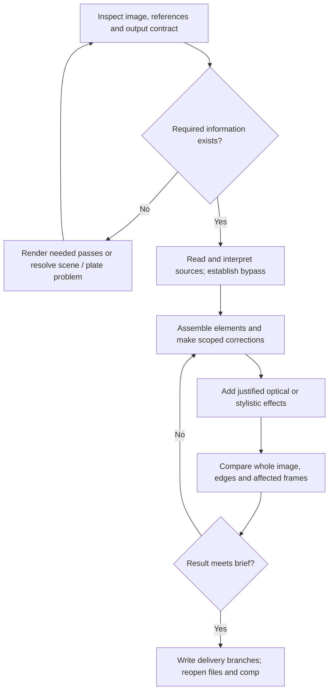

# Compositing: develop and deliver the shot

Use this branch for assembling rendered/photographic elements, selective corrections, image
effects and final image delivery. It can start from an existing image or sequence without
rebuilding the scene. For channels, mattes or beauty reconstruction, also read
[passes and mattes](compositing-passes-and-mattes.md). Use [rendering](render-workflow.md) when
the required information must first be rendered, and [lighting](lighting-workflow.md) when
the correction needs different light transport or camera behavior. For chroma keying, tracking
or plate integration, use [footage integration](footage-integration-workflow.md). For a cel/toon
look, use [cel shading](cel-shading-workflow.md) to choose material versus image-space treatment.

For a concrete Over or object-grade operation, go directly to [alpha](techniques/alpha-over.md) or [Cryptomatte exposure](techniques/crypto-local-exposure.md).

## Establish the image contract

Inspect the supplied beauty/plate and applicable [visual references](reference-workflow.md).
Identify what should change and what should remain recognizable: subject colors, focal
hierarchy, contrast, highlight roll-off, background, atmosphere or a particular optical effect.
Use a bypass image under the same viewing transform for comparison. A technical pass test
needs a known input/output, not an unrelated mood board; a new look needs visual evidence.

Check the actual source: resolution, pixel aspect, crop/data window, frame range/rate, camera,
layer/pass names, working color space, alpha interpretation and dependencies. A loaded image
is not necessarily the intended frame, layer or view. Decide whether delivery is an opaque
finished shot, a reusable RGBA element, scene-linear intermediate, display-ready still, or
sequence. These outputs can need different branches of the same graph.

The order follows image dependencies, not a mandatory stack. A simple exposure correction
may be the whole task. A background integration may need camera matching, mattes, shadow
elements and a color match before finishing. Do not enable every render pass or effect.

## Work in deliberate color spaces

Interpret color inputs using their actual encoding and convert them into the chosen working
space. Blender's usual compositor work is scene-linear; a camera log plate needs its proper
input transform, not an arbitrary gamma. A display-referred reference is useful for visual
comparison but does not contain the original scene radiance. Mark masks, depth, vectors and
IDs as data; never apply a view transform or creative grade to them.

Keep the scene/display view consistent while judging the look. Scene exposure, a compositor
Exposure node and display exposure operate at different boundaries; record which one changes
the delivered pixels. Preserve HDR values for scene-linear lighting operations and glare.
Clamping before them can remove the information they need. Nonlinear grades can require
unpremultiplication; see the alpha checks below.

Separate an un-view-transformed EXR branch from display delivery when both are requested.
Prefer the scene/File Output color-management controls where they express the required
transform. A manual conversion node can be useful for a specific interchange, but prove
that neither the writer nor recipient applies that transform again. Inspect reopened saved
pixels and file metadata/settings; a plausible Viewer image does not prove correct export.

## Compose readable operations

Use named frames/groups for useful boundaries such as input interpretation, assembly, local
corrections, optics and delivery. Expose controls that correspond to the look: exposure in
stops, matte selection, effect strength, background color or focal distance. Keep a bypass
and relevant diagnostic outputs. A reusable group has an explicit color/alpha/data interface;
copy it deliberately when a shot needs independent edits rather than silently changing users.

| Need | Useful tools / decision | Check |
| --- | --- | --- |
| Composite a foreground over a plate | Alpha Over with known premultiplication; transform/scale with a defined canvas | Edge halos on bright and dark backgrounds; crop, pixel aspect and fractional alpha |
| Adjust global or local response | Exposure, Color Balance, curves or a targeted color operation; Cryptomatte/AOV/painted mask where needed | Neutral and saturated surfaces, clipping, protected regions and mask boundaries |
| Change an existing light contribution | Available Light Group passes or a correctly reconstructed lobe | Shadows, indirect/reflected contribution and noise; large relights may require rendering |
| Add bloom, streaks or other lens response | Glare driven by appropriate HDR highlights; tune at final image scale | Highlight source is justified; effect survives bypass comparison without washing out the subject |
| Add depth atmosphere or blur | Mist/Z and a purpose-specific mapping; Defocus/Vector Blur only with valid inputs | Silhouettes, transparent surfaces, occlusions and consecutive frames; 2D passes lack hidden geometry |
| Integrate live-action footage | Track/camera match, key or roto, despill and edge treatment as appropriate | Plate grain/sharpness, lens distortion, motion, contact/shadows and reflections |

Do not use a blanket AO multiply as a universal finishing step: the beauty already contains
occlusion from its lighting. A creative adjustment is possible, but inspect whether it doubles
darkening. Likewise, flat RGB tinting does not reproduce a different material's reflection or
transmission. Return to materials/light/rendering when the requested change needs new physics.

Choose one deliberate denoising boundary. Renderer-denoised beauty and raw lighting passes
are different inputs; independently denoising components changes their sum. For compositor
Denoise, use compatible noisy color and denoising auxiliary passes from the same render.
Inspect fine texture and temporal stability; do not denoise IDs or conceal under-sampling
with repeated filters. Confirm CPU/GPU support and precision for the actual nodes and output.

## Treat alpha as an interface

Blender compositor images normally use premultiplied RGB. For a foreground over background,
the associated-color relationship is `Cout = Cf + (1 - af) * Cb` and
`aout = af + (1 - af) * ab`. A generic Mix with alpha as factor is not automatically Over.
Do not multiply premultiplied RGB by alpha a second time, or declare straight data premultiplied
merely to hide a fringe. Check the source image's alpha mode and the operation's expectation.

For operations that need unassociated color, use Alpha Convert to straight, operate on color,
then convert back once; handle alpha zero without inventing edge color. A purely linear
exposure multiply can operate on premultiplied RGB directly. Set Alpha has different modes:
Apply Mask multiplies RGBA, while Replace Alpha changes alpha without multiplying RGB.
Choose from the input's actual state; when restoring the source alpha to already associated
RGB, applying it as a mask again darkens the edge. Neither mode by itself recovers missing
foreground color or repairs a mismatched matte. See
[Set Alpha](https://docs.blender.org/manual/ru/5.2/compositing/types/color/set_alpha.html).

Coverage masks and alpha may describe the same antialiased edge. Applying both as independent
cutouts can square coverage and darken/shrink it. For a local correction on a beauty, mix
original and corrected beauty by the intended selection; do not also replace its alpha with
that selection. Inspect semi-covered pixels and any overlap with other objects. If exact
separation is needed, render an isolated contribution rather than overclaiming a masked grade.
For an isolated foreground whose correction must extend equally to its silhouette, raw
coverage may underweight that correction again. A weight normalized by foreground alpha can
be appropriate, with a defined alpha-zero result. Verify it at edges; dividing by alpha cannot
separate different object colors already mixed together in the same pixel.

Glare can create light beyond an object's alpha. For a finished opaque shot, composing the
element into the intended background before the optical effect is often appropriate. For a
reusable element, agree on coverage versus additive emission and the receiving compositor;
an RGBA export can lose RGB where alpha is zero. Test it over different backgrounds instead
of forcing alpha to one or increasing the matte without checking the resulting silhouette.
Glass/refraction and volume integration also depend on the original background/lighting:
Film Transparent alone does not make those contributions freely replaceable.

## Verify the saved result

Compare bypass and final at the same view transform, then inspect representative edge crops
at actual output resolution. Verify the selection, protected areas, highlight detail, alpha,
noise and resampling. For animation, inspect adjacent frames as well as key moments for
matte flicker, grain/denoising changes, pumping, missing frames and frame-offset mistakes.

For sequences, distinguish scene/shot frame numbers from source-file numbering. Verify the
input's sequence mode, start, duration, offset and intended looping/refresh behavior; sharing
an image datablock does not prove that Image and Cryptomatte nodes use the same frame mapping.
Read back or inspect the actual first, middle and last source frames, including a non-default
shot start when applicable. Test a late frame after an earlier one and in a fresh session.
A duration set to one can leave a convincing but frozen image; a label or moving overlay does
not prove that the plate and its matte advance. See the
[Image node](https://docs.blender.org/manual/ja/5.2/compositing/types/input/image.html).

Confirm that writing multiple frames creates distinct intended files without overwriting
previous frames. Check count, names, range, dimensions and representative contents before
encoding a preview. Rendering the animation operator, repeatedly rendering single frames and
File Output naming can differ; prove the chosen route with a short range. A video encoder
reading the wrong start number or frame rate can hide missing files or change timing.

Save the editable graph and its inputs. A Render Result/Viewer buffer is not a persistent
source after restarting Blender. Keep the originating scene reproducible or explicitly save
the required passes as files, and prove that the comp reads the intended saved inputs.
Use stable paths and distinct output names; avoid overwriting the source or previous good
output during review. Relative image paths resolve against the blend location: establish that
location before switching an already loaded source to a relative path. Reopen in a fresh
process and evaluate the comp from its delivered
dependencies. Check actual dimensions, channels, bit depth, frame numbering, alpha and color
interpretation in the resulting files; a File Output node can write separately from the
scene render path. Test a representative changed control, then restore the approved value.
Compare decoded pixels under the same interpretation when checking image reproduction;
metadata can change file hashes without changing pixels. Keep hashes for source identity.

Report the source and output contract, corrections/effects, saved editable comp, verified
files and unresolved limitations. Tracking/keying, deep compositing, HDR mastering and
editorial conform require their own task-specific validation; this guide is not proof of them.

## Version-sensitive implementation

Blender 5.0 made the compositor a separate reusable node-group datablock. Its active Group
Output's first input must be Color; a Viewer alone is not final output. Scene copies can
share this group. File Output and many node options changed API; inspect the installed
sockets/properties instead of pasting a 4.x recipe. See
[recent features](recent-blender-features.md) and the official
[5.0 migration notes](https://developer.blender.org/docs/release_notes/5.0/migration/compositor_migration/).
The [5.0 compositor notes](https://developer.blender.org/docs/release_notes/5.0/compositor/)
explain the color-management changes. Alpha conventions are covered by
[Alpha Over](https://docs.blender.org/manual/en/4.4/compositing/types/color/mix/alpha_over.html)
and the current [Image settings](https://docs.blender.org/manual/en/latest/editors/image/image_settings.html);
use the installed version's controls, not historical socket indices.
For effect controls, consult [Glare](https://docs.blender.org/manual/sr/5.2/compositing/types/filter/glare.html)
and [Denoise](https://docs.blender.org/manual/en/5.2/compositing/types/filter/denoise.html).
