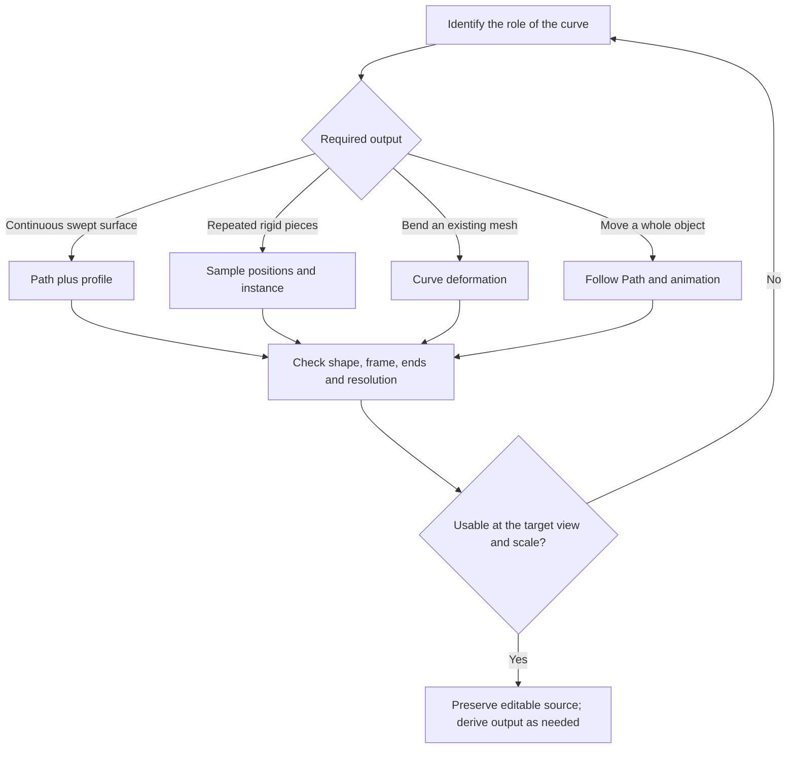

# Curves, profiles and path-driven models

Use when a shape is best controlled by a trajectory, contour or cross-section. Keep control
shape, evaluated sampling and final mesh density as separate decisions. Read
[procedural bounds](procedural-geometry.md) for limits and measurement rules.

## Draw the control shape

Choose Poly for intentional straight segments/corners, Bézier for art-directed tangent control,
and NURBS for a weighted rational shape when that representation helps. Use a NURBS surface
only for a genuine U/V patch problem; curve operations do not automatically support surfaces.
Identify whether the source is a legacy Curve datablock, a Curves geometry object or geometry
generated inside GN; their editing tools and Python data APIs are not interchangeable.

Start with a few meaningful points and compare orthographic and oblique views. For Bézier
curves, select handle types intentionally: Vector can preserve a corner, aligned handles
maintain a shared tangent, and automatic handles may introduce an unwanted overshoot. Adjust
tangents before adding many points. For NURBS, check order relative to point count, weights,
endpoint/cyclic behavior and the evaluated shape; weights are shape controls, not resolution.
The evaluated curve need not reach its first/last control point without suitable endpoint
behavior. Choose the spline for the shape and attachment requirements; point count alone
does not justify silently switching a path to NURBS.

For cables/rails or a modeled stream, establish attachment points, directions and clearances;
include bend radius and slack where appropriate. Measure both evaluated ends against their
intended contacts after sweeping and after any conversion. Checking control-point coordinates
alone can miss a shortened path. Inspect actual caps where closure is required; an enabled
cap option does not establish a closed result.
Check the swept approach and bends against nearby surfaces, including the profile radius;
an endpoint inside its fitting does not prove the intervening route stays outside a wall.
Inspect the attachment in the target view and a diagnostic view. A curve hidden inside its
support can look disconnected even though its endpoint coordinates are correct.
For a closed contour, inspect closure and tangent continuity. Reversal of spline direction can
change profile orientation, UV direction, caps and travel; keep it intentional.

## Sweep a profile

For an open Bézier path and an editable closed section, the [editable sweep](techniques/editable-sweep.md) helper builds the curves, radius/tilt controls and capped Geometry Nodes output.

A legacy curve bevel/profile can suit a simple editable tube. The **Curve to Tube** asset
modifier can provide profiles, caps and UV generation when available. For custom rules, use
Curve to Mesh with an explicit profile and the radius/scale behavior needed by the design.
Choose a planar profile with an intentional local origin; asymmetric profiles reveal twist.

Adjust the path frame/normal and tilt where needed rather than increasing tessellation to
hide an orientation error. Inspect inflections, steep segments and closed seams for flips.
Test one bend and its end treatment before extending the whole route. Sweeping multiple
intersecting paths does not automatically create a sound pipe junction; model a junction asset
or resolve the intersection explicitly if it is visible/functional.

Control path samples and profile sides independently. A resample Count can establish a
predictable output count; Length/automatic modes need additional bounds. High path resolution
cannot fix a visibly polygonal profile, and high profile resolution cannot fix a kinked path.
Round/custom caps and joins need their own cost allowance.

Choose UV behavior to suit the surface: normalized coverage for a designed graphic or a
distance-based scale for repeated texture. Check visible stretching, end caps and profile seams.
See [Curve to Tube options](https://docs.blender.org/manual/id/5.2/modeling/modifiers/generate/curve_to_tube.html);
inspect the asset actually installed before scripting its settings.

## Repeat, deform or move: use the appropriate relationship

For rigid posts/ties/links, sample a curve and instance pieces with a tangent-based orientation
and an intentional up direction. Check spacing, endpoints and whether pieces should rotate
rigidly or bend. Keep their source geometry shared. An Array followed by Curve deformation
is another useful pattern when the pieces should deform along the path.

For the **Curve modifier**, align the mesh's intended deformation axis with the curve setup,
check relative origins/transforms, and provide enough longitudinal geometry to bend. Inspect
the undeformed source and a diagnostic axis before compensating with arbitrary rotations.
See the [modifier manual](https://docs.blender.org/manual/en/4.2/modeling/modifiers/deform/curve.html)
and verify the matching runtime behavior.

For a whole vehicle/camera traveling without deformation, use **Follow Path**. Choose curve
Evaluation Time or the constraint's normalized Offset Factor as the motion control; keep the
owner's offsets and distinct forward/up axes deliberate. Review roll and target tracking.
Route to [animation](animation-workflow.md) for speed, timing and temporal checks. A normalized
parameter alone should not be assumed to give the intended speed profile.

## Verify the source and derived result

Compare silhouette against references, measure key dimensions/clearances, and inspect profile
orientation, thickness, UV scale, seams, caps and joins. Check actual viewport and render
tessellation and any downstream subdivision. Test allowed parameter extrema in isolation.
Keep a flat profile or one-dimensional path as such; use the proper bounds contract instead
of adding fake thickness. Convert only a delivery copy where a mesh is required, then compare
the converted/exported result to the editable source.
