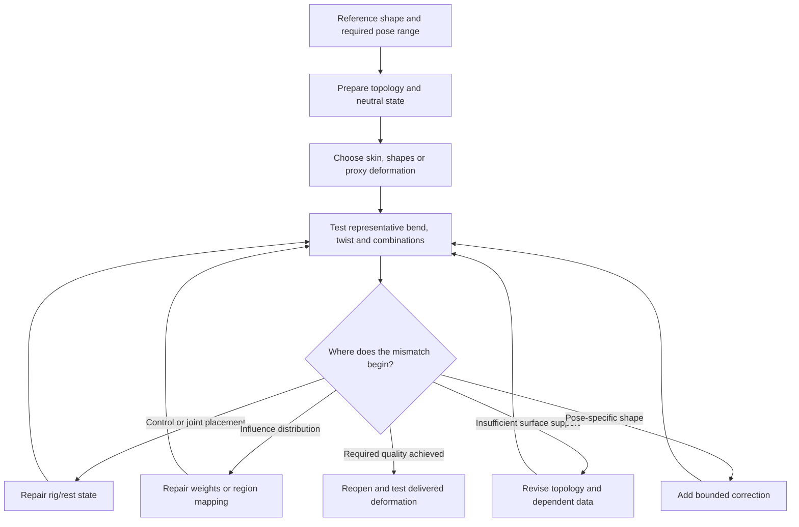

# Deformation: preserve the intended shape through motion

Use for skinning, bend/twist quality, morph targets, corrective shapes and proxy/cage deformation.
Read [rigging](rigging-workflow.md) for control behavior, [modeling](modeling-workflow.md) for
form/topology and [modifiers](modifiers-workflow.md) for evaluated stack and bind dependencies.
For a local defect on a posed limb, [find affected vertices by comparing mirrored weights](techniques/mirrored-skin-weights.md) and confirm the patch on the evaluated skin.
Judge the surface in the poses and camera distances that matter, not only in its neutral pose.

Small operations: [weight partition](techniques/skin-weight-partition.md),
[Preserve Volume A/B](techniques/preserve-volume-ab.md) and [shape before skin](techniques/pose-shape-before-skin.md).
Use the relevant card once the cause/operation is known; a complete character builder is not required.

## Choose how the surface should respond

| Surface behavior | Candidate | Main boundary |
| --- | --- | --- |
| Rigid articulated part | Parenting, bone attachment or rigid weights | Keep distances/shape; avoid smooth joint weights on a hard component |
| Jointed continuous skin | Armature and deliberate weights/topology | Bend, twist, compression, nearby parts and actual target skinning model |
| Designed local expression or pose correction | Relative shape keys and optional drivers | Fixed vertex correspondence, reference key, coordinate space and combinations |
| Ordered whole-shape morph | Absolute keys or another explicit morph system | Evaluation time/interpolation; not a stack of independent expressions |
| Flexible continuous bend | B-Bones, curve/lattice or a suitable chain | Sampling, handles/twist, endpoints and target support |
| Detailed surface following a proxy | Surface Deform or Mesh Deform | Valid bind state, topology/dependencies and whether surface or enclosing cage fits |
| History-dependent soft motion | Cloth/soft-body/other simulation | Solver and cache workflow; a keyed deformation is not a physical simulation |

## Prepare geometry and a compatible rest state

Provide enough loops across bending regions and enough longitudinal samples for the intended
curvature. Avoid concentrated poles/long thin faces at highly compressed joints when they
produce pinching. More subdivision can smooth a surface but does not repair poor joint layout.
Retain the intended rigid and soft regions, seams, thickness and clearances.

Check the neutral mesh against the skeleton/cage before binding. Changing rest bones, base
coordinates or vertex order later can invalidate weights, shape keys, binds and animation.
Treat those changes as a dependency update with a saved checkpoint. Preserve high-detail
sources when deriving a deformation-friendly base; topology replacement is not a harmless
cleanup step once shape keys or vertex-indexed data exist.

## Skin with interpretable influences

Confirm the Armature modifier's target, viewport/render state and bind mode. For vertex-group
skinning, group names must match the intended deform bones. Bone envelopes and vertex groups
are different sources; do not leave an unintended second influence route active. Modifier
presence or parenting to an armature alone does not establish correct skinning.
For scripted binding by part name, compare rules with actual generated part IDs before assigning
weights. Report unmatched parts and affected vertices explicitly; do not silently route them
to a root bone. Inspect a part-to-bone map and pose representative extremities so a plausible
rest pose cannot hide a wrong assignment.

Automatic weights are a starting estimate, not anatomical or mechanical understanding. Inspect
whether all intended vertices received weights and whether nearby limbs, thin layers, clothes
or disconnected parts acquired unwanted influence. For a rigid component, a direct attachment
or deliberate single-bone assignment is often easier to verify than automatic weighting.

Use Weight Paint, numeric group assignments, smoothing, mirroring or data transfer according to
the source and precision needed. Pose the joint while adjusting the influence and compare more
than one angle. Lock trusted groups deliberately; inspect the selected subset before Clean,
Normalize All or Limit Total. Modifier masks and corrective-region groups should not be treated
as additional skeleton influences. A target's influence-count limit is a delivery contract,
not an arbitrary universal four-bone rule.

Distinguish Normalize (rescales the active group's maximum) from normalization of the sum of
deform influences. Blender interprets deform-bone weights relatively; Auto Normalize helps
maintain an already normalized painting workflow but cannot create a missing assignment or
repair wrong influence locations. Check zero-total vertices, unexpected deform groups, locked
weights and target requirements. After removing weak weights or limiting influences, recheck
the remaining distribution and actual pose; numerical normalization is not a visual criterion.

Mirroring depends on topology/spatial correspondence and side naming, not simply a symmetric
appearance. Weight transfer depends on the chosen mapping, rest alignment and separation of
nearby surfaces. Test fingers, inner limbs and thin layers where nearest-surface mapping can
cross to the wrong region. Keep the donor available and do not overwrite a good skin blindly.

## Diagnose bending and twisting before adding corrections

Evaluate neutral, intermediate and extreme bends, axial twist and combined motions. Compare
the silhouette, joint cross-section, thickness, contacts and an untextured shaded view. A total
volume number can hide a local collapsed joint; sample the problematic region as well.
Recovered cross-section or volume can still coexist with a folded or intersecting inner bend.
Inspect compression and contacts from useful angles separately; for dense or ambiguous regions,
use an appropriate intersection diagnostic and inspect what it flags. Do not treat one scalar
metric as proof of surface quality. Widening or redistributing a bend may help, but must preserve
the intended rigid regions and be rechecked through the motion.

Separate wrong skeleton motion from poor skin weights and from insufficient topology. Then
consider twist distribution, a better deformation chain, B-Bone handles or an appropriate
skinning method. Armature Preserve Volume uses quaternion-based deformation and can reduce
linear-skinning collapse, but may introduce bulges and is not equivalent to every exporter or
engine's skinning. Compare the same poses with it on/off; do not present the checkbox as a
universal fix or change it silently after developing the skin.

Subdivision before deformation supplies more samples at a cost; subdivision after deformation
smooths the deformed control surface. Corrective Smooth can address residual distortion but
requires suitable rest data for the geometry reaching it. Use Original Coordinates only when
correspondence fits; use a valid bind where upstream constructive modifiers require it. Inspect
its effect off/on, at rest and away from the corrective pose. Do not smooth away intended folds
or use correction to hide penetrating topology. See the [modifier guide](modifiers-workflow.md).

## Author shape keys and corrections in the right space

Keep the same vertex count, order and connectivity for corresponding shapes. Equal counts
alone do not prove correspondence. Choose relative keys for independently weighted expressions
or correctives, absolute keys for a timed sequence of shapes. For a relative key, understand its
Reference Key; it is not necessarily Basis. Test zero, full and intended extrapolated values,
then meaningful combinations. Pinning/show-only the active key can hide a broken final mix.

New Shape from Mix incorporates the current shape-key mix; it does not imply an inverse solution
for all downstream armature/modifier deformation. Standard mesh shape keys feed the modifier
stack. A corrective sculpt made in a bent evaluated pose therefore needs an appropriate
posed-sculpt/inverse-deformation workflow to become a pre-armature delta. Copying already bent
coordinates directly into a base-space key can deform twice. Verify the corrected pose, neutral
pose and a neighboring pose with the key disabled/enabled before trusting it.

Drive corrections from the relevant pose/control in an explicit space. Select a rotation mode
and variable that remain meaningful over the tested range; a wrapped Euler component is not
a universal joint-angle measure. Test both bend directions and combined twist where relevant.
Avoid a dependency cycle where the driven surface also determines its driver's bone solution.
Expose a useful correction strength/bypass and bound the activation to the intended range.

For facial work, separate jaw/eye rigid motion from soft expressions. Check eyelid closure,
lip contacts, teeth/eye intersections and combinations such as blink plus gaze or jaw plus smile.
Individual good keys do not guarantee a good combined expression. Add combination correctives
only for demonstrated failures; a full facial/FACS system requires a dedicated asset-specific
pose set and cannot be certified by one bent limb.

## Use proxies and cages with deliberate bind ownership

For a local vertical change to a shoulder, ridge or other existing mass, use the [fitted lattice and region lift](techniques/lattice-region.md).

Lattice provides a coarse control grid; Mesh Deform uses an enclosing closed mesh cage;
Surface Deform follows a target surface's deformation. Choose the representation for the shape
and motion, not the modifier name. For B-Bones, segment count and handle behavior affect the
deforming result; one exported rigid bone does not reproduce all internal segment deformation.

Before binding, establish the intended rest geometry, transforms, modifier stage and influence
region. Check cage closure/orientation or target-surface validity as required by the tool.
Bound precision and mesh density; a binding operation can be substantially more expensive than
ordinary frame evaluation. Save before an expensive bind and test a small useful region first.

Read back bind state, then move the target in the way the system actually consumes. Surface
Deform transfers target-mesh deformation; moving only its object transform is not a substitute
for changing that mesh. Test near and far regions, boundaries and extreme shapes. After changes
to upstream topology, cage, sparse influence membership or rest state, check/rebuild the bind.
Keep targets and bind data with the asset and verify them after reopening.

## Verify the delivered surface

Use the rig's [pose/motion checks](rigging-workflow.md#validate-and-deliver-the-intended-rig),
then inspect skin-specific failure regions. Compare the evaluated output, not just source
coordinates or weight colors. If correction is claimed, retain a matched before/after view
and a measurement suited to the defect. A vertex difference proves an effect, not improvement.

For baked/exported delivery, decide whether the receiver needs skin weights, morph targets,
sampled bones or a mesh cache. Preserve the authoring source. Verify material/UV/normal
continuity and deformed geometry after the actual conversion, including corrective combinations.
A transform-only bake cannot capture every surface change. Report the tested poses, methods,
supported target behavior and remaining artifacts without claiming generic character quality.

Primary sources: [Armature modifier](https://docs.blender.org/manual/en/latest/modeling/modifiers/deform/armature.html),
[automatic weighting](https://docs.blender.org/manual/it/5.2/animation/armatures/skinning/parenting.html),
[weight tools](https://docs.blender.org/manual/en/latest/sculpt_paint/weight_paint/editing.html?highlight=vertex+weight+tool),
[shape-key semantics](https://docs.blender.org/manual/en/5.2/animation/shape_keys/introduction.html),
[shape-key workflow](https://docs.blender.org/manual/nl/5.2/animation/shape_keys/workflow.html),
[Corrective Smooth](https://docs.blender.org/manual/en/4.2/modeling/modifiers/deform/corrective_smooth.html),
[Surface Deform](https://docs.blender.org/manual/en/4.2/modeling/modifiers/deform/surface_deform.html),
[Mesh Deform](https://docs.blender.org/manual/id/4.0/modeling/modifiers/deform/mesh_deform.html),
and [B-Bones](https://docs.blender.org/manual/fi/5.0/animation/armatures/bones/properties/bendy_bones.html).
Consult installed-version interfaces; older pages explain the mechanics, not current API parity.
See [provenance](provenance.md) for actual tests and limits.
