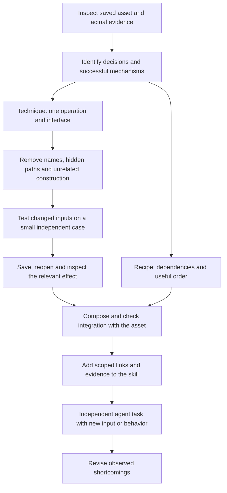

# Turn a reference asset into reusable knowledge

Use when curating/extending the skill, not as mandatory paperwork for ordinary scene edits.
The asset's successful property supplies evidence; the recipe/techniques are the reusable output.

- **Technique:** applicability, input state/axes/units, one mechanism, output and meaningful
  check. Include small code/node/stack examples where useful. Prefer explicit objects/parameters
  and no file IO or scene edits on import.
- **Recipe:** how techniques serve a result, dependencies, choices and integration checks.
  Link mechanisms instead of duplicating their code.
- **Reference asset:** saved source, viewed images, provenance, actual checks/limits; retain
  history outside the routine task's reading path, available for audit/debugging.

Choose the verified property, not everything in a file labeled “reference”. A partial/failing
asset can supply diagnostic evidence without becoming a successful recipe through editing.
Read the relevant source section and subsequent repairs. Remove fixed paths, global resets,
unrelated construction and implicit active-object dependencies; define what the example owns.

Test extraction itself: change a meaningful input on a small case with different names/parameters.
Then compose on a working copy of the source or another realistic case. Save/reopen when persistence
matters and view actual images for appearance claims. Keep numeric and artistic acceptance distinct.
Record source/version, interface, performed checks, limits and evidence location; keep long logs out.
Add a task-based route in the relevant guide/index. No second auto-selected skill is required;
an absent external archive should not prevent using an installed technique. Preserve the prior version.

Independent-agent tasks test discovery and application separately: no exact target answer/audit,
frozen variants, and distinct environment, measurement and modeling errors. Stronger claims require
the corresponding test; successful helper execution is not proof of agent effectiveness.

## Keep discovery task-based as modules grow

Register the operation in its technique module using ordinary task terms (hole, panel
thickness, nod, spin) and a boundary that prevents a wrong match. Link it near the relevant
decision in the discipline guide. Distinguish a ready helper from a guide section and an
integration-only asset. Do not require the full source asset to understand the short interface.
Maintain these routes in one technique index; add a separate module page only when its own
choices justify another reading step, not merely because more files exist.

In trials, record separately: discovered/read, invoked/adapted, evaluated correctly, saved
and reopened. A read event alone does not show use. An explicit-helper test can diagnose
whether invocation works, but cannot validate autonomous discovery. Expand from observed
repeated needs and verified mechanisms; do not add long example catalogs as a fallback for
an unclear task route.
