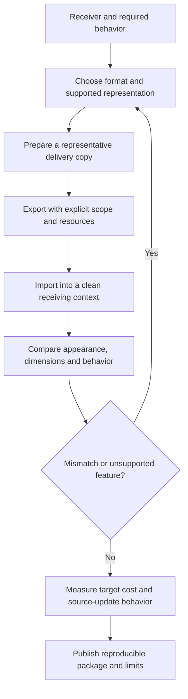

# Export: agree on the receiver, then prove the boundary

Use when delivering geometry, materials, animation or scene data to another application or
format. A native `.blend` source and a derived delivery asset have different responsibilities.
Preserve the editable source; prepare an export representation only as far as the receiver
requires. For native [project/library packaging](project-handoff.md), keep the established ownership
and dependency records; an export file is not a complete source-project handoff.

For a known GLB operation, use [scope/clip/timebase](techniques/scoped-glb-export.md),
[payload inspection](techniques/glb-payload-audit.md) or [surface comparison](techniques/glb-surface-roundtrip.md).
The tested exporter has consequential defaults and a measured fps_base time limitation;
validate seconds independently of same-frame reimport. Use this guide for broader choices.

## Define the exchange contract

Identify receiver/version/importer, renderer/platform and intended use. Specify scale/axes,
origin/pivots, hierarchy/identity, visible geometry, material/texture semantics, UV channels,
motion/clips and external resources. Add LOD/collision/lightmaps only when the target uses them.
If the receiver is unspecified, state the chosen interoperability test and its limits; a
Blender round trip does not certify Unity, Unreal or a browser implementation.

Choose [the format profile](export-formats.md) from required behavior, not habit. Record only
consequential export/import options in existing project notes or a reproducible preset/script.
Inspect the installed operator and matching documentation before scripting version-sensitive
flags. A format specification, Blender exporter and receiving importer may support different
subsets of the same feature. Probe a representative asset early.

## Prepare a controlled export representation

- Define the exported roots/collection explicitly. Exclude inspection lights, helpers, old
  variants and collision proxies from beauty geometry unless the target contract needs them.
  Verify actual exported names/counts; selection alone is fragile across operators.
- Use one scale/axis conversion boundary. Test a known dimension, a non-origin pivot and a
  rotated/asymmetric part. Inspect mirrored/nonuniform transforms, normals and tangent handedness.
  Do not repair orientation with unexplained rotations at several stages.
- Inspect evaluated modifiers/GN/curves at the production settings. Preserve shared meshes or
  format-supported instances where useful; realize/convert only when required. Control
  triangulation for shading/deformation/baked tangent maps; compare the export copy with its
  source. A triangulation or normal change after baking may require a new bake.
- Map source materials to the receiver's shader model. Keep a native complex shader when it
  is the actual deliverable; for interchange, choose supported parameters/extensions, a target
  shader rebuild, or [baked maps](baking-workflow.md). Baking appearance can lose view/light-
  dependent behavior. Agree on that loss rather than silently flattening coat, transmission,
  thin foliage or procedural effects into a color image.
- Verify image channel roles, color spaces, UV selection, normal convention, alpha and
  double-sided behavior. Inspect the receiver under controlled light; export success does not
  prove that a shader graph or image has been translated.

## Carry motion as an explicit product

Choose editable rig/skin/morph data, sampled transforms, or a geometry/volume cache according
to the consumer. Constraints, drivers and procedural state do not automatically become runtime
systems. Use [animation](animation-workflow.md) for bake comparison and preserve the rig source.

Declare clip names, frame range, FPS/time units, loop/root-motion behavior, skeleton rest pose,
supported bone influences and morph requirements. Inspect selected Actions/slots/NLA tracks;
avoid exporting every unrelated action as a clip. Sample the start/end, extremes and in-between
poses after import. Check duration in seconds, root travel, bone orientation, skinning and morph
weights independently. A moving object does not validate a skeletal or morph export.

For topology-changing results, choose a supported cache and its dependency/time contract.
Check nonsequential replay from a clean open; a rest mesh plus animation keys cannot replace
an animated liquid surface. Importer-specific curve/hair/volume limits require their own sample.

## Validate the actual saved exchange

1. Export to a declared destination, retain the complete log, and check this run's result and
   dependencies. Embedded containers may still contain external references: inspect the payload.
2. Copy the delivery package to a clean location and import into a fresh receiver/session.
   Ensure resources resolve from the package rather than cached source paths. Inspect dimensions,
   pivots, hierarchy, material slots, UVs/normals, images and required animation.
3. Compare images from useful matched views/light and check relevant numerical behavior. Vertex
   order/count can change through triangulation and UV/normal splits; compare spatial shape,
   shading and attributes instead of demanding identical source indexing. File validity and
   visible fidelity are separate conclusions.
4. Test an intentional source change and re-export/reimport when stable updates are required.
   Verify names/IDs, target references and local overrides survive the intended update route.
   Renaming or replacing every target object is not a neutral update strategy.
5. Measure [performance](performance-workflow.md) in the declared consumer. Keep proxy estimates,
   import/file statistics and runtime measurements separate. Record unsupported/lossy features.

Deliver the format file, actual referenced resources, import assumptions and concise check
results alongside the preserved source when requested. A validator checks syntax/format rules;
it cannot certify visual equivalence, gameplay collision, rendering cost or source editability.
For Unity's identity/prefab boundary, use [Unity handoff](unity-handoff.md).

Worked example: [a checked GLB round-trip](techniques/glb-surface-roundtrip.md).
Read the chosen card's evidence and limitations before adapting it.
