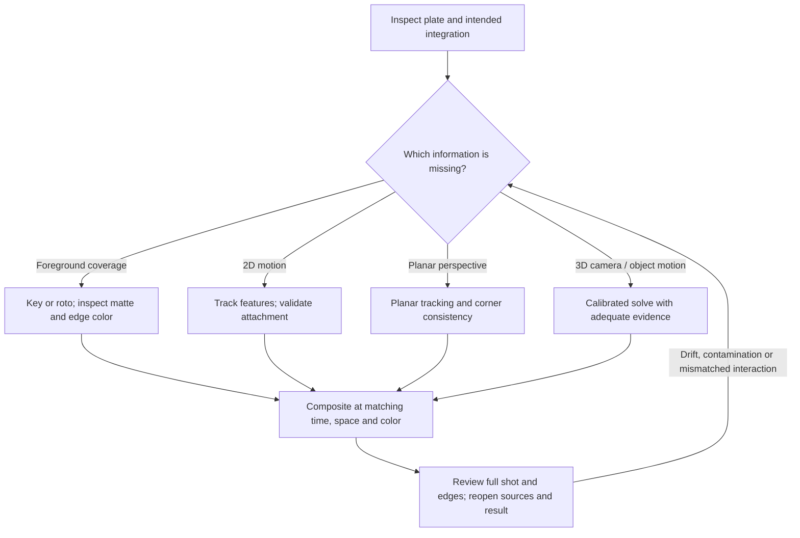

# Keying, tracking and footage integration

Use when a shot needs a chroma key, roto/masks, tracked replacement or integration with a
photographic plate. Read [compositing](compositing-workflow.md) for color/alpha and delivery.
An image sequence can support a small technical test; it does not certify difficult real
footage, camera reconstruction or every kind of hair, glass and motion blur.

## Inspect the plate and choose the required solve

Check actual pixels across the shot: frame range/rate, resolution/pixel aspect, crop, encoding,
exposure changes, lens distortion, blur, compression, occlusions and usable features. Establish
what must be inserted/removed and what must stay. A supplied still is insufficient evidence
for how a key or track behaves over time. Keep the original plates available and editable.

Choose the minimum appropriate motion model. One point can supply translation; rotation,
scale or a planar perspective attachment need additional evidence. A plane track does not
establish a 3D camera. Camera solving needs suitable feature coverage, lens assumptions and
parallax; pure camera rotation is a different case from translational motion. A low average
reprojection error alone does not prove correct scale, ground plane or scene integration.

## Extract coverage and repair edge color separately

Select a key color from actual clean backdrop pixels. For uneven backing, consider a sampled
Keying Screen or separate local treatment instead of forcing one color/threshold to fit the
whole shot. Keep sampled backing regions on the backing as the foreground moves. Garbage
masks exclude irrelevant regions; core mattes preserve known opaque interior regions.
They have different roles and should not erase the soft edge being evaluated.

Inspect the Keying node's Matte, Edges and processed Image separately. Adjust separation on
representative frames before expanding work. Clip Black/White, blur, dilate/erode and feather
are tools with visible costs: hard clipping loses fine coverage, shrinking loses details,
and broad blur produces a halo. A near-binary matte is not a universal quality target.

When an opaque core and fine edges need different treatment, test separate core/edge keys or
masks and combine their coverage deliberately. Do not let a permissive core fill a hole or
thicken every thin feature, or add the mattes without controlling overlap. Compare the combined
result against each branch; more nodes do not by themselves improve extraction.

Despill corrects backdrop contamination in foreground color; it is not the same as improving
alpha. Protect legitimate colors close to the screen hue and inspect skin/material identity.
When foreground and backdrop are genuinely indistinguishable by color, use roto or additional
evidence rather than claiming a perfect chroma key. Reconstructed hidden color is an estimate.

Check alpha and RGB independently over a dark, light and intended background. The processed
Image output of Keying already applies its matte; multiplying that image by Matte again can
double the edge coverage. If composing a matte with a separate color branch, define whether
the RGB is straight or associated before Set Alpha/Alpha Over. Do not judge an edge solely
against the original green screen, where contamination may be hard to see.

For a synthetic check, compare extracted matte with known coverage in interiors, backgrounds
and fractional edges separately; inspect omitted thin features and color/spill as well.
Whole-frame error or binary-mask overlap can hide excessive coverage on thin features. Compare
their apparent thickness and fractional coverage, not just whether they survived thresholding.
Do not feed ground-truth alpha into the graph and call the result a keying test. Real plates
usually lack exact ground truth, so the reference/edge/temporal inspection matters more.

## Track image evidence and prove the attachment

Use distinctive stable features. Choose pattern size, search area and motion model for their
actual displacement/appearance change. Too small a search loses fast motion; a large ambiguous
region can jump to another feature. Normalize can help illumination changes; it cannot make
an occluded feature visible. Review the pattern preview and tracked path rather than accepting
the existence of a marker on every frame as success.

Track in useful segments and inspect where the feature turns, blurs, crosses another element
or leaves the frame. Correct/reinitialize or use another feature through gaps. Do not silently
interpolate a failed track and report it as measured. Previous-frame tracking can accumulate
drift; inspect the original feature and end-to-end attachment as well as neighboring steps.

Connect the actual track to the consumer: Track Position/Follow Track for suitable 2D use,
Plane Track Deform for a plane, or reconstructed camera/object motion for 3D integration.
Check normalized image coordinates versus pixels, reference-frame offsets, origin conventions,
image scale/crop and clip time against scene time. A marker coordinate that is numerically
correct can still drive the wrong location if this boundary is misinterpreted.

Verify an attached graphic/grid in the final composite, not only a tracking error report.
For plane work, inspect all corners and an interior grid as perspective changes. For 3D work,
check reprojection and a simple ground/contact proxy at multiple depths, including relevant
lens distortion. Apply distortion/undistortion consistently to the interacting elements;
tracking the distorted plate and placing an undistorted overlay can create edge drift.

Use native tracking data when that is the deliverable. In scripted tests, prove the tracking
operator's required Movie Clip Editor context before processing a long shot. A failed context
or unavailable operator is a tool limitation, not a successful solve. Do not replace tracked
positions with synthetic ground truth; store known motion separately for error measurement.

## Integrate and validate the shot

Match exposure/color response, sharpness, grain, perspective, motion blur and timing to the
plate. Judge contact/shadows and required reflections/refraction separately: a tracked and
well-keyed cutout can still look unintegrated. Use modest operations whose effect can be
inspected rather than a generic finishing stack. Preserve the unprocessed input and bypass.

Review playback and neighboring frames near difficult events. Measure drift, matte edge
stability and frame alignment where possible; a few clean keyframes cannot certify a shot.
Save the clips/sequences, native tracks/masks and editable compositor. Reopen them and render
non-sequential frames; check that the images, selected track and keyed matte advance together.
Follow [sequence checks](compositing-workflow.md#verify-the-saved-result) for output persistence.

Report the tested motion model and conditions. A clean synthetic translation/keying fixture
can validate native data flow and reveal mistakes, but does not establish a production camera
solve, occlusion recovery, hair extraction or temporally stable roto on challenging footage.

Primary sources: [Keying](https://docs.blender.org/manual/id/5.1/compositing/types/keying/keying.html),
[Keying Screen](https://docs.blender.org/manual/en/5.0/compositing/types/keying/keying_screen.html),
[tracking settings](https://docs.blender.org/manual/en/5.0/movie_clip/tracking/clip/toolbar/track.html),
[marker coordinates](https://docs.blender.org/manual/en/latest/movie_clip/tracking/clip/sidebar/track/marker.html),
[track preview](https://docs.blender.org/manual/en/latest/movie_clip/tracking/clip/sidebar/track/track.html),
[Plane Track Deform](https://docs.blender.org/manual/en/5.0/compositing/types/tracking/plane_track_deform.html)
and [camera solve concepts](https://docs.blender.org/manual/fr/2.91/movie_clip/tracking/clip/editing/solve.html).
Use installed-version interfaces; the historical solve reference is conceptual, not API guidance.
