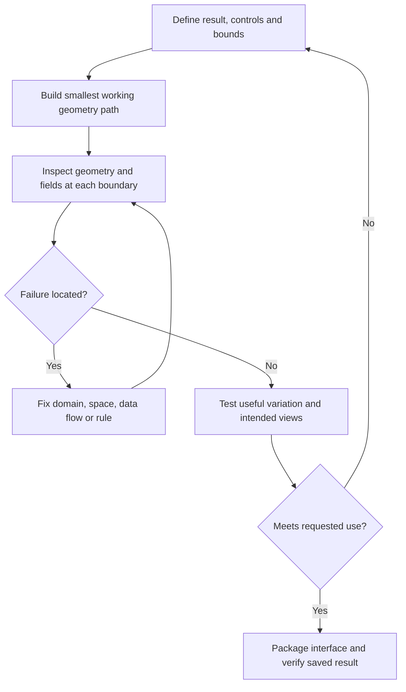

# Geometry Nodes: design, inspect, then scale

Use for procedural forms, repeated placement, deformations and geometry-dependent systems.
Choose GN when an editable rule is useful; a few manual instances or a simple modifier may
already satisfy the task. For placement recipes read [patterns and scatter](scatter-workflow.md);
for material construction read [shader nodes](shader-nodes-workflow.md). These are cooperating
disciplines: a geometry graph is not a shader graph even when both contain Noise or Math nodes.

For a known row/grid/ring operation, start with the [small pattern technique](techniques/gn-patterns.md).
For per-copy material variation, use the [instance-attribute bridge](techniques/instance-shader-attribute.md).
These can be applied without opening the full historical scene.

## Start with an observable contract

Describe the intended result before drawing the graph: input geometry/assets, output component
types, dimensions, exposed variations, coordinate space, materials and target use. Establish a
small measurable example, such as eight posts along a path with their feet on the ground.
Follow [procedural bounds](procedural-geometry.md) before evaluating generators. A graph can be
appropriate for a blockout without being a finished asset generator.

## Distinguish data, fields and context

| Concept | Decision it changes |
| --- | --- |
| Geometry stream | Trace the component actually reaching the consumer: mesh, curve, points, instances or volume. A mesh operation does not automatically process every component. Join Geometry combines components; it does not weld boundaries. |
| Constant value | One value, such as a seed or count, can drive a whole operation. Do not assume every socket can accept a per-element field. |
| Field | A rule evaluated by a consumer on its geometry and domain. Position, Index or a selection can mean something different after topology or domain changes. A visible wire is not a stored array. |
| Domain | Decide whether a rule belongs to points, edges, faces, face corners, splines or instances. Domain adaptation can interpolate or average; it may destroy a discrete mask or a UV seam. |
| Coordinate space | Position/direction must refer to the same frame as the sampling, projection or transform. Domain and coordinate space are independent choices. |

For example, displacing vertices from their current Position and placing instances from point
Position are different evaluations. If original coordinates are needed after deformation,
capture them before moving geometry. When sampling another geometry, provide the intended
source geometry and use a matching sampling method: Sample Index needs valid correspondence;
nearest-surface, proximity and ray queries answer different spatial questions.
The official [Fields guide](https://docs.blender.org/manual/id/5.2/modeling/geometry_nodes/fields.html)
explains why reusing a field after changing geometry can produce different values.

## Preserve only the attributes you need

Use **Capture Attribute** for temporary values that must survive a change, then pass its
geometry output along the downstream branch. The captured field cannot retrieve data from
an unrelated sibling branch. Use **Store Named Attribute** for an intentional interface, such
as a material mask, UV map or externally consumed ID. Document name, type, domain, range and
missing-value behavior. Avoid writing generic names into unknown input geometry.

Check the named attribute's existence and actual values, not just a plausible zero result.
UV seams generally need face-corner storage. A face-level material category should not silently
become an averaged vertex value. Where geometry is converted or realized, inspect the resulting
attribute propagation; storing an attribute is not a guarantee it survives every operation.
See [Capture Attribute](https://docs.blender.org/manual/en/5.0/modeling/geometry_nodes/attribute/capture_attribute.html)
and [Store Named Attribute](https://docs.staging.blender.org/manual/en/latest/modeling/geometry_nodes/attribute/store_named_attribute.html).

## Separate source geometry from instance transforms

Give sources a deliberate pivot, local forward/up axes and unit scale appropriate to the asset.
For Object Info or Collection Info, inspect the space, instance and child-transform options;
test a translated/rotated source and a transformed host. Applying the same transform twice can
look correct only when both objects happen to be at the origin. Avoid self-referential inputs.

Process shared source geometry before multiplying it where possible. Use instance translation,
rotation and scale for placement. Realize only the branch that needs independent mesh-level
processing, joining/welding or a target export that cannot retain instances; realization itself
does not weld vertices or convert curves to meshes. Measure the expanded cost first. Do not
add Realize Instances as a universal fix for an empty mesh audit or a missing material.
Check the installed version's nested-instance limits when building deep assemblies.
[Blender's instance model](https://docs.blender.org/manual/en/latest/modeling/geometry_nodes/instances.html)
explains shared geometry and the cost of realization.

## Choose fields, zones and time deliberately

- Use fields for independent per-element decisions: alternating variants, offsets, masks or
  orientation. Repeating a whole evaluation in a Python loop is often unnecessary.
- Use Repeat zones for a bounded iteration where the previous result feeds the next; use
  For Each Geometry Element where genuinely separate element-local work is required. Neither
  is a mandatory way to make a row or grid. Account for accumulated geometry at each iteration.
- Use Simulation zones when previous state matters. Scene Time driving an analytic transform
  does not require a simulation. Check playback, reset/replay, frame range and cache behavior
  through the [animation workflow](animation-workflow.md). For emission, lifecycle, persistent
  state, integration and contacts, use [particle simulation nodes](particle-simulation-nodes.md).
- Use stable IDs for persistent variation. Index is appropriate for a deliberately ordered
  pattern, but filtering or sorting can change it; capture pattern coordinates/identity first.

## Make the graph usable by another artist

Group by a coherent responsibility, such as placement layout or profile generation, not an
arbitrary node count. Keep source selection, layout, variation and output handling separable.
Name exposed controls by meaning and units: post spacing, clearance, width, seed. Establish
defaults, allowed ranges and empty/single-element behavior; UI min/max alone is not enforcement.
Expose artistic decisions without publishing every implementation value. Reuse group datablocks
when their behavior should stay shared, and make independent variants deliberately.

Use frames, labels and a readable left-to-right geometry path. Keep a few useful diagnostic
outputs or a preview mode when they materially help editing. Avoid duplicate public socket
labels. Node names in tutorials may refer to custom groups, and node modes can change sockets.
For scripted construction, inspect current node/interface identities, set modes before wiring,
and verify links, active sockets and readback using [Blender methods](blender-methods.md#resolve-active-node-sockets-and-prove-their-effect).
Node mode enums are not socket type enums; a helper must report a missing/ambiguous input,
not silently leave defaults. Check computed ranges/orientations on a small population and a
control change before increasing count. Near-zero scale or a narrow unintended angle range
can leave plausible but sparse output without an exception. Rotation sockets,
capture items and modifier inputs are particularly version-sensitive; do not copy socket
indices or obsolete API paths from an older tutorial.

## Debug at the first wrong boundary

Start with a cheap source and few elements. Inspect the points before instances, then the mask,
orientation and final assembly. Viewer, Spreadsheet, socket inspection and node warnings expose
different evidence; inspect the evaluated component and domain that the consumer actually uses.
A disconnected or unevaluated branch may have no meaningful runtime diagnostics.

| Symptom | First useful check |
| --- | --- |
| Empty output | Component type, output connection, selection, source reference and zero/invalid count |
| Every element has the same value | Consumer context/domain, accidental constant, missing named attribute |
| Pattern shifts after filtering | Index used as identity or sampling correspondence changed |
| Correct count but missing a region | Eligibility mask, sampling/traversal order and [spatial coverage](scatter-workflow.md#bound-generation-before-it-runs), before increasing density |
| Wrong orientation or placement | Source axes/pivot, typed rotation conversion, host/source space, duplicate transforms |
| Material variation disappears | Attribute domain/propagation and shader lookup mode; inspect the rendered source material |
| Evaluation stalls | Point/voxel count, nested multiplication, costly queries and realization boundary |

Use timings to locate measured bottlenecks, then reduce the expensive branch or cache static
work where appropriate. Keep production and viewport settings identifiable. The official
[performance guide](https://docs.blender.org/manual/ja/latest/modeling/geometry_nodes/performance.html)
supports postponing realization and controlling evaluated data; it is not a promise that one
node arrangement is always fastest.

Test the requested parameter range, a relevant transform variation and save/reopen. Inspect
the actual target view as well as counts and bounds. For an attribute consumed by a shader,
also test the [GN-to-material boundary](shader-nodes-workflow.md#connect-geometry-and-materials).
New tools are candidates in [recent features](recent-blender-features.md), not mandatory upgrades.

Conceptual learning reference: Blender Studio's
[Geometry Nodes from Scratch](https://studio.blender.org/training/geometry-nodes-from-scratch/)
separates data structure, fields and attribute propagation. Use current runtime documentation
for implementation; this guide is an independently written decision workflow, not a course transcript.

Worked example: [patterns and per-instance shader data](techniques/gn-patterns.md).
Read the chosen card's evidence and limitations before adapting it.
