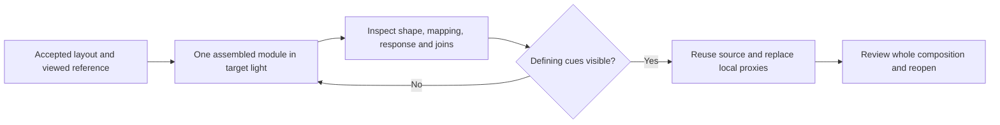

# Develop an interior composition inside an existing plan

Use for a kitchen run, work corner, storage wall or another bounded interior assembly.
Start from the accepted [layout](blockout-camera-light.md#architectural-layout-studies)
and the [existing-file route](existing-file-workflow.md). Read only the surface families
needed by this composition; a whole apartment need not reach one finish level at once.

## Choose the next useful slice

Identify the host walls/openings, occupied clearance, target camera and the few proxies being
replaced. Preserve the surrounding layout while detailing. Distinguish the editable master
from cutaway/plan review scenes; linked objects can share geometry across those views.
Refreshing a derived plan is a presentation dependency, not a reason to rebuild the master.

From a viewed reference, choose one representative assembly that tests the main construction
and surface questions together. For framed cabinetry this might be a single door with a
stile, rail, inset, adjacent carcass and counter/backsplash junction. A larger kitchen may
reuse its source dimensions, parts and material frames after that slice works. A repeated
function call is not proof of a reusable or valid component.

Save and open a useful image of that slice before expanding the run. For a custom mesh
helper, prove [shell orientation and dimensions](techniques/mesh-orientation.md)
on the sample first. Check actual cavities: an opaque block behind a glass door can conceal
everything inside even when the transmission graph is connected correctly. Use constructed
panels where an interior must be visible; a closed proxy can remain for an unseen solid mass. For a working cut-out, inspect the first
actual hit through the assembled stack as well as the cut itself: a countertop opening can
be correct while a carcass panel still covers the basin. A ray targeted only at the expected
object cannot detect an intervening part.

## Test use states as part of the composition

Reserve the actual appliance envelope and its installation/service space before filling the
remaining run with decorative cabinetry. Manufacturer dimensions are a source for a selected
product; they do not certify a mixed assembly or substitute for its installation instructions.
Keep unverified service/ventilation assumptions explicit at the study's finish level.

Check the closed arrangement and the relevant open or extended state separately. Place a
hinge/slider at the construction joint and move the complete leaf, including handles and
inner panels. Preserve world transforms when introducing a parent into an existing assembly.
A small control with saved poses can answer the layout question without a full animation rig.

Measure the occupied clearance with the furniture present, at the actual height of use.
A clear closed aisle may narrow considerably when an oven door is open. State what is
measured and which passage/use claim it supports; projected bounds and sampled poses are
not continuous collision certification. Use the existing [spatial measurement](techniques/assembly-fit.md)
for directional gaps, inspect the images, and save reproducible closed/open views.
Refresh the derived plan when the module arrangement changes.

## Route surface questions to their mechanism

| Needed cue | Read / decisive observation |
| --- | --- |
| Timber fronts and frames | [Board grain](techniques/wood-grain-frame.md) / [metric image patch](techniques/metric-image-patch.md): direction and physical source scale on each part, including rotated copies |
| Tile and grout | [Tile field and junction](techniques/tile-field-junction.md): physical tile + clear seam, phase and cut edges; glaze response versus recessed grout |
| Molded plastic | [Plastic finish](techniques/molded-plastic-finish.md): broad/edge reflection, roughness comparison and optional fine mold texture |
| Coated upholstery / artificial leather | [Embossed upholstery](techniques/embossed-upholstery.md): grain spacing, shallow relief and finish tested separately; seams and cushioning remain geometry |
| Frosted glass | [Frosted pane](techniques/frosted-pane.md): clear/rough and near/far background; separate etched face from thickness and backing occlusion |
| Translucent curtains | [Sheer fabric](techniques/sheer-fabric.md): diffuse transmission, open weave and sheen have separate controls; check folds, hem and pane clearance |

If a pane looks opaque, first check occlusion, face direction/thickness, the active output
and the selected renderer's transmission support. Only then tune roughness or sampling.
A named glass material or a valid socket value does not establish light transmission.
For a finish that fails to read, isolate its response on the assembled sample instead of
regenerating the entire room or adding unrelated decoration.

## Integrate and review

Bring the selected asset parts and material dependencies into the host, with source cameras
and studio lights kept separate. Re-establish the room's motivated illumination before
changing already-proven shader values: an imported softbox can become a conspicuous rectangle
through glass, while an enclosed room changes the fill and reflections. Check one familiar
surface in this new light before retuning the whole palette.

Replace only owned proxies, preserve source components and keep the intended review scenes
reproducible. Recheck circulation and wall/window intersections after adding counters or
tall units. Inspect edge highlights, contact, openings and visible construction gaps.
For left/right variants, verify both assembled extents and the signed clearance between
their actual mating edges with a scoped [assembly-fit measurement](techniques/assembly-fit.md).
A valid mirrored mesh can still occupy the wrong interval;
one correct side or the countertop's bounds do not establish the whole assembly's fit.
The overview should establish the composition; choose a detail view that contains the
complete feature under evaluation, including a relevant edge or background through glass.
Do not let a close camera crop away the evidence it was intended to show.

Assign the intended active scene/camera before the final save; having named camera objects
alone does not select a render view. Reopen the saved master and use its camera/engine/visibility.
Report which surfaces
read successfully and which remain provisional. This route incorporates a partial kitchen
trial: that trial exposed geometry, API and surface failures; it is not a finished reference
asset or proof that this workflow has passed a new independent test.
