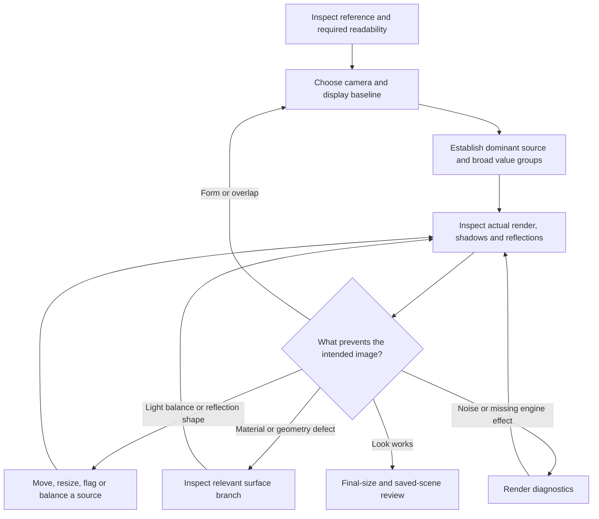

# Light the shot, preserve the material

Use for developing or repairing production lighting and camera presentation. For a layout
or mood decision, the [blockout guide](blockout-camera-light.md) may suffice. For sampling,
engine limits and saved output, use [rendering](render-workflow.md). Enter here directly for
a focused relight; existing assets need not be rebuilt into a new scene pipeline.

For a known contribution/source-size check, use the small [light A/B technique](techniques/light-role-ab.md).
For an empty/cropped or edge-on diagnostic view, use the read-only [camera framing probe](techniques/camera-framing.md) before another render.

## Translate the reference into a lighting intent

Follow the [reference workflow](reference-workflow.md) and inspect actual images. Extract the
dominant direction, apparent source size, light/shadow balance, color relationships, background
separation and reflection shapes. Identify what must read: silhouette, surface texture,
transparency, a face, a path or another focal subject. A reference is evidence of appearance;
its exact power, distance and hidden light count usually remain unknown. If the target hides
how a surface receives light, use a [focused reference search](reference-workflow.md#search-to-close-a-visual-gap)
for an analogous fixture/receiver, keeping the target composition and mood authoritative.

State a useful target such as “soft side light, restrained fill, readable amber transmission”
instead of prescribing three lights for every scene. Key/fill/rim describe functions, not a
mandatory rig. Daylight through openings, practical fixtures, product softboxes and stylized
lighting have different motivations. Reuse the established camera/look when the task is only
a local correction; otherwise resolve framing before spending time on small highlight accents.

## Establish the camera and a stable viewing baseline

Choose aspect, position, perspective/orthographic projection and framing for the intended
image. Camera position sets perspective; changing focal length from a fixed position changes
field of view. Moving the camera to keep framing while changing focal length changes the
perspective relationship. Sensor fit/size also matters for a lens match. Inspect roll, clipping,
foreground tangencies and depth separation instead of distorting assets to repair framing.

When depth of field serves the shot, set a meaningful focus target/distance and inspect near,
hero and far details at final size. Blender's camera F-Stop controls depth of field; do not
assume it implements a photographic auto-exposure system. For motion blur, check shutter timing,
camera/object/deformation motion and required frame/subframe data in the chosen renderer.
Preview a short sequence before an expensive animation render. A still cannot establish
temporal quality. Shutter duration is expressed in frames; relate it to FPS and shutter timing,
not an assumed seconds value. See [camera controls](https://docs.blender.org/manual/id/5.2/render/cameras.html)
and [Cycles motion blur](https://docs.blender.org/manual/ka/5.2/render/cycles/render_settings/motion_blur.html).

Record the engine, working color space/OCIO context, display/view transform, look, exposure
and relevant white balance. Keep these stable when comparing lighting changes. Evaluate both
the intended look and a neutral material view when needed; a strong colored light can conceal
material identity. View exposure changes the image globally; source intensity changes scene
illumination. Do not use both interchangeably to conceal an unexplained mismatch.
Cycles Film Exposure is another, separate control that changes render data; it is not the
Color Management view exposure ([Film](https://docs.blender.org/manual/zh-hant/latest/render/cycles/render_settings/film.html)).

## Build the light field in purposeful increments

| Need | Useful controls / observation |
| --- | --- |
| Broad soft form or product reflection | Area light size, shape, position and orientation; inspect the highlight as well as the shadow |
| Distant directional daylight | Sun direction and angular size; World/sky supplies a separate environment contribution |
| Local practical / beam | Point or Spot placement, radius, cone/blend and motivated fixture geometry; check falloff and shadows |
| Environment/reflection context | World color/sky or correctly interpreted HDR environment, orientation and strength; inspect actual scene World rather than Material Preview HDRI |
| Shape a reflection or subtract fill | Bright/dark cards, flags, source movement or environment adjustment; preserve intentional camera/shadow/reflection visibility |
| Object-specific artistic adjustment | Light/shadow linking when supported; document the exception and inspect the affected receivers/blockers |

Start with the dominant contribution, then add or subtract light to solve a visible problem.
Temporarily isolate sources to locate unwanted highlights, competing shadows or washed-out
contrast. Preserve enough shadow to describe form; a dark region is not automatically a defect.
Use named lights/collections and meaningful controls so another shot can revise the rig.

Compare the location, extent and transition of lit regions, not just a matching warm/cool
palette. Choose the diagnostic for the discrepancy:

| Visible mismatch | Isolate and inspect | Likely decisions to revisit |
| --- | --- | --- |
| Flat, uniformly colored receivers | Dominant source alone, then fill/World | Source direction, extent/spread, blockers and excessive fill |
| Reflection too broad or weak | Receiver under one source; move its highlight | Source geometry and angle, receiver normals/roughness; a diffuse light pool and a reflection differ |
| Background merges with foreground | Thumbnail/value groups and actual occlusion | Local contrast, motivated separation, overlapping forms; uniform fog/fill can flatten them further |
| Grain absent or looks inflated | Same surface under broad and grazing diagnostic light | Mapping/feature scale and relief, then source placement; extra bump is not a general cure |

Keep materials fixed for a lighting comparison, or the diagnostic light fixed for a material
comparison. Change the variables responsible for the mismatch, then recombine and inspect the
shot. If depth is limited by layout or missing forms, return to that branch; additional lights
cannot establish the missing geometry.

Source size relative to distance affects shadow softness and reflection shape. A bigger source
is not simply a stronger version of a small one. Blender's Normalize control decides whether
total power is maintained as light size/shape changes; it does not promise identical brightness
on a particular surface after resizing or moving. Light Exposure is an intensity multiplier,
distinct from display exposure. Temperature and tint also interact. Inspect the live controls
and units rather than copying physical lamp wattages into remembered defaults. See
[light objects](https://docs.blender.org/manual/en/5.0/render/lights/light_object.html) and
[4.5 control changes](https://developer.blender.org/docs/release_notes/4.5/rendering/).

## Light the relevant material response

For reflective objects, design what the surface reflects: a dark metal may be reflecting a
dark environment. Move/shape a source or reflection card before changing metallic or roughness.
For glass/resin, separate surface reflections, transmitted background and interior absorption.
An illuminated backing or edge contrast can reveal transparency; increasing front light alone
may cover it with reflections. Check thickness/normals and renderer paths if transmission is
missing. [Broncolor's glass example](https://broncolor.swiss/news/how-to-photoshoot-glasses)
illustrates controlling reflections versus transmitted light; it is a physical-lighting
analogue, not a required Blender setup or equipment recommendation.

Grazing light can reveal relief and weave when the reference calls for it. Use
[material composition](material-composition.md) to distinguish shading defects from light.

For luminous fixtures, inspect four related appearances separately: the visible emitter,
illumination on nearby receivers, reflected source shapes, and any image-space glare. Temporarily
bypass glare and isolate an emitter/light contribution if the cause is unclear. In a path tracer,
an emissive mesh may already light the scene; an auxiliary light is an optional approximation
or artistic control, not a mandatory duplicate. If used, align its location/shape/direction with
the fixture and check combined energy and shadow behavior in the actual engine.

Set source intensity and receiver response under the established view transform before tuning
glare. A bright core can lose saturation through the display transform while its spill remains
colored; do not force every part to one saturated hue or use bloom to stand in for illumination.
For a spill that is too even, inspect source size/orientation/spread, occlusion and fill before
painting darker material or lowering global exposure. Keep the intended dark areas and compare
the footprint to the reference. Atmospheric volumes are another light/contrast mechanism; add
them for a demonstrated depth/beam effect and inspect a bypass, not as automatic final polish.

See the [Cycles emitter and spread controls](https://docs.blender.org/manual/en/5.2/render/cycles/light_settings.html)
and the [AgX highlight behavior](https://developer.blender.org/docs/release_notes/4.0/color_management/).
The latter documents a display mechanism, not a requirement to use that transform for every job.

Light linking changes which objects receive illumination; shadow linking changes blockers.
These are deliberate artistic departures. Verify actual include/exclude sets and results;
hiding an object from the camera need not remove it from reflections or shadowing. Current
support differs for light objects, emissive meshes and engines. See
[light linking](https://docs.blender.org/manual/en/latest/render/lights/light_linking.html).
An uncluttered Outliner or a checked visibility box is not evidence of the resulting light paths.

## Review the shot and preserve useful alternatives

Compare thumbnails for hierarchy and full-size crops for contact shadows, highlight shape,
edge separation, texture readability and transmission. Use grayscale/value inspection when
it resolves a hierarchy problem; color remains necessary to judge the final appearance.
Check that apparent floating is not a real gap, and that blur or darkness does not hide defects.
For a suspected support gap, compare evaluated contact surfaces using the
[surface and fit checks](modeling-workflow.md#surface-quality-and-handoff). After resizing or
moving a support, update evaluation and measure again; requested dimensions alone do not prove contact.
Compare both actual surfaces: a support at world Z=0 does not establish contact with a floor
whose top may be elsewhere.

For alternatives, preserve settings through named scenes, controlled collections or recorded
rig states as appropriate. Know which materials, Worlds and lights are shared datablocks:
changing one alternative can unintentionally change another. Test the saved active camera,
World, render visibility and chosen lighting state after reopening. Deliver the requested
look plus concise evidence of a meaningful change, not a collection of unreviewed presets.
