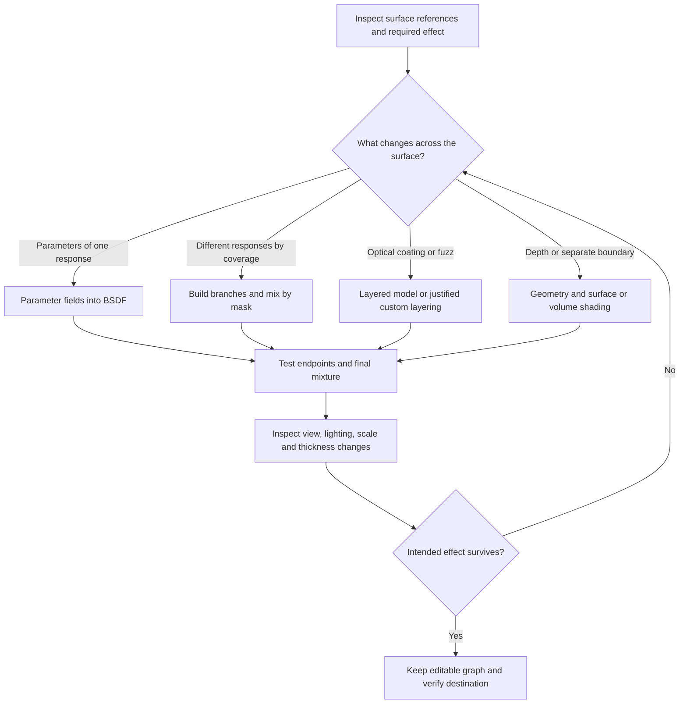

# Compose material responses, layers and effects

Use for a material with multiple surface behaviors, coatings, transmission, scattering,
directional highlights, emission or stylization. Read the shared [shader workflow](shader-nodes-workflow.md)
for coordinates, data interpretation and inspection. A material is an evaluated response to
light, view and geometry; it may use no image textures, many maps, procedural fields and
multiple shader branches. A four-map PBR set is one delivery representation, not a capability
limit or a mandatory starting point for every surface.

For efficient wood/plastic/concrete/metal/skin/packaging starting points and characteristic
tests, use [surface families](surface-families.md). This guide owns the underlying mixing and
optical mechanisms; a family template should reuse them instead of duplicating a universal graph.

If the mechanism is already chosen, use the small [spatial mix](techniques/spatial-shader-mix.md),
[interior absorption](techniques/volume-absorption.md), [sheen](techniques/sheen-response.md),
[frosted pane](techniques/frosted-pane.md) or [sheer fabric](techniques/sheer-fabric.md) card. Each includes a meaningful comparison; loading the complete material study is optional.

## Choose the composition operation by the physical or artistic relationship

Describe the substrate, visible covering, spatial coverage and interaction with light. Decide
whether the effect changes one scattering model, selects different surfaces, adds a layer
over a surface, or requires distinct geometry/interior volume. A graph with more nodes is
not evidence of a more convincing material.

| Relationship | Useful representation | What to distinguish |
| --- | --- | --- |
| One substance with changing properties | Mix color/scalar/vector **parameters** feeding a BSDF | Parameter interpolation and mixing two complete scattering responses need not produce the same result |
| Adjacent or patchy material regions | Masked **Mix Shader** between independently working branches | Coverage/transition between responses; factor 0 selects the first branch and 1 the second |
| Clear finish over a substrate, surface fuzz | Built-in coat/sheen layers where they express the effect | A coating interacts with the light reaching the base; a simple 50/50 mix does not automatically model that layering |
| A deliberately custom scattering combination | Individual BSDFs with reasoned weighting/Fresnel, or **Add Shader** where the contributions really should sum | Add does not normalize weights or attenuate an underlying full-strength BSDF; it is not a generic coat operator |
| A visible separate coating, droplet, shell or film | Separate geometry/material when thickness, silhouette, refraction or parallax requires it | Surface-only appearance versus an actual spatial layer; inspect interfaces and avoid coincident faces |
| Light traveling through a medium | Surface shader plus an appropriate **Volume** output | Surface reflection/refraction versus absorption/scattering along a path through the interior |

The [Mix Shader manual](https://docs.blender.org/manual/nl/5.2/render/shader_nodes/shader/mix.html)
defines branch weighting; [Add Shader](https://docs.blender.org/manual/ja/5.2/render/shader_nodes/shader/add.html)
sums closures. If adding two reflective branches makes a surface unexpectedly bright, inspect
their combined contribution instead of compensating with exposure. An emissive contribution
can intentionally add radiance; it still needs a deliberate amount and coverage.

## Build and debug branches before composing the final look

Make each branch visually convincing on the test object under the same diagnostic light.
Use a mask preview to confirm spatial scale, orientation and distribution, then inspect
the two endpoints and a representative mixed state. A useful public control might be exposed
substrate coverage, coat roughness, weave scale, absorption density or emission strength.
Test the actual change in the image; a socket accepting a value is not proof of an effect.

For fine weave, scratches or pores, compare the delivery view with a useful close view and
an effect-off version. If the change is noise-limited or disappears, inspect feature size,
lighting, bump filtering and sampling/denoising before inflating relief or contrast. A numeric
pixel difference alone does not prove that the intended structure reads. Use a small diagnostic
crop with controlled settings rather than repeatedly raising the cost of the whole scene.
The [Cycles sampling guide](https://docs.blender.org/manual/en/5.0/render/cycles/render_settings/sampling.html)
explains denoising detail tradeoffs; check the installed engine's options. Fine detail need
not be individually resolved in every distant view, but required material identity must survive.

Keep mask generation and material response modular when they are independently reusable.
Give groups explicit coordinate, unit, mask-range and output contracts. Share the intended
mask across related channels while controlling each response: removing paint can reveal
metal color/reflectance and a lower surface, rather than merely darkening the paint.
Avoid accidental perfect correlation between every noise field.

A coating may need a different normal from the rough substrate. Route base and coat normals
intentionally; do not add encoded RGB normal maps. Inspect mask boundaries and grazing views
for a discontinuity between relief and material coverage. Height-based blending is a chosen
mask construction, not an automatic physical stack with depth. When masks depend on camera,
normal, curvature or object position, verify whether that dependency should move with the
object or vary with the view. A Facing/Fresnel control is not an object-space dirt mask.
See [Layer Weight](https://docs.blender.org/manual/en/latest/render/shader_nodes/input/layer_weight.html).

## Select surface mechanisms from observed behavior

These are decision examples, not fixed recipes or a requirement to use every feature.

| Surface/effect | Mechanisms to consider | Diagnostic that separates it from a generic PBR map set |
| --- | --- | --- |
| Painted metal, ceramic glaze, lacquer | Distinct exposed-substrate/coating regions; coat response; independent roughness/normal detail | Compare substrate-only, covering-only and coverage transition; move a broad highlight across the coat |
| Wet stone or droplets | Wet/dry masks, roughness/specular change and plausible color response; coat for a surface film, geometry for visible droplets | Compare dry/wet endpoints at grazing incidence; do not equate wetness with arbitrary darkening alone |
| Brushed metal | Metallic response with anisotropy and a deliberate tangent direction, plus restrained directional microdetail | Rotate tangent/object/light and verify highlight orientation; ordinary roughness noise does not establish anisotropy |
| Fabric, velvet, dusty surfaces | Sheen or a suitable fiber response, directional weave, fine relief; actual fibers where the silhouette needs them | Compare front/grazing light and near/far views; sheen should not become an unexplained rim emission |
| Glass, resin, colored liquid | Transmission/refraction at a boundary; closed geometry where needed; interior absorption/scattering for depth-dependent color | Inspect a background through thin/thick regions and a moving highlight; validate thickness and bounce/renderer settings |
| Leaf, paper, thin sheet | Thin-surface transmission/translucency or a supported thin-wall model | Backlight both sides; do not assume a solid-glass setup is appropriate to a zero-thickness sheet |
| Wax, skin, soft translucent solids | Subsurface model with scattering length related to object scale and suitable geometry | Compare thin/thick/backlit regions; increasing roughness or using alpha is not equivalent to subsurface scattering |
| Oil-film or iridescent finish | Supported thin-film model with film thickness/IOR and view dependence | View/light-angle sweep; a fixed rainbow base-color texture does not establish interference |
| Displays, luminous marks, hot surfaces | Masked emission plus intended reflective response; volume/blackbody where appropriate | Emission off/on, dark and lit contexts; distinguish emitted light, reflected highlight and compositor glare |
| Toon, stylized rim, graphic transitions | [Cel shading](cel-shading-workflow.md): deliberate bands, view/light-dependent branches and an independent contour strategy | Check the intended camera/light range and actual renderer; distinguish graphic art direction from physical response and verify temporal behavior |

Principled provides several of these layers in one node; use its current interface rather
than assuming a generic five-input material. Its [layer model](https://docs.blender.org/manual/nl/5.2/render/shader_nodes/shader/principled.html)
includes coat, sheen and emission. The [specular/transmission controls](https://docs.blender.org/manual/sl/5.2/render/shader_nodes/shader/principled.html)
cover tangent-dependent highlights and refraction. For physical thin-film interference, use
the relevant shader's supported feature and units; the [Glass BSDF documentation](https://docs.blender.org/manual/ja/5.2/render/shader_nodes/shader/glass.html)
specifies film thickness in nanometers, not scene meters.

## Keep surface, transparency and volume distinct

Transparent BSDF passes rays without refraction; glass transmission changes their direction.
An alpha cutout, refractive object and translucent scattering sheet therefore need different
tests, including shadows and compositing when relevant. See
[Transparent BSDF](https://docs.blender.org/manual/pt/latest/render/shader_nodes/shader/transparent.html)
and [Cycles light paths](https://docs.blender.org/manual/en/5.2/render/cycles/render_settings/light_paths.html).
Holdout is a compositing operation, not a substitute for a transparent material.

Interior absorption depends on traveled distance: validate geometry, outward normals, object
scale and an appropriate density/range. Connect a volume response to Volume and surface
reflection/refraction to Surface; a surface Mix Shader is not a substitute for this distinction.
Avoid unintended overlapping media or unbounded world-volume cost. A homogeneous closed test
volume is a useful first case before procedural density. See
[volume materials](https://docs.blender.org/manual/id/5.2/render/materials/components/volume.html).
Simulation of smoke/fire is a separate source-of-density task; a volume shader alone does not
create a simulated effect.

## Check renderer, version and delivery limits early

Inspect installed sockets and support for the intended renderer. Cycles and EEVEE share node
graphs but not every shading feature or approximation. EEVEE transmission/thickness/render
method settings must be validated in the intended scene; refer to its
[material settings](https://docs.blender.org/manual/en/5.2/render/eevee/material_settings.html).
Do not assume a Cycles volume or anisotropy result carries over unchanged.

Blender 5.2 adds Principled Thin Wall and a shader Time node; it also changes Random Walk
scattering scaling, with a legacy compatibility mode for older files. Probe the current
interface and compare migrated looks at the same physical scale. See
[5.2 rendering notes](https://developer.blender.org/docs/release_notes/5.2/rendering/).
Shader to RGB is an EEVEE-specific stylization route with pass/effect limitations, not a
general shader-to-texture converter; see [supported nodes](https://docs.blender.org/manual/ja/5.2/render/eevee/limitations/nodes_support.html).

Keep the authored material graph when that is the requested deliverable. Bake/export a
derived approximation only when the destination needs it. Arbitrary BSDF mixtures, depth-
dependent absorption, moving interference and view/light-dependent stylization generally
cannot be flattened into four maps without changing behavior. Some targets support additional
material extensions; test their actual importer rather than assuming either total loss or
complete support. Describe which effects were retained, approximated or not delivered.

Save/reopen the material and its dependencies. Compare controlled variants and the intended
shot, and check temporal stability for animated masks or moving highlights when requested.
Report the effects visually demonstrated separately from features merely present in the graph.

Worked example: [thickness-dependent absorption](techniques/volume-absorption.md).
Read the chosen card's evidence and limitations before adapting it.
