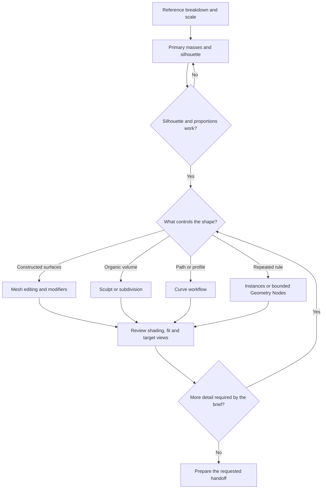

# Develop form and choose modeling tools

Use for detailed form development after the necessary reference/blockout work. Start at the
current asset's weakest relevant level, not automatically from scratch. At every pass decide
whether the target view or downstream use benefits from more geometry.
For a known cut/radius or anchored-thickness operation, go directly to the
[hard-surface techniques](technique-index.md#hard-surface); use this guide for form/tool choices.

## Primary, secondary, then surface detail

Primary forms establish silhouette and proportion. Secondary forms explain construction:
openings, major bevels, panel depth, joints and support. Surface detail describes finish and
use. Review each at the intended distance. A scratch map cannot repair a wrong housing profile;
extra edge loops cannot compensate for a badly positioned camera.

Choose topology for the output: deformation, subdivision, close specular highlights, baking,
manufacturing or real-time delivery need different treatment. Do not impose all-quads or a
fixed polygon count on every asset. Plan UV seams, material boundaries and moving parts before
committing fine topology; preserve editable sources for later changes.

For repeated scripted primitives, choose built-in construction or a proven source mesh
when they already provide the needed topology. A custom vertex/face helper needs one
non-degenerate sample checked for dimensions and outward winding before multiplication.
Closed, manifold boxes can still have every face pointing inward; a two-sided render or
`mesh.validate()` does not establish orientation. The [scoped shell probe](techniques/mesh-orientation.md)
reports separate components and degeneracies without repairing them. Reuse the checked construction.

## Practical tool choices

| Shape problem | Useful operation and setup | What to inspect |
| --- | --- | --- |
| Extend a shell or make a recess | Extrude for connected depth; Inset for a local border; establish thickness and face direction | Duplicate internal faces, consistent wall thickness, intended opening |
| Symmetric construction | Mirror around an intentional origin or mirror object; use clipping/merge only where a shared seam is intended | Seam, merge distance and asymmetric features |
| Edge highlight / manufactured radius | Bevel selected edges through angle, weight or explicit selection; choose width in scene units | Tiny-edge clamping, overlap, silhouette and highlights at target distance |
| Cut or join volumes | Boolean with suitable solver and coherent operand volumes; inspect intersections before cleanup | Coplanar ambiguity, thin slivers, normals and downstream bevel/subdivision |
| Give a sheet thickness | Solidify with deliberate thickness, offset and rim behavior | Inside corners, actual thickness and self-intersections |
| Smooth a designed surface | Subdivision with purposeful control topology, support loops or creases | Pinching, volume loss and render subdivision cost |
| Bend a whole form cheaply | Lattice, Simple Deform or proportional editing with explicit axes, pivot and falloff | End conditions, preserve-volume needs and surrounding fit |
| Fit to another surface | Shrinkwrap with deliberate target, projection direction, offset and affected region | Back-side projection, penetrations and boundary behavior |
| Repeated construction | Linked duplicates/collection instances, Array or a GN system | Spacing, accumulated offsets and source ownership; see scatter/curve branches |

For construction or deformation stacks, read [modifiers](modifiers-workflow.md): order,
selection/weights, space and bind state are part of shape design. It includes order tradeoffs,
diagnostics and applying a derived copy without losing the intended evaluated result.

## Sculpting and retopology

Use broad move/grab and volume-building operations at modest resolution to establish the
form; refine only where the silhouette or surface needs support. Choose voxel remesh for
rebuilding volumes, Dyntopo for local adaptive sculpt detail, or Multiresolution when its
base-topology workflow fits. Treat each as a representation choice with cost and data-loss
implications. Preserve a checkpoint before topology replacement and bound resolution.

Use retopology when deformation, baking, editing or delivery justifies it. Arrange loops for
the required motion and visible curvature, then validate extreme poses or a bake test rather
than judging only the wireframe. Use [rigging](rigging-workflow.md) for joint/control design
and [deformation](deformation-workflow.md) to distinguish topology, weight and corrective-shape
problems. Test representative poses before committing dependent UVs/keys to changed topology.
Fine sculpt detail may belong in displacement/normal maps;
use the [baking workflow](baking-workflow.md) to verify the actual receiver and saved maps.
The [recent features guide](recent-blender-features.md) covers newer sculpt tools without
making them a required replacement for these methods.

## Surface quality and handoff

Test the intended construction, regardless of which model/agent built it. For a solid part,
"some vertices exist" and a plausible shaded image are insufficient. Use a target view plus
a section, orthographic detail, face-orientation overlay or evaluated measurement as appropriate.

| Property | Useful evidence and common false positive |
| --- | --- |
| Real wall thickness | Measure between the intended opposing surfaces at relevant thin regions, before/after finishing and at parameter extremes. A nonzero bounding box can conceal folded, doubled or self-intersecting surfaces. An intentional source plane/profile may remain zero-thickness. |
| Closed solid where required | Inspect boundaries, non-manifold connections, internal/duplicate faces, degeneracies and self-intersections. Positive signed volume alone is not proof of a valid shell. Keep intended openings or surface representations intentional. |
| Face direction | Inspect Face Orientation and normals from exterior/interior views. Recalculate or flip according to the intended shell; a flat open sheet needs an explicit intended side. Face winding and custom shading normals are separate data. |
| Surface shading | Inspect neutral and grazing light, sharp boundaries and interpolated/custom normals. Smooth shading, Weighted Normal and shader bump cannot add thickness, fix a silhouette or repair inverted/overlapping faces. |
| Part orientation | Compare visible faces, edge directions and attachment side against the reference. Correct face winding or contact does not establish the intended front/side view. After a rotation, recheck dependent fittings and cable/pipe routes. |
| Assembly fit | Measure both sides of each important joint in the same space: support contact, intended penetration, positive clearance or deliberate seam. Use a scale-appropriate tolerance and inspect parameter extremes; inspect oblique/reverse views when one camera hides the joint. |

Repair the first incorrect construction stage and repeat the affected checks before adding
surface detail. Do not require a watertight volume from an intentional cloth sheet, decal,
guide curve or source profile. Conversely, do not accept an accidentally open physical slab
because its material is double-sided. Keep this distinction in the asset's output contract.

The [normals manual](https://docs.blender.org/manual/sl/latest/modeling/meshes/editing/mesh/normals.html)
distinguishes face orientation from custom split normals. Use runtime-matched diagnostic tools;
an Edit Mode analysis of a source mesh may not represent its final constructive modifiers.

Inspect a neutral shaded view and a useful grazing/specular view. Distinguish geometric
pinching, inverted normals, smoothing boundaries and material artifacts before changing
topology. Smooth shading changes normals, not silhouette; use sharp-edge/angle/normal tools
for an intentional shading result. Verify exposed edges and interiors relevant to the shot.

Check manifoldness when the output requires a closed volume; an open sheet or intentional
profile need not be closed. Validate evaluated dimensions and major fit, then route to
[UV layout](uv-workflow.md) and [baking](baking-workflow.md),
look development, rigging or export as the requested deliverable needs. Use the shared
[procedural bounds](procedural-geometry.md) for subdivision, arrays and other topology growth.

Use runtime-matched manuals linked from the modifier guide for specific settings. This
workflow is a tool-selection guide, not a universal modifier stack.

Worked example: [drilled motor and editable geometry examples](implementation-examples.md#geometry-and-surfaces).
Read the chosen card's evidence and limitations before adapting it.
