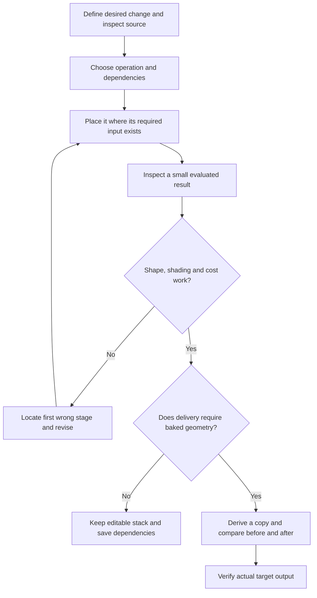

# Modifiers: design and verify the evaluated stack

For a small executed opening/edge example, use [Boolean → Bevel](techniques/cut-bevel.md).

Use when constructing, deforming, debugging or preparing a derived version of an asset.
Choose the operation for its intended geometric effect, required editability and downstream
use. A short stack is sufficient when it solves the shape; a longer stack needs understandable
dependencies, not a ceremonial cleanup order. Continue the reference/form review in
[modeling](modeling-workflow.md), and use [GN](geometry-nodes-workflow.md) for procedural groups. For skinning, pose corrections
and cage/shape-key behavior, continue with [deformation](deformation-workflow.md); for the
skeleton and control relationships, use [rigging](rigging-workflow.md).

## Establish what each stage receives and produces

Inspect the actual object type, source mesh/curve, transforms, origin, linked/shared data,
shape keys, animation and existing stack before changing it. Identify referenced cutters,
curves, cages, armatures, textures and attribute/vertex-group inputs. The visible result can
depend on another object's evaluated state, not only on the active object's mesh.

Treat the stack as ordered geometry processing: upstream changes alter the input of later
operations. Explain consequential order choices in terms of the desired shape. Keep meaningful
modifier names and a small public control surface. A modifier can be present yet ineffective
because its target, selection, weight, component or visibility state is wrong.

## Choose by the geometric job

| Need | Candidates and decisions | Inspect before expanding the asset |
| --- | --- | --- |
| Symmetry or repetition | Mirror with intentional origin/reference; Array or native GN placement | Seam/merge threshold, clipping versus welding, spacing, caps, bounds and source sharing |
| Shells, panels and rims | Solidify with selected mode, offset and thickness | Inside/outside direction, corners, rim materials and actual wall thickness |
| Manufactured edge highlights | Bevel with deliberate width interpretation, segments and affected edges | Silhouette, small-edge clamping, miter intersections and reflected highlights |
| Cut, union or intersect volumes | Boolean with retained operands and a solver suited to input geometry | Closedness when required, coplanar/tiny intersections, internal faces and downstream shading |
| Smooth control surface | Subdivision Surface with useful control topology/creases; Multires for its sculpt workflow | Shrinkage, pinching, open boundaries, level-dependent shape and cost |
| Bend, twist or shape a form | Simple Deform, Curve or Lattice | Local axis/origin, sufficient deformation sampling, limits and cross-section distortion |
| Follow a surface or cage | Shrinkwrap, Surface Deform or Mesh Deform according to the relationship | Projection versus bound deformation, affected region, offset, bind/rest state and target validity |
| Deform a character or correct a joint | Armature, Corrective Smooth and appropriate corrective shapes | Weight leakage, volume loss, pose extremes and topology/rest-state compatibility |
| Change shading or transfer data | Smooth by Angle, Weighted Normal, Normal Edit, Data Transfer or GN attributes | Sharp boundaries, mapping correspondence and attribute propagation; normals do not repair silhouette |
| Rebuild or reduce geometry | Remesh, Decimate, Weld or a deliberate topology operation | Loss of UVs/attributes, collapsed detail, seam damage and output-specific topology needs |
| Add relief | Displace with deliberate coordinates/strength/midlevel, or shader relief | Enough geometry, space and scale; distinguish mesh displacement from render-only shading |
| Physics or time-dependent geometry | Appropriate simulation/caching system at the intended stack stage | Input topology, reset/rebake requirements, playback and reproducibility; see [animation](animation-workflow.md) |

This is a selection map, not a demand to use each family. Surface Deform transfers a target's
deformation; Shrinkwrap projects toward a surface. Smooth changes vertex positions; smooth
shading changes normal interpolation. These similarly named operations solve different tasks.

## Order follows the intended construction

Use a small A/B example when uncertain; compare silhouette, section, normals and evaluated
geometry. These examples explain dependencies rather than prescribing one stack:

- **Mirror and finish:** welding a symmetric base before subdivision can create a continuous
  surface. Finishing separate mirrored halves can retain a seam. Confirm which result is intended.
- **Solidify and Bevel:** thickness first creates side/rim edges that a later bevel can round;
  beveling a sheet first shapes only the geometry available at that stage. Check the thickness
  remaining after rounding and whether the chosen width is clamped by small features.
- **Boolean and Bevel:** cutting first lets a later bevel affect new cut edges; cutting a
  previously rounded form can leave sharp cuts. Edge-selection rules and topology determine
  which edges are actually affected. Do not fix a solver failure by blindly adding segments.
- **Repeat and deform:** an array before a bend can form one continuous bent assembly;
  deforming the source before repetition repeats the already bent element. Check joins and
  whether instances should preserve rigid shapes instead of stretching.
- **Subdivision and deform/displace:** earlier subdivision provides samples for detailed
  deformation at greater cost. Later subdivision smooths the deformed coarse shape. Match
  sampling to the required curvature and test the production levels.
- **Deformation and correction:** Corrective Smooth commonly follows the deformation it
  corrects. Its rest-source choice must match the topology arriving at that stage; constructive
  operations upstream can require bound coordinates rather than original vertex coordinates.
- **Normals and topology:** normal treatment should act on the surface whose shading is being
  judged. Later topology changes can invalidate an earlier result; preserve sharp boundaries
  and verify propagation rather than enforcing “Weighted Normal always last”.
- **Simulation and finish:** establish which topology/rest data the solver consumes. Cloth
  finishing thickness/subdivision commonly follows the simulation; a higher subdivision
  level before it changes simulated geometry and cache cost. Surface-rest capture for modern
  hair dynamics must precede the deformation it describes. Use [cloth](cloth-workflow.md)
  or [grooming](grooming-workflow.md) for the actual system, rather than a universal stack order.

For corrective rest data, see the
[Corrective Smooth manual](https://docs.blender.org/manual/id/5.2/modeling/modifiers/deform/corrective_smooth.html).
After changing upstream topology, targets or the rest setup of a bound modifier, check validity
and rebind when required. After simulation-input changes, invalidate/rebuild the relevant cache.
Do not regard a successful bind at one pose as proof of every pose.

## Resolve common settings with measurements

**Scale and origin.** Many operations use local coordinates. Nonuniform object scale can
distort a bevel or make Solidify's world-space thickness vary by direction. Choose a deliberate
transform policy, then measure the evaluated world-space result. Applying transforms can change
rigs, children, drivers, shared data or an established procedural setup; do it only where
appropriate. Clearing scale changes object size and is not a substitute for preserving shape.

**Thickness.** Decide where the original sheet lies within the finished wall: inside, outside
or center. Normals affect that direction. Even Thickness is not a manufacturing guarantee;
inspect tight bends and junctions rather than trusting the setting name. See
[Solidify](https://docs.blender.org/manual/en/5.1/modeling/modifiers/generate/solidify.html).
For scripted BMesh solidification, see the [fresh-normal check](techniques/mesh-orientation.md):
its cached-normal issue is separate from modifier thickness settings.

**Bevels.** Decide whether width means offset, width, depth or another supported interpretation.
An angle limit, edge-weight attribute and vertex group select edges differently. Check that
weights exist on the intended domain and survive preceding operations. Clamp Overlap may make
the actual radius smaller than requested; disabling it can cause intersections. Use segments
needed by the target highlight/silhouette, then assess shading separately from geometry. See
[Bevel](https://docs.blender.org/manual/de/5.2/modeling/modifiers/generate/bevel.html).

The GN Mesh Bevel node is a separate interface. In Blender 5.2, edge mode uses the four
start/end left/right offsets; the singular `Offset` belongs to vertex mode. A valid link
to an inactive input can therefore leave the actual edge width at its default. Set the
mode first, inspect its active inputs, then measure thickness and corners on a small solid.
Do not assume every conventional Bevel option has a direct node equivalent. See
[Mesh Bevel](https://docs.blender.org/manual/en/5.2/modeling/geometry_nodes/mesh/operations/mesh_bevel.html).

**Booleans.** Retain intelligible cutters and inspect their geometry and visibility separately
from the result. Use Float for suitable simple inputs, Exact where its overlap handling is
needed, or Manifold when its manifold-input requirement holds. These choices have different
failure modes; Exact is not a substitute for understanding bad input. Extra self-intersection
or hole handling should address an observed case. Inspect material assignment on cut faces.
See [Boolean solvers](https://docs.blender.org/manual/nl/5.2/modeling/modifiers/generate/booleans.html).

## Ordinary types and asset modifiers are distinct implementations

Inspect the runtime version and RNA, plus the installed Essentials asset interface. A menu
entry may create a conventional modifier or a Geometry Nodes asset group. In particular,
the legacy `ARRAY` modifier and the GN-based Array asset are not interchangeable APIs. Do not
create a guessed modifier enum from a display label, or copy a tutorial's numerical sockets.
Asset inputs, child groups and resources belong to the asset's dependency contract.

The [recent-features guide](recent-blender-features.md#modifier-specific-compatibility-checks)
tracks concrete version boundaries. For an unfamiliar setting, read matching release notes
and manual, inspect the live enum/interface, test a small example and read back the result.
For GN modifier parameters use the runtime-appropriate access in [Blender methods](blender-methods.md).
Recheck authored drivers/animation after migration; a property that accepts a write may not
be the property the modifier actually evaluates.

## Debug the stack before applying it

Inspect the first stage where the result becomes wrong: compare stack prefixes in a temporary
copy or toggle a small subset while preserving original settings. Check viewport/render flags,
Edit Mode visibility and cage display independently; an edit cage is not the final geometry.
Use the evaluated mesh/dependency graph, including instances, rather than only `obj.data`.

| Symptom | Useful first check |
| --- | --- |
| Effect missing | Visibility flags, object/component compatibility, target reference, influence/group, selected edges |
| Thickness or radius inconsistent | Object scale, width mode, local small edges, normals, clamp and operation order |
| Shading damaged | Actual topology, face orientation, sharp boundaries, custom normals and where those data change |
| Bind/correction breaks | Upstream topology, rest pose, target validity and stale bind/cache state |
| Preview works, render fails or differs | Render visibility/levels, Simplify, simulation state, asset references and expanded geometry cost |
| Applied/exported result differs | Application order, evaluation mode/frame, shared data, attribute/material loss and importer behavior |

Bound arrays, subdivision, remesh voxel resolution and repeated nested stacks before evaluation
using [procedural bounds](procedural-geometry.md). Compare only meaningful alternatives, and
optimize measured expensive stages. One modifier can generate far more geometry than a long
stack of cheap deformations; modifier count is not a performance metric.

## Apply only for a concrete handoff

Keep editable sources. On an independent delivery copy, identify whether the target needs
an evaluated static mesh, an applied prefix, deformation keys, a rig or a baked animation.
Copying the object can leave its mesh shared: verify ownership before destructive application.
Applying a modifier from the middle can evaluate it as if first and change the result. Either
apply the required prefix in order on the copy or derive the intended evaluated snapshot,
then compare against the source at the same frame/settings. Do not silently bake a whole rig
when the deliverable requires editable animation.

Topology-changing operations conflict with fixed shape-key correspondence. Use a supported
deform-only shape-key route only where it preserves that correspondence; otherwise design a
separate export/bake solution. GN on an Empty cannot use ordinary mesh-modifier Apply; select
a supported evaluated-geometry conversion where needed. The
[modifier introduction](https://docs.blender.org/manual/en/latest/modeling/modifiers/introduction.html)
documents application and shape-key restrictions.

Check evaluated dimensions, silhouette, intersections, material slots, UVs/named attributes,
normals and relevant poses before/after. Inspect actual production settings and a saved/reopened
deliverable. Exporters may evaluate a different subset or visibility mode: test the imported
result. Successful Apply or file export is an operation result, not the acceptance criterion.

Worked example: [evaluated thickness and contact](techniques/anchored-shell.md).
Read the chosen card's evidence and limitations before adapting it.
