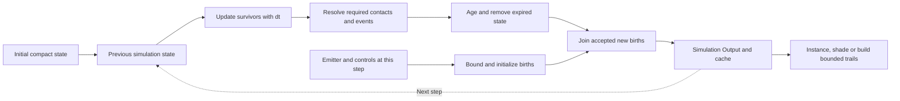

# Stateful particles in Geometry Nodes

Use after [choosing the particle route](particles-workflow.md). The
[GN workflow](geometry-nodes-workflow.md) covers field domains, typed sockets and data flow;
this guide covers particle identity, time integration, lifecycle and replay. The following is
a design model, not a required node layout or a complete general-purpose physics solver.

For an already chosen mechanism, use [birth budget/ID](techniques/gn-emission-budget.md),
[survivor update](techniques/gn-state-step.md) or [owned bake/replay](techniques/gn-bake-replay.md).
These short cards cover one bounded operation; the guide below covers design choices.

## Separate state from its rendered representation

Keep compact points/vertices with position and the state the effect actually needs. Typical
point-domain state is `fx_velocity` (scene units/second), `fx_age`/`fx_lifetime` (seconds), an
integer `id`, and optional size, orientation, angular velocity, birth time or event flags.
Names are examples: use a deliberate interface and inspect type/domain/existence at boundaries.
Store per-particle values on the geometry carried through the zone; an unconnected field is
not persistent per-particle state. Global state can include elapsed time, next ID and a fractional
emission accumulator. Feed the zone's result into instancing/material/trail branches afterward.

Simulation Input receives the initial state once. External values linked into the zone are
reevaluated at each step; joining fresh births only before the input initializes a burst rather
than continuous emission. Output leaves through Simulation Output. Pair the input/output nodes
and define state items before wiring version-sensitive sockets. See
[Simulation Zone semantics](https://docs.blender.org/manual/vi/5.2/modeling/geometry_nodes/simulation/simulation_zone.html).

Choose a consistent update convention. For example, advance existing particles, remove expired
ones, then add new age-zero births at the end of the interval. Those births first move at the
next step. A solver with subframe birth times instead advances each birth for its remaining
fraction of the interval. Both need documented timing; accidentally advancing newborns by a
full interval can produce launch offsets and shortened lifetimes. Define the initial frame,
first emission and exact death condition instead of relying on a hidden one-frame assumption.

## Use elapsed time and persistent identities

Use Simulation Input's **Delta Time in seconds** for rates and integration. Effective scene
FPS includes `fps_base`. Do not assume one frame is one second, and do not advance an initial
state when dt is zero. Repeating a per-frame displacement at a different FPS changes the motion.
For a constant acceleration, one possible integration step is:

`p_next = p + v * dt + 0.5 * a * dt²; v_next = v + a * dt; age_next = age + dt`.

That position equation is exact only for acceleration held constant over the interval, before
contacts. Semi-implicit Euler or another solver may fit other systems. Define acceleration
versus force/mass deliberately. A time-based damping such as `v *= exp(-drag * dt)` avoids
an unexplained fixed multiplier per frame; it still needs an appropriate integration order.
More substeps improve some errors but cannot repair an incorrect coordinate space or contact rule.

For a rate r, accumulate `carry + r*dt`, emit its integer part, and carry the fraction forward.
Rounding `r*dt` independently every frame loses low-rate particles or changes the rate with FPS.
Define burst events separately and prevent a held event condition from firing again every step.
If substepping a custom solver, use dt/substeps for each update and allocate births once or
at correct substep times; repeating the full-frame emission in each substep multiplies births.

Enforce available capacity before creating births: for example, accept at most
`max_live - survivor_count`, clamped to zero. Decide whether excess requests are dropped or
queued with a separately bounded backlog; do not silently turn rejected whole births into an
unbounded carry. Bound source sampling itself as well as accepted births, and bound retained
trail history separately through [procedural limits](procedural-geometry.md).

Assign identity **once at birth**, unique across retained particles/history and emitters. A
monotonic integer counter carried through the zone plus the birth's local index is one option.
Advance it by accepted births, even when earlier particles die. A frame-local Index or resetting
the counter to current population can reuse IDs. Set ID writes the built-in attribute; an ID
node falls back to Index if the attribute is absent. See
[Set ID](https://docs.blender.org/manual/en/latest/modeling/geometry_nodes/geometry/write/set_id.html)
and [ID](https://docs.blender.org/manual/en/5.2/modeling/geometry_nodes/geometry/read/id.html).

Use ID plus a named seed to initialize lifespan, velocity variation, scale or color. Preserve
those values through filtering/joining/caching. Regenerating random velocity every frame creates
jitter, not a launch variation. Time-varying turbulence is a separate, intentionally continuous
field. Inspect uniqueness and a particle's unchanged attributes across births/deaths. For very
large/long simulations, choose integer bounds/namespace deliberately; a hash is not a proof of
collision-free identity and float math eventually loses integer precision.

## Put emitter, solver and colliders in one defined space

GN position fields normally live in the modifier object's local space. Moving that host can
move all retained particles with it. A stationary simulation host with a separate animated
emitter sampled in relative space is often simple for world-space trails. Other space designs
are valid if all positions, velocity vectors, acceleration and collider data use the same frame.
Avoid applying translation to vectors, and account for nonuniform scale when transforming
directions/normals and interpreting radii. Do not blindly apply transforms to an animated setup.

Sample an emitter's evaluated geometry at each emission event. Store the birth location and
initial velocity; do not repeatedly replace existing particles' positions with current emitter
positions. Include emitter velocity only when required. A rapidly moving emitter may need
subframe sampling/distributed births to avoid dotted gaps; increasing count at the same few
locations does not solve that temporal sampling problem.
For an analytic route, evaluate an authoritative emitter path at birth time and at current
time as needed. Independently duplicating the visible emitter's path in the particle graph
creates an edit dependency; share its controls/function or explicitly verify both after edits.

## Collisions and forces are explicit parts of the graph

Scene gravity, Force Field objects and Collision modifiers do not magically integrate a custom
point graph. Supply the corresponding fields/geometry and response yourself, or choose a system
that implements them. “Raycast” in GN queries target geometry; it is distinct from the shader
node with the same display name. See [GN Raycast](https://docs.blender.org/manual/nl/latest/modeling/geometry_nodes/geometry/sample/raycast.html).

Start with the required contact class. An analytic plane can test crossing and signed distance.
For a stationary plane and radius r, correct the center to the permitted side and modify velocity
only when moving into it: split normal/tangent components, use restitution on the normal and a
deliberate friction rule on the tangent. Reflecting the full velocity every frame near a plane
can cause jitter or energy gain. A simple end-of-step correction does not recover exact impact
time; use time of impact and the remaining interval when the shot needs accurate bounce timing.

For a mesh, a segment ray from previous to proposed position can detect crossings missed by
testing only the endpoint. Check Is Hit, ray length, normals and common coordinate space before
using hit data. A ray is infinitesimally thin; finite particle size, grazing contacts, moving
colliders and multiple impacts need more work or a suitable solver. Proximity alone gives distance,
not inside/outside or a complete collision response. Substeps and simplified collision proxies
can help, but test fast particles and thin obstacles. Instancing a complex shape does not give
its points shape-aware collision or particle-particle collision.

## Cache and replay

Keep the simulation range, preroll, FPS, seeds, state schema, emitter/collider dependencies and
runtime version with the asset. Reset relevant preview state after edits; use a durable bake
for independent/nonsequential rendering. GN Simulation Zone baking stores evolving state;
a Bake node can also cache stateless expensive geometry. Neither is texture baking or applying
a modifier. See [GN baking](https://docs.staging.blender.org/manual/en/latest/modeling/geometry_nodes/baking.html).

Choose packed or disk-backed bakes according to size and delivery. Packed GN bakes are supported
from [Blender 4.3](https://developer.blender.org/docs/release_notes/4.3/geometry_nodes/); verify the actual runtime
and that the packed result is saved. Disk bakes need valid paths and their files delivered.
Selecting broad bake operators may affect all simulations on selected objects: scope selection
to the intended hosts or use the runtime's specific bake operation. Verify completion, not merely
the operator return. Bake formats are version-dependent; do not promise cross-version replay.

Reopen in a fresh process, jump to middle/end/earlier frames, and compare persistent IDs,
positions, age and count with the evaluated baseline. Check cache files or packed data as
appropriate. Reopen once more after changing an owned control and rebuilding the affected bake
if editability/rebake is part of the deliverable. A file that only works after warm sequential
playback is not proof of durable random-access replay.

Validate a reduced population first: zero births, one particle, a short burst, low continuous
rate, birth/death boundaries, moving emitter and one relevant impact. Compare equal elapsed
times at different FPS or substep counts when time consistency matters, allowing the known
integration/collision error. Then inspect a rendered sequence at the intended density, including
the tail after emission stops. Cache equality alone cannot establish convincing motion or looks.
