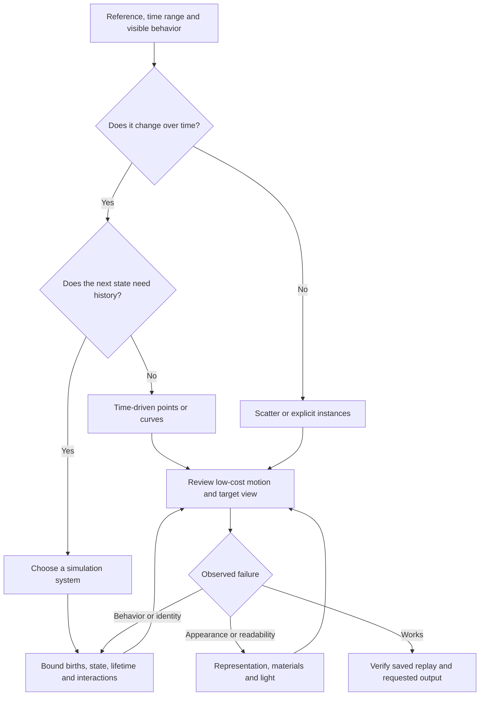

# Particle effects: choose behavior before a system

Use for emitted or moving populations: dust motes, rain, sparks, falling leaves, confetti,
debris, swarms or stylized trails. Enter here directly for a local effect. Static repetition
belongs in [scatter](scatter-workflow.md); motion timing in [animation](animation-workflow.md).
For a custom stateful graph, continue with [particle simulation in GN](particle-simulation-nodes.md).
Use [specialist simulation](simulation-workflow.md) for rigid/cloth/fluid contact and volumes;
strand design belongs in [grooming](grooming-workflow.md).

For a known local operation, start at [state/motion techniques](technique-index.md#state-and-motion):
birth/ID, time step, settled contact, age response or saved replay. Read this guide to choose
the system or representation; a local control edit does not require the full source effect.

## Define what the shot must show

Inspect actual image or motion references through the [reference workflow](reference-workflow.md).
Extract the source region, direction, spread, speed/acceleration, clustering, size range,
lifespan, interaction and appearance over time. A long-exposure spark streak is not evidence
of a long solid object; distinguish trajectory, shutter blur and a persistent trail. A still
cannot establish timing. If only still references are available, state the motion assumption
and review a preview sequence. A behavior study can be complete before detailed surfacing.

Set real scale, FPS, shot range, any preroll, camera and the required deliverable. Decide whether
the effect needs physical contact, art-directed trajectories or just a convincing image.
Keep emitter, motion rules, render representation and material response separately editable.
Expose useful controls with units: particles/second or total burst, lifetime seconds/frames,
launch speed, spread, particle radius, wind, seed and preview density.

## Select the least complex route that supports the behavior

| Requirement | Candidate | Decision boundary |
| --- | --- | --- |
| Stationary dust, surface objects or a single arranged burst image | Bounded GN points/instances or hand placement | No history needed; preserve deliberate composition |
| Repeatable drifting motes, orbiting shapes, known ballistic paths or a designed loop | Stable points plus Scene Time/curves, with birth time and analytic age | Direct seeking is useful; complicated interaction or accumulated events may require state |
| Custom emission, aging, collisions, state transitions or accumulating trails | GN Simulation Zone with explicit state | Design the state and solver; a zone alone supplies no particle physics |
| Existing Emitter setup, straightforward built-in forces/collision or an established Boids workflow | Legacy Particle System where the runtime supports it | Keep working project setups; verify actual cache and object/collection rendering |
| A few hero fragments with shape, orientation and mutual contact | [Rigid bodies](rigid-body-workflow.md) or keyed motion | Point-radius bounce cannot reproduce arbitrary fragment contacts |
| Coherent smoke/fire, liquid surfaces or foam coupled to liquid | [Fluid domain/flow/effector workflow](fluid-workflow.md) | Instanced dots or Points to Volume alone do not solve those physical systems |
| Dense granular interaction | A suitable tested specialist solver | Contact, packing and friction require their own proof; neither this particle guide nor a liquid template certifies grains |
| Hair/fur strands or grass grooming | [Curves/grooming](grooming-workflow.md); suitable dynamics if needed | Legacy Hair particles and modern Curves are different data/workflows; static grass can use scatter |

Preserve a suitable existing solution. Native GN is useful for custom, inspectable effects;
it is not a reason to replace a functioning Emitter or install a third-party package.
Inspect the intended version: the local 5.2.1 runtime retained legacy particle types, while
5.2 introduced **experimental** GN hair/cloth physics. Neither observation guarantees another
version's interface. Those new dynamics/XPBD tools are not an automatic general particle,
fluid or rigid-body replacement ([5.2 physics](https://developer.blender.org/docs/release_notes/5.2/physics/)).

## Legacy Emitter: use its actual contracts

Inspect emission start/end, total parent count, lifetime, seed, source distribution and masks.
**Number is not a particles-per-second control; Lifetime is in frames.** Convert a desired
rate/duration deliberately and inspect actual birth/death times, including endpoints and preroll.
For surface emission, check evaluated mesh, normals and modifier order; use volume emission
only with an appropriate closed volume. Test moving/deforming emitters at low count before
increasing density. The source's movement and the initial normal/object velocity contributions
are separate choices. See [emission](https://docs.staging.blender.org/manual/en/latest/physics/particles/emitter/emission.html)
and verify the corresponding installed-version settings.

Choose physics for the effect: Newtonian for forces/ballistics, Keyed for designed transitions,
Boids when its behavior rules fit the task. Inspect gravity/field weights, damping and the
collision collection. A Collision modifier and scene force fields can participate in this
system; their existence does not automatically drive a custom GN graph.

Fast motion and thin obstacles need a small collision trial: increase integration subframes
where justified, inspect collision normals/thickness and whether particle size participates
in deflection. Check die-on-hit versus bounce, friction and repeated contacts. Do not present
particle/deflector contact as mutual rigid-body collision. See
[Newtonian integration/deflection](https://docs.blender.org/manual/en/2.93/physics/particles/emitter/physics/newtonian.html)
and inspect the live settings before using old examples.

Choose an actual supported render representation. An old tutorial or a stored Halo enum does
not prove that the intended renderer draws it. For object/collection instances, check pivot,
source axes, size, rotation, collection picking and material assignment. Viewport display
percentage, children and render settings can produce very different counts/costs. Prove a few
particles in a real render, then test the intended count. Preserve original sources.

## Shape the effect in space and time

Use emission envelopes, masks, bursts and coherent flow to establish the large motion before
adding randomness. A seed is for repeatability, not a substitute for composition. Protect
focal subjects and negative space, and inspect the camera throughout the range. Stable identity
must drive per-particle color, scale and variation so deletion/reordering does not cause popping.

Separate simulation radius, rendered object bounds and perceived size, but keep their intended
relationship consistent when changing size, age-driven shrink or orientation. Check the actual
rendered bounds against the actual support near impact/settling; a center clamped to a fixed
offset can float after the visible radius shrinks. Update the contact representation and any
affected bake when needed. A long confetti strip can intersect the floor even when its
center/radius test passes. Decide whether that needs an
orientation-aware proxy, a different solver or an explicitly accepted distant-shot approximation.
For moving colliders, inspect relative velocity and the source/collider's evaluation time.

Map normalized age to color, opacity/emission or size only when the reference calls for it.
An emission shader does not itself add a screen-space halo. Use [shader nodes](shader-nodes-workflow.md)
for attribute interpretation and [lighting/rendering](render-workflow.md) for exposure, paths,
transparency, motion blur and temporal denoising. Check actual rendered attributes, not only
the Spreadsheet. Tiny bright points can flicker; judge them at delivery resolution over time.

Do not assume **Particle Info** reads GN particle state. Its documented scope is Cycles parent
particles rendered as objects/collections, with age/lifetime in frames
([Particle Info](https://docs.blender.org/manual/en/latest/render/shader_nodes/input/particle_info.html)).
For GN, pass explicit named attributes through the intended point/instance/realized domain and
use the corresponding shader lookup. Instancer lookup can read GN instance attributes
([support introduced in 3.4](https://developer.blender.org/docs/release_notes/3.4/nodes_physics/));
verify it on the final representation and renderer before building a whole age-driven effect.

For sprite-like effects, textured card instances can be cheaper than detailed meshes. Choose
camera-facing or axis-locked orientation deliberately and inspect alpha edges, overlapping
cards, shadows and camera changes in the actual renderer. For motion blur, verify the rendered
subframe result: storing a custom `fx_velocity` attribute does not automatically connect it
to a renderer/exporter's velocity convention, and stable IDs alone do not guarantee correct blur.

Keep points and instances lightweight until a consumer needs mesh/curves/volume. A persistent
trail needs particle ID plus sample order/time, a bounded history and a rule for dead particles;
joining points by current index can connect unrelated births. Curves to tubes and volume grids
can dominate cost even when the particle count looks small. A blur streak and a stored trail
have different data and timing requirements.

## Cache, review and hand off

Bound creation before evaluation: rate, burst size, lifetime, simultaneous survivors, child
emission, trail samples, instance complexity and frame range. For a steady source, rate times
mean lifetime estimates the live population; use maximum lifetime/bursts and an explicit cap
for a hard bound. An ever-growing history is not bounded by deleting expired visible instances.
Neighbor interactions can cost far more than independent particle updates; bound neighborhood
work and measure solver cost before scaling a swarm or all-pairs interaction.
Test zero emission and the intended maximum, not only the convenient default.

For a stateful effect, sequentially evaluate from the initial frame with required preroll.
Preview cache, saved bake and exported geometry are different deliverables. Save a reproducible
setup and record cache ownership, location, frame range, FPS, source dependencies and settings.
Changes to sources, forces, collisions, seed, time or the solver can invalidate a bake; invalidate
and rebuild only the affected owned cache. A saved blend alone does not prove its cache exists.
GN packed/disk behavior is covered in [the simulation guide](particle-simulation-nodes.md#cache-and-replay).

Inspect birth, peak density, first impact, death and tail end, plus consecutive frames through
important events. Test identity stability, emitter movement, collisions, bounded population
and disappearance. Reopen in a fresh process and seek frames out of order when that delivery
needs it. Compare state by persistent identity rather than current array order. Render a short
preview at the intended FPS; separate skipped-frame playback from actual timing.

For export, prove that the chosen consumer retains instances, time samples, IDs, velocities,
materials and any needed blur; a Blender simulation cache is not a universal interchange file.
For example, [USD point-instancer support](https://docs.blender.org/manual/id/5.2/files/import_export/usd.html)
has format/exporter limits; a successful export does not imply that the editable GN graph travelled with it.
Deliver only the requested sources/cache/sequence, with preview/final distinctions and measured
limits. A few sampled frames cannot establish every collision, engine or production-scale limit.
