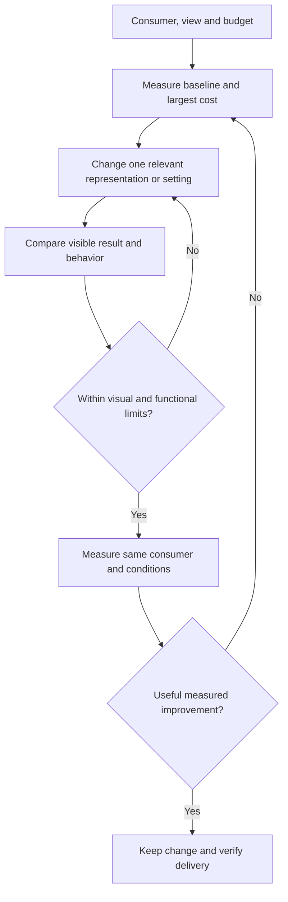

# Performance: measure the consumer and preserve the visible result

Use for geometry/texture budgets, costly scenes, LODs and runtime delivery. For offline engine,
sampling and output costs, also use [rendering](render-workflow.md). For interchange, pair this
with [export](export-workflow.md); a smaller source file does not prove a cheaper target frame.

For GLB payload counts and explicitly limited memory estimates, use
[payload audit](techniques/glb-payload-audit.md); actual receiver timing still follows this guide.

## Establish a reproducible budget

Identify consumer/version, hardware/platform, resolution, representative view/sequence and
quality requirements. Use an existing project budget or label an initial estimate. Do not
invent a universal triangle, material or texture ceiling for every asset. Set local budgets
from the scene's visible counts and importance; one acceptable prop can become expensive when
repeated across the scene.

| Resource | Measure separately |
| --- | --- |
| Geometry | Unique meshes, exported vertices/triangles, expanded occurrences, visible/culled geometry and deformation work |
| Materials and drawing | Material slots/primitives, shader variants, target batches/draw calls/passes and shadow passes |
| Textures | Dimensions/channels/format, mip levels, unique/shared images, disk bytes and actual resident/streamed memory |
| Animation/FX | Skin influences/bones, morphs, update rate, simulation/cache cost and expensive temporal peaks |
| Delivery/startup | Package bytes, dependency count, decode/upload/load time and transient memory |
| Frame/render | CPU and GPU timings, render samples/quality, resolution, peak memory and representative outliers |

Source vertices are not necessarily exported vertices: UV seams, hard normals and material
boundaries can split GPU attributes. Count the payload after conversion. Shared mesh data can
save storage while each occurrence still costs visibility, shading, shadow or animation work.
Material count is a useful warning, not a measured draw-call count. Use the target profiler to
identify actual draws and passes; [Unity's rendering statistics](https://docs.unity3d.com/6000.0/Documentation/Manual/RenderingStatistics.html)
illustrate why geometry, batches and pass changes are distinct metrics.

Keep cold import/compile/upload separate from warmed playback/rendering. Repeat comparable
measurements when timings matter, hold the view/settings fixed, and avoid attributing concurrent
jobs or shader compilation to the asset. A single tiny fixture's timing is not a benchmark.

## Choose the optimization that addresses the cost

- Geometry/evaluation: fix unnecessary subdivision, curve resolution or realization using
  [procedural bounds](procedural-geometry.md). Reuse data where appropriate. Merge only when
  the benefit outweighs lost culling, editability, animation or material boundaries.
- Shading/overdraw: inspect alpha layers, expensive shader paths, material/pass proliferation,
  shadow casters and transparent overlap. More alpha cards can cost more than a modest mesh.
- Textures: allocate resolution to visible texel density, share suitable sources, pack channels
  only with correct semantics, and test target compression/mips. Disk PNG/JPEG size is not GPU
  texture memory. An RGBA8 base-level estimate is width×height×4 bytes; a full 2D mip chain is
  approximately 4/3 of that before block compression, alignment and runtime allocation effects.
- Animation/FX: simplify expensive evaluated chains, bake stable work into a suitable derived
  representation, and review error over time. Decimation of a rest pose does not validate joints,
  corrective shapes or motion bounds. Cache size/load and playback cost remain separate.

Re-measure the whole scene after a local improvement. Removing material detail to hide a wrong
normal or lowering resolution to conceal a bad source is a visual change, not an equivalent
optimization. Keep the required quality contract explicit.

## LOD and visibility

Design levels for projected size and acceptable silhouette/shading error, including the most
exposed angle. Use manual modeling, Decimate, remeshing or a target system as appropriate;
percentage reduction alone does not define a usable LOD. Preserve important openings, pivots,
material/UV interpretation and deformation where needed. Inspect the actual transition,
crossfade or popping and shadow behavior in the consumer. Check animated bounds/culling too.

Use impostors/cards only where their view/depth/parallax behavior is adequate. A particular
engine's virtualized geometry system changes the choice of LOD strategy; it does not remove
material, foliage, memory or target-platform costs. Mesh names alone do not configure runtime
switching. [Unreal's LOD workflow](https://dev.epicgames.com/documentation/unreal-engine/creating-and-using-lods-in-unreal-engine)
also distinguishes rendering LODs from the mesh selected for complex collision.

## Collision and lightmaps belong to their consumers

Choose collision for the requested interaction: blocking volume, walkable opening, raycast,
rigid dynamics or another query. Keep visible and collision geometry related but independently
owned. Dynamic concave collision often needs decomposition or a different representation;
verify the receiver's restrictions. Test clearances and contacts with the actual actor/query,
not just collision-mesh visibility. An empty labeled collider is not a functional test.

Add a lightmap UV channel when baked lighting needs it. Verify non-overlap, intended bounds,
chart padding at actual resolution and texel allocation through [UV layout](uv-workflow.md).
Inspect the imported channel index and baked lighting for seams/leaks; a second UV map is not
proof that the receiver uses it. Keep material UVs distinct. Importers can generate/modify UVs
or normals, so inspect the imported asset rather than only the authoring source. See
[Unity model-import settings](https://docs.unity3d.com/6000.0/Documentation/Manual/FBXImporter-Model.html).

## Report the measured scope

Keep a compact before/after record: asset/source revision, consumer/settings, geometry and
texture counts, changed decision, measurement and visible tradeoff. Label estimates and
unmeasured target behavior. Blender cost checks cannot certify engine draw calls, gameplay
collision or device frame rate. Preserve the editable high-quality source when generating
optimized delivery variants, and verify reimport/update behavior before replacing target assets.
