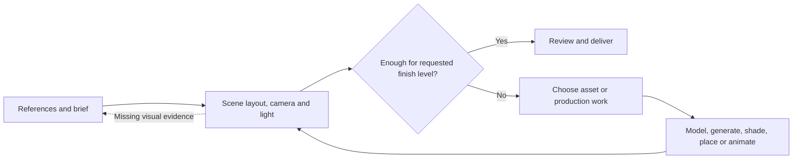

# Production map for assets and scenes

Use this map for a new scene or a substantial redesign. It locates the disciplines and their
handoffs; it is not a requirement to perform every discipline on every task. Follow the relevant
branches for blockout, modeling, Geometry Nodes, shaders, UVs/textures/baking, placement, curves,
animation, particle effects, lighting, rendering or compositing
via the [method selector](blender-methods.md).

## Define the deliverable before choosing the workflow

Determine the intended experience and how it will be judged: a still with a fixed camera,
animation with changing views, a reusable asset library, or a real-time environment. Establish
style, focal subject, scale, target resolution/viewing distance, and technical constraints.
Separate essential features from optional polish. Ask only about uncertainty that materially
changes the result; otherwise record a reasonable assumption and advance reversible work.

Choose the finish level independently of the eventual project's ambitions. A user evaluating
a film set can request only a blockout; that study is complete when the layout, camera and
light support the decision. Do not mark it incomplete for missing final textures, or call it
a production-ready set. Explicit future possibilities are not current deliverables.

Use a brief in the existing project format. Useful content is the visual goal, target views,
required assets/behavior, reference locations, scale/style rules, delivery requirements,
current unresolved questions, and the next useful validation. Do not create empty templates.

| Delivery | Decisions that change production |
| --- | --- |
| Blockout / camera / lighting study | Define the decision to assess; deliver editable masses, named views and a light/value study, with assumptions and relevant scale checks |
| Still / product visualization | Camera and silhouette drive detail allocation; verify final resolution, material response and color/output settings |
| Animation / cinematic | Validate shot coverage, deformation or rig needs, temporal stability, simulations/caches and render consistency |
| Real-time environment | Validate player views, traversal and collision early; establish target material, texture, geometry and runtime budgets |
| Reusable kit / library | Validate combinations, pivots, variants, source updates, previews and documented use beyond one staged camera |
| Focused asset edit | Reuse the existing direction and contracts; review the changed asset and affected consumers without rebuilding unrelated work |

## Stages, decisions, and evidence

Proceed when the next decision is supported, not because every item in a phase is perfectly
finished. Several disciplines overlap. A stage check is normally the agent's own review,
not a request for user approval unless the user/project has established an approval milestone.

| Stage | Main decision / useful output | Evidence needed before broadening work |
| --- | --- | --- |
| Brief and visual development | Reference selection, visual language, scale anchors, focal intent, known unknowns | Images actually inspected; essential shapes, material families and uncertainties identified |
| Layout / blockout / previs | Major masses, camera or player path, negative space, proportions, rough lighting | Target views read correctly; dimensions and spatial relationships work; reference comparison identifies no unresolved major mismatch |
| Asset strategy and prototype | Reuse boundaries, kit interfaces, unique assets, material/texture approach, first technical risks | A representative connected sample works in context, including relevant target import; interfaces survive a small variation |
| Asset production | Primary/secondary forms, appropriate topology; UVs, retopology/bakes, look development, rigging as required | Assets satisfy their visible and functional roles; the shared approach remains consistent and within measured limits |
| Scene integration | Replace proxies, dress the scene, integrate animation/FX where needed, refine lighting and cameras | Full-scene composition and scale still work; joins, repetition, occlusion, motion and aggregate cost are inspected |
| Finaling | Resolve visual defects, finish lighting/compositing and optimize measured bottlenecks | Actual production views/frames or target runtime pass the brief; improvements survive comparison with the reference and earlier milestones |
| Delivery | Editable sources, valid dependencies, derived exports, previews and necessary usage notes | Reopen/reload/import succeeds; output and source agree; requested files and checks are present |

## Two concurrent loops

**Scene loop:** references → rough composition/layout/light → in-context review → refinement.
Keep it running while assets develop. Do not postpone seeing the whole scene until every part
is detailed. A camera change can expose new surfaces or change which details matter.

**Asset loop:** reference analysis → form/interface prototype → modeling and surface work →
integration → revision → reusable release. A good isolated prop may still be wrong for the
scene's scale, visual density, palette, or lighting. Review both contexts.

Use a representative slice to connect the loops. For a corridor, it might include a straight
section, a corner/door junction, one prop, shared surfacing and a test light setup. Select it
for the questions it can answer, not a fixed object count. For one hero prop, a difficult
subassembly/material test can serve the same purpose. For a final-look task, resolve the important
[surface/light pairing](texture-authoring-workflow.md#prove-the-surface-before-spreading-it) at the
intended viewing scale; multiplying a generic material does not prove its fidelity. If comparison
stalls, revisit the evidence or authoring route before extending that treatment across the scene.
Keep a real comparison view and the next unresolved cue for the sample. If mass/color match
but structural cues fail, revise the shape or representation before expanding the family.
Do not expand a prototype into a whole unrequested environment.

## Spend effort on the cue that still fails

Prioritize by target-view importance and uncertainty, not by ease of scripting. Group related
surfaces using [material families](surface-families.md), geological forms through
[rock recipes](rock-recipes.md), and prove a difficult plant through
[vegetation](vegetation-workflow.md) before mass placement. Reuse a verified source, shader or
assembly where it already supplies the required cues; author only the missing differences.
Keep one compact comparison and the next unresolved decision per important family in existing
notes, rather than a full checklist for every object.

When a bounded iteration fails to improve the defining cue, reconsider representation or source
before adding detail: a flat control is not finished concrete, a dark tube is not a recessed
crack, and many leaves are not a convincing crown. Keep successful work and replace the weak
part. Match effort to the requested finish; do not turn every background prop into a hero asset
or declare a required hero finished merely because the generator and save/reopen checks pass.

## Plan cross-discipline dependencies early

- UV and material strategy can change module seams, bevels and topology. Decide whether the
  asset needs tileables, trims, unique bakes, decals or another approach before duplicating it.
  Use [shader nodes](shader-nodes-workflow.md) to prototype the actual response,
  [texture authoring](texture-authoring-workflow.md) to choose sources/layers/maps, and
  [baking](baking-workflow.md) for a verified transfer to the receiver. If
  [Geometry Nodes](geometry-nodes-workflow.md) supplies masks or UVs, define that data interface
  and prove it on the representative slice before propagating the generator.
  Use [material composition](material-composition.md) for multiple surface/optical responses;
  [UV layout](uv-workflow.md) defines the coordinate, density and packing contract where needed.
- Rig/deformation needs can change separation, topology, pivots and clearance. Resolve them
  before final detail when motion is requested; a static asset does not need a rig by default.
- Lighting begins during layout and is refined alongside materials. Use neutral inspection
  light to diagnose a shape/material separately from the intended scene lighting.
  Use [lighting](lighting-workflow.md) for the shot and [rendering](render-workflow.md) for
  engine support, convergence, resource cost and verified output. Agree on color/output and
  useful passes before handing frames to [compositing](compositing-workflow.md). Define
  [AOVs/mattes and layer contributions](compositing-passes-and-mattes.md) while their source
  information can still be rendered; verify the saved input/output boundary.
- [Library publication](asset-library-workflow.md) defines source/update ownership; [project handoff](project-handoff.md) verifies dependencies and clean relocation. Choose live links or pinned snapshots according to the recipient, and prove local edits survive intended updates.
- [Export/runtime constraints](export-workflow.md) can change representation and hierarchy.
  Choose the [format profile](export-formats.md) and test one representative item early, then
  validate the actual final output. Measure [performance](performance-workflow.md) in its consumer;
  an early round trip is not final certification or proof of target-device frame rate.
- Particle effects need a lifecycle, identity, time/space convention and representation that
  fits the shot; use [particles](particles-workflow.md) and, when needed,
  [GN simulation](particle-simulation-nodes.md). Agree on emitter/collider ownership, preroll,
  cache delivery and render/blur needs before finalizing the effect.
- Specialist simulation uses [pattern and cache selection](simulation-workflow.md), then
  [rigid bodies](rigid-body-workflow.md), [cloth](cloth-workflow.md), [grooming](grooming-workflow.md)
  or [liquid/gas](fluid-workflow.md). Establish physical size/time, contact representation,
  upstream solve dependencies and the actual cache handoff before adding expensive detail.
  The bundled mesh audit cannot certify these outputs or their temporal behavior.

When a reference or design decision changes, revisit affected downstream work: proportions may
change kit dimensions; topology may invalidate UVs/bakes; materials may change light response;
camera changes may change detail budgets. Keep the reason and the affected assets identifiable.

## Keep checkpoints useful

Capture comparable views at meaningful decisions, with the source revision/settings needed
to reproduce them. Separate artistic readiness (form, look, composition) from technical
readiness (saved resources, contracts, budgets, target behavior). Both matter for delivery.
An early proxy is valid for layout even while unsuitable for final publication.

The existing manifest statuses `planned/building/verified` describe technical asset readiness.
They do not encode these production stages. Keep stage notes and reference analysis in the
brief/review record; do not invent unsupported status values or claim the checker reads them.
For a scoped study in a larger planned project, keep future assets planned and review the
study's own requested output. A complete study does not imply the full asset graph is ready.

This map is a synthesis, not a universal studio standard. The primary production accounts
behind it are listed in [provenance](provenance.md#production-workflow-sources).

## Coverage and the remaining production branches

Coverage describes this skill's guidance, not the readiness of any scene. A completed blockout
does not need all the branches below. As of 2026-10-22, the skill has dedicated decision guides
for references, blockout/camera/light studies, modular ownership, modeling, modifiers, GN,
shader nodes/material composition, UVs, texture authoring/baking, placement, curves, rigging,
skinning/shape keys/cage deformation, animation,
particle effects (including a legacy Emitter route and stateful GN), specialist simulation
patterns for rigid bodies/cloth/liquids/gas, grooming and strand-dynamics choices, production lighting and
rendering, compositing with passes/mattes and image delivery, cel shading/contours and
footage integration (keying/tracking), interchange profiles and measured performance/LOD/collision/
lightmap decisions, asset libraries/linked updates and native project handoff. A branch having a guide does not mean an
independent agent has demonstrated its whole workflow end to end.

| Remaining branch | Present coverage | What a useful extension must add and demonstrate |
| --- | --- | --- |
| Specialist character workflows | Rig/control architecture, rest/space handling, skinning, corrective shapes, pose checks and bake comparison | Full facial systems, retargeting across different proportions/rest poses, production auto-rig regeneration and target skinning/morph compatibility need dedicated asset tests |
| Advanced simulation and grooming | Solver-specific common patterns including sewing/pressure, collision/rest/scale decisions, cache dependencies/replay, groom density and experimental GN dynamics with capability limits | Production-scale garments/hair, reliable progressive tearing, numerically sound hero splash/fire, complex multiphase/two-way coupling, cross-version caches and target strand/volume delivery need dedicated tests |
| Target delivery and performance validation | Export workflow, glTF/FBX/USD/Alembic selection, LOD/collision/lightmap and measurement guides; a small Blender GLB round trip | Actual target-engine imports, skin/morph/cache cases, LOD and collision behavior, lightmap baking, compression/decoder support, source updates and device profiling still require their own receiver-specific tests |
| Asset publication and reproducibility | [Asset libraries](asset-library-workflow.md), [project handoff](project-handoff.md), catalog identity, native two-consumer updates, override preservation and relocated texture/Alembic checks | Complex rig/nested overrides, actual Asset Browser discovery/previews, cross-version migration, team publication conflicts and large multi-shot packages still need representative tests |

For a static rendered scene, prioritize lighting/rendering and image delivery; add UV/baking
when the asset's surfaces require it. For a game asset, prioritize UV/baking and target import
before multiplying assets. For a deforming/animated scene, prioritize rig/deformation and
temporal validation; add simulation only for stateful physical behavior. This is a work-order
decision, not a universal requirement to complete every specialization.

Detailed trial scope and untested cases live in [provenance](provenance.md), rather than
being repeated in this routing map. A branch guide or a successful small fixture does not
certify a complete environment, all engine features, arbitrary deformation or a target import.
Use the actual task to select the next meaningful end-to-end test.

Ground specialist work in primary documentation, including
[Cycles baking](https://docs.blender.org/manual/en/latest/render/cycles/baking.html?highlight=bake),
[render passes](https://docs.blender.org/manual/en/4.4/render/layers/passes.html) and
[Blender Studio's asset publication model](https://studio.blender.org/tools/addons/asset_pipeline).
These sources inform the interfaces; this skill does not require a particular studio add-on.

Test the branches with realistic briefs, not only isolated API snippets. Separate failures of
the skill's decisions/routing from missing tools, model errors and version incompatibilities.
Use observed outcomes to make narrow changes, then rerun the affected case in an isolated
workspace. A successful file validator cannot establish artistic or behavioral reliability.
