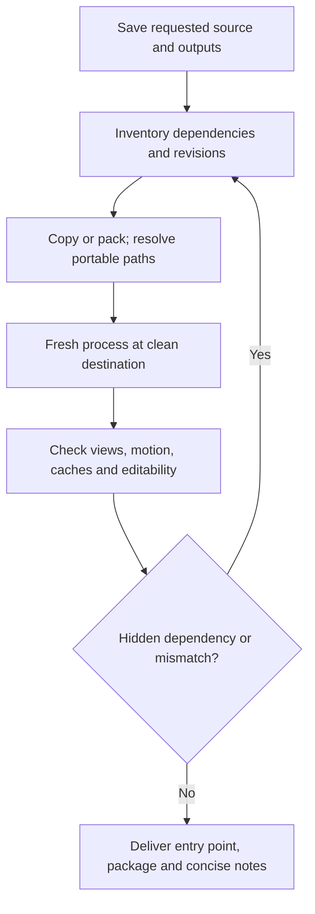

# Project handoff: prove the saved dependency package

Use when delivering editable sources, an asset library, a render/animation project or an archive.
For a derived interchange file, also use [export](export-workflow.md). Define what the recipient
must do: inspect images, edit assets, rebuild a simulation, render shots or update linked sources.
Deliver the corresponding source and dependencies; a rendered preview cannot replace an editable
project, and an editable scene without caches may not reproduce a solved shot.

For a concrete saved-resource issue, use [owner-relative paths/pixels](techniques/owner-relative-resources.md).
For a known package test, use [clean relocation](techniques/clean-project-relocation.md).
The dependency choices below remain relevant for resources those small cards do not cover.

## Inventory the actual dependency graph

Inspect saved data and recursively referenced libraries, not only the visible scene objects.
Reuse the existing manifest/project record when present. Record only resources necessary for
the requested handoff and any known excluded or unavailable dependencies.

| Resource | Packaging question |
| --- | --- |
| Native libraries and catalogs | Which published revisions are referenced, including nested links? Are catalog definitions included? |
| Images, UDIMs, sequences and fonts | Are all used tiles/frames/files saved, accessible and interpreted with the intended roles? |
| Simulation, GN bakes, geometry and volume caches | Which owner/settings/time range produced them? Are all required stages/files present? |
| Footage, audio and compositor inputs | Do clip/sequence offsets, FPS and channel/alpha interpretation survive relocation? |
| Runtime dependencies | Which Blender version, render engine, extensions/node assets, scripts or custom color configuration are actually required? |
| Editable versus derived outputs | Can the recipient distinguish authoring source, frozen cache/export and review image? |

For library-owned resources, resolve relative paths against the owning library, not blindly
against the open shot. In Python, use the relevant `library` argument to path resolution.
Search/report missing files helps identify gaps; it does not prove resource identity. If two
directories contain the same basename, verify the intended revision/content before relinking.

## Choose a package representation

Use a project folder with relative links when several scenes share assets or large external
caches. Keep a clear entry scene and portable relationships between scenes, library sources and
resources. Existing project layouts are preferable to a new mandatory directory convention.

Pack eligible small resources when a self-contained blend is useful. Saving, packing resources
and packing linked asset data are separate operations. Inspect the actual saved representation:
an image can be marked as packed linked data while its external pixels remain unavailable.
Package that file or pack it at its editable resource owner, then re-open without the original
path. A successful operator and `is_linked_packed` flag do not establish pixel availability.

[Packed-data documentation](https://docs.blender.org/manual/id/4.4/files/blend/packed_data.html)
describes eligible resources and exclusions such as footage. Do not assume every solver cache,
sequence, online dependency or external executable fits inside a blend. Some GN bakes support
packing; others need a delivered directory. Use the actual [simulation/cache route](simulation-workflow.md).
An asset `_bundle.blend` has a specific self-contained meaning in the
[Asset Browser](https://docs.blender.org/manual/id/5.2/editors/asset_browser.html); a renamed file
with unresolved references does not satisfy it.

## Reopen from a clean destination

Copy the intended package to an isolated destination. Open it in a fresh process with only the
declared configuration. Verify resolved paths stay inside the package or point to explicitly
agreed external dependencies. A stronger test makes the test source unavailable temporarily;
do that only to a controlled copy with guaranteed restoration, never to a shared production
library. A fresh process that can silently read the old absolute path is an incomplete test.

Inspect saved textures, material/node inputs, library ownership and target-view images. For
animation/cache delivery, seek out of order and compare start, middle/end and meaningful
neighboring frames; test playback without rebuilding the solve. Preserve the distinction between
cache replay, solver correctness and artistic readiness. Check a representative edit/control
when editability is promised. If updates are promised, use the two-consumer test in
[asset libraries](asset-library-workflow.md), not just a one-time open.

## Leave a reproducible handoff

Provide a compact entry-point note: intended use/finish, source and release revision, required
runtime/extensions, resource/cache locations, frame range/FPS, render/color/output settings,
tested operations and remaining limitations. Include usage rights where relevant. Record hashes
when exact revision identification or cache freshness matters; hashes cannot prove visual quality.

Keep a recoverable source before applying or reducing assets. Use version control or revisioned
releases suited to binary files and large caches; avoid concurrent uncontrolled writes to a
shared published blend. A changed source may invalidate bakes or delivery exports. Recheck those
dependencies rather than labeling old caches current. The optional [manifest profile](manifest-contract.md)
checks declared facts/freshness; it is not required for every small asset and does not replace
actual reopening, rendering or recipient testing.
