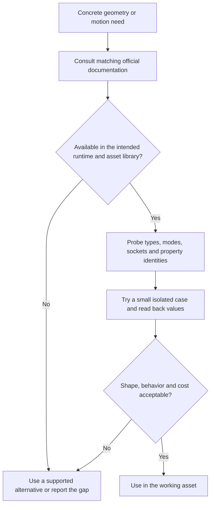

# Recent Blender features and how to adopt them

Use when selecting a newer tool or adapting a script. This is a short candidate map, not a
complete release catalogue. Checked against official release documentation on **2026-10-22**:
5.2 LTS is released; the [5.3 page](https://www.blender.org/releases/blender-5-3/) still labels
that release as expected on November 10. Recheck release status on later tasks. Never infer
the running version from an executable folder name or a moving `latest` manual.

## Capability discovery is part of tool use

Use a functioning Blender channel and inspect `bpy.app.version_string`, context, intended
datablocks and actual RNA. Prefer direct data access for deterministic edits; use operators
when they provide the needed tool behavior, with explicit mode, selection and editor context.
Read operator documentation/poll requirements before invoking them. UI labels, node class
identifiers and modifier types are different namespaces; search/introspect instead of guessing.

A tool may be a built-in operator, a modifier type, a node, an Essentials asset or an extension.
For asset-based modifiers, locate the installed asset through the Asset Browser/modifier menu
or library inspection, then inspect its node-group interface and dependencies. Do not assume
that every named modifier maps to `obj.modifiers.new(type="ITS_LABEL")`, or that every release
feature is already downloaded. Preserve source asset identity; make a local variant only for
a deliberate edit. Do not install extensions or upgrade Blender merely to follow this guide.
Appending a root group does not by itself prove that its subgroups/resources are portable:
inspect indirect libraries and asset references, especially across drives or machines.

Before a procedural group is used, set modes, inspect available sockets/domains, wire a small
valid graph, read inputs back and evaluate real geometry. Geometry Nodes fields are evaluated
by their consumers; use Viewer/Spreadsheet to debug intermediate geometry and attributes.
Keep reusable groups named, documented at their interfaces and retained through save/reopen.

## Candidate map

| Version / capability | Useful application and adoption check |
| --- | --- |
| **5.0: GN-based Array, Scatter on Surface, Instance on Elements, Randomize Instances** | Try the bundled asset for a common placement rule before writing a larger graph. Inspect its installed controls and bound counts; keep the legacy Array distinction explicit. |
| **5.0: Curve to Tube, Geometry Input** | Consider the former for a path/profile asset and the latter for an intentional dependency on another object's evaluated geometry. Check dependencies, frames and output cost. |
| **5.1: face-center snapping and improved freehand Bézier fitting** | Useful for placement and drawn path blockout. Verify the selected snapping target or fitted shape rather than assuming the new tool resolves scale or tangency. |
| **5.2: Mesh Bevel node** | Candidate for procedural edge treatment; choose mode and its active offsets, then test selected edges, thickness and growth. Its interface differs from the ordinary Bevel modifier; see [the modifier guide](modifiers-workflow.md). |
| **5.2: Set NURBS Order / Weight** | Shape control for GN curves; inspect compatible spline type. |
| **5.2: geometry bundles and GN on Empties** | Consider for cross-object data or generators without input mesh. Keep ownership explicit. |
| **5.2: Scene Project brush, primitives in Sculpt Mode, remesh attribute interpolation** | Useful for assembling sculpt volumes and projecting toward other surfaces; inspect preserved data and form. |
| **5.2: object-mode in-between tools, Graph Editor local view, playback loop modes** | Useful for motion refinement and review. Playback bouncing is not a baked looping animation. |
| **5.2: experimental GN hair/cloth physics** | Use only for a relevant motion need, with a small isolated trial, bounded simulation and a fallback. Verify cache and downstream support. |

Sources for the version claims: [5.0 modeling](https://developer.blender.org/docs/release_notes/5.0/modeling/),
[5.1 modeling](https://developer.blender.org/docs/release_notes/5.1/modeling/),
[5.2 Geometry Nodes](https://developer.blender.org/docs/release_notes/5.2/geometry_nodes/),
[5.2 sculpt](https://developer.blender.org/docs/release_notes/5.2/sculpt/),
[5.2 animation](https://developer.blender.org/docs/release_notes/5.2/animation_rigging/),
[5.2 physics](https://developer.blender.org/docs/release_notes/5.2/physics/).

## Particle and simulation compatibility

- **4.3: packed GN bakes and integer/hash utilities.** Packed Simulation/Bake results can
  simplify a small handoff; verify saved data, size and reopened seeking. Integer counters
  help birth identity, while a hash alone does not guarantee unique IDs.
- **5.2: experimental Hair/Cloth Dynamics and XPBD.** These are specific evolving physics
  tools, not a universal replacement for Emitter, fluids or custom point simulation. Inspect
  rest-state/collider inputs and test the required behavior before adopting them.
- The local **5.2.1** runtime exposed legacy ParticleSettings/ParticleSystem alongside GN
  Simulation nodes. Availability of a type or old render enum is not proof of rendered output.
  Follow [particle route selection](particles-workflow.md) and inspect the intended runtime.

For practical adoption, use [cloth](cloth-workflow.md) and [grooming](grooming-workflow.md).
The dated local probe also found XPBD and installed Hair Dynamics, Cloth Dynamics
(Experimental), Collider and custom effector assets. Their availability is a capability
observation, not evidence that every interaction or bake route works. Inspect asset/rest
dependencies and keep classic and GN collision/cache contracts distinct.

Sources: [4.3 Geometry Nodes](https://developer.blender.org/docs/release_notes/4.3/geometry_nodes/),
[5.2 physics](https://developer.blender.org/docs/release_notes/5.2/physics/) and
[Simulation Zones](https://docs.blender.org/manual/vi/5.2/modeling/geometry_nodes/simulation/simulation_zone.html).

## Modifier-specific compatibility checks

Use the [modifier workflow](modifiers-workflow.md) for construction decisions. These dated
changes are reasons to inspect capabilities, not reasons to upgrade a working project:

| Version / change | Consequence for the agent |
| --- | --- |
| **4.5: Manifold Boolean solver** | Test it for manifold operands; it is not a general replacement for Exact on arbitrary open meshes. |
| **5.0: Float replaces the Fast solver label/API identifier** | Read live solver enums before assigning old `FAST` examples. |
| **5.0: six GN asset modifiers** | Array, Scatter on Surface, Instance on Elements, Randomize Instances, Curve to Tube and Geometry Input have asset interfaces; the legacy Array remains distinct. |
| **5.1: Boolean performance changes** | Release notes describe improvements for attribute-heavy Exact inputs and some Manifold cases; measure the actual asset rather than promising a fixed speedup. |
| **5.2: Array rotation-alignment improvement** | Check the installed asset's orientation controls and a nontrivial path/source frame; old screenshots are not an interface contract. |
| **5.2: GN input RNA and GN on Empties** | Check control/driver paths and object-type-specific conversion; ordinary Apply is not a universal bake path. |
| **5.2: experimental Cloth/Hair Dynamics assets** | Treat rest-geometry dependencies, reset/cache behavior and future compatibility as part of adoption, not just asset availability. |

Sources: [4.5 modeling](https://developer.blender.org/docs/release_notes/4.5/modeling/),
[5.0 modeling](https://developer.blender.org/docs/release_notes/5.0/modeling/),
[5.1 modeling](https://developer.blender.org/docs/release_notes/5.1/modeling/),
[5.2 modeling](https://developer.blender.org/docs/release_notes/5.2/modeling/),
[5.2 physics](https://developer.blender.org/docs/release_notes/5.2/physics/).
Consult corrective-release notes if an observed regression matches the project; do not turn
release-wide fixes into claims that every modifier or installed add-on has been tested.

## Texture and bake compatibility checks

- **4.3 brush assets:** sculpt/paint brushes are managed through asset libraries. Resolve the
  installed brush and applicable mode; old scripts that assume a particular local brush
  datablock already exists can fail. Keep custom brush resources portable.
- **5.0 image bake targets:** only active **and selected** image nodes are bake destinations.
  Check every receiving material; an unselected node can leave a region empty even when the
  operator finishes. Shader-editor display and image-editor selection are different state.
- **5.0 Multires baking:** n-gon and subdivision/UV interpolation improvements and vector
  displacement support change available routes. Verify levels, displacement space and the
  reconstruction shader on a small sculpt; do not treat normal and vector-displacement maps
  as interchangeable.

Sources: [4.3 sculpt/paint](https://developer.blender.org/docs/release_notes/4.3/sculpt/),
[5.0 rendering](https://developer.blender.org/docs/release_notes/5.0/rendering/).
These changes were checked on 2026-10-22; actual selected-image behavior was exercised in
Blender 5.2.1 LTS. Brush strokes and Multires baking were not exercised by that fixture.
Use [baking](baking-workflow.md) and [texture authoring](texture-authoring-workflow.md)
for the workflow, rather than applying release-note features merely because they are new.

## Surface and UV compatibility checks

- **5.2 shading:** Principled adds Thin Wall, shader trees gain a Time node, and Random Walk
  subsurface scaling changes with a legacy mode for older files. Validate the installed
  interface, geometry assumptions and renderer support; compare migrated looks at matched scale.
  See [5.2 rendering](https://developer.blender.org/docs/release_notes/5.2/rendering/) and
  [material composition](material-composition.md).
- **5.0 UV selection/packing:** sync selection can address individual UV corners, selection
  is shared across UV sets, and packing gains a custom-region option. Read the current selection
  state before operators; do not assume editing a different UV set restores separate selection.
- **5.1/5.2 UV diagnostics:** Select Tile, then Select by Winding and island overlap selection
  add useful checks; 5.2 also adds original-bounds unwrapping. A detected mirrored/overlapping
  region can be intentional, so assess it against the declared layout contract.

Sources: [5.0 modeling/UV](https://developer.blender.org/docs/release_notes/5.0/modeling/),
[5.1 modeling/UV](https://developer.blender.org/docs/release_notes/5.1/modeling/),
[5.2 modeling/UV](https://developer.blender.org/docs/release_notes/5.2/modeling/).
Use [UV layout](uv-workflow.md) to choose methods and inspect actual coordinates. Documentation
availability does not mean every listed feature has been exercised by the package's fixtures.

## Lighting and rendering compatibility checks

- **4.5 light controls:** Exposure, Temperature and Normalize make intent explicit. Size
  changes can preserve total power or alter it depending on Normalize; a fixed surface's
  illumination can still change. Temperature multiplies the light tint. The power UI's W
  label was removed because radiometric and typical lamp specifications were confused.
- **5.2 EEVEE:** screen tracing/thickness and Fast GI behavior changed; Far Thickness was
  removed. Compare an older scene before retuning it. Camera-ray visibility for lights and
  other support changes need validation in the installed engine, not assumed parity with Cycles.
- **5.2 Cycles:** Texture Cache can reduce texture memory/startup cost with generated `tx`
  files, disk use and a scene-dependent render tradeoff. Check the resource bottleneck and
  cache ownership/location before adopting it. GPU/denoiser support can also change by backend.
- **5.2 output:** saving render output can be disabled. A completed job with no new file
  needs an output-state/path check before rerendering or rebuilding the scene.

Sources: [4.5 rendering](https://developer.blender.org/docs/release_notes/4.5/rendering/),
[5.2 EEVEE](https://developer.blender.org/docs/release_notes/5.2/eevee/),
[5.2 Cycles](https://developer.blender.org/docs/release_notes/5.2/cycles/),
[5.2 output](https://developer.blender.org/docs/release_notes/5.2/rendering/).
Use [lighting](lighting-workflow.md) and [rendering](render-workflow.md) for the decisions.
These dated feature notes do not establish that all options were tested by this package.

## Asset import and packaging compatibility

Current [5.2 Asset Browser guidance](https://docs.blender.org/manual/id/5.2/editors/asset_browser.html)
distinguishes Link, Append and Pack, with asset/preference import choices. Inspect the actual
UI/operator rather than carrying forward an old Append (Reuse Data) preset. The tested 5.2.1
runtime exposes `pack` on library loading and `is_linked_packed` on IDs; neither establishes
that an external texture has been embedded. [Asset libraries](asset-library-workflow.md) selects
ownership/update behavior; [project handoff](project-handoff.md) verifies actual portability.

## Two scripting compatibility boundaries

**Actions:** the slotted data model introduced in 4.4 is the current route. Blender 5.0 removed
legacy `action.fcurves`/`action.groups`; use the right slot's channelbag or high-level keyframe
insertion. See [animation workflow](animation-workflow.md) and the
[5.0 API notes](https://developer.blender.org/docs/release_notes/5.0/python_api/).

**GN modifier controls:** Blender 5.2 replaces the old custom-property input/output access with
RNA properties. After finding the actual interface identifier, inspect the corresponding
entry under `modifier.properties.inputs` (or outputs) and its value/attribute mode. Rebuild
animation/driver paths from the live property path, then evaluate at sample frames. Compare
and Random Value socket identifiers also changed: display-name matches alone may be ambiguous.
See [5.2 API notes](https://developer.blender.org/docs/release_notes/5.2/python_api/).

Record whether a capability is documentation-only, present in the runtime, or exercised on a
small example. None of those states alone certifies the user's production asset. Recheck the
actual project after applying a method, including its visual result and save/reopen behavior.

## Compositor compatibility and useful newer controls

- **5.0 graph/output:** use the scene's `compositing_node_group` and an active Group Output
  with a first Color input. A copied scene may share its compositor group. Confirm which
  edits should propagate. The old Composite node and several compositor-specific math types
  were removed; unified nodes and option sockets require runtime inspection.
- **5.0 File Output:** `directory`, `file_name` and `file_output_items` replace the old
  `base_path`/`file_slots`/`layer_slots` API. Socket names no longer create nested directories.
  Prove a small write and inspect actual filenames before a sequence.
- **5.2:** File Output has its own extension toggle; Blank Image can supply a known canvas;
  Image Editor gizmos and auto-keying aid interactive controls. Static Switch conditions can
  skip unused branches; do not assume the same for dynamic conditions. Socket inspection and
  Group Output timing help diagnosis. Film Grain and projection assets are candidates when
  the shot needs them, not a mandatory finishing stack. Verify asset availability and output.
- **5.2.1 runtime probe:** available image format enums depend on `image_settings.media_type`.
  Selecting `MULTI_LAYER_IMAGE` exposes `OPEN_EXR_MULTILAYER`; set the media category before
  selecting its format. Inspect interleaved versus multipart EXR support in the receiving app.

Sources: [5.0 migration](https://developer.blender.org/docs/release_notes/5.0/migration/compositor_migration/),
[5.0 compositor](https://developer.blender.org/docs/release_notes/5.0/compositor/) and
[5.2 compositor](https://developer.blender.org/docs/release_notes/5.2/compositor/), checked 2026-10-22.
Use [compositing](compositing-workflow.md) for workflow. The 5.2.1 runtime was probed; only
operations exercised by the recorded fixtures/trial count as tested, not every feature above.

## Cel shading and contour compatibility

Shader to RGB remains EEVEE-specific; Toon BSDF is a Cycles route with different controls.
Do not infer renderer support from the ability to create a node. Ordinary lobe-pass
reconstruction is unsuitable for EEVEE Shader to RGB; validate Combined and any separate
line/AOV inputs. See [cel shading](cel-shading-workflow.md).

Grease Pencil APIs and line generation evolved separately from legacy `gpencil` examples.
In 5.2, Line Art gains Fill Strokes and stroke fill behavior depends on `fill_id`; use it only
when filled generated strokes are intended. The release also fixes camera-shift and contour
boundary issues, so compare the actual shot after migration rather than relying on a version
number as a visual guarantee. Sources: [5.2 Grease Pencil](https://developer.blender.org/docs/release_notes/5.2/grease_pencil/)
and [5.2 fixes](https://developer.blender.org/docs/release_notes/5.2/bugfixes/), checked 2026-10-22.
The test scope for individual contour routes is recorded in [provenance](provenance.md).

## Rig and deformation compatibility

- Use the installed Bone Collections and bone-color interfaces; older armature-layer and
  bone-group examples are not interchangeable APIs. Probe actual datablocks/RNA before
  building control visibility or selection tools.
- **5.0:** Pose Mode selection and visibility moved to `PoseBone.select` / `PoseBone.hide`;
  old `Bone.select` examples fail. Keep EditBone selection distinct and verify which bones
  an Only Selected bake will consume in the actual mode.
- **5.2:** Bone parenting exposes a Head/Tail placement control; adding bones has explicit
  space/alignment/length/deform choices. Inspect actual attachment and bone axes rather than
  assuming a UI operation preserves old defaults.
- **5.2:** the default Only Insert Available auto-key preference changed. Do not infer that
  moving a fresh control created animation; verify the intended channels and Action slot.
  Avoid changing user preferences just to make a test pass.
- **5.2:** Pose Library attempts conversion between differing rotation modes, but stored
  Euler-order information has limits. Review applied poses, especially after rotation-mode
  changes; a successful pose application is not proof of the same orientation.
- For scripted keys/bakes use the slotted-Action workflow in [animation](animation-workflow.md).
  Constraints, custom properties, shape keys and B-Bone channels need their own evaluated checks.

Sources: [5.2 animation/rigging](https://developer.blender.org/docs/release_notes/5.2/animation_rigging/)
and [4.0 bone collections migration](https://developer.blender.org/docs/release_notes/4.0/upgrading/bone_collections/),
[5.0 Python API](https://developer.blender.org/docs/release_notes/5.0/python_api/).
These are versioned candidates, not a promise that every route was exercised. Follow
[rigging](rigging-workflow.md) and [deformation](deformation-workflow.md) for workflow and
[provenance](provenance.md) for validation scope.
