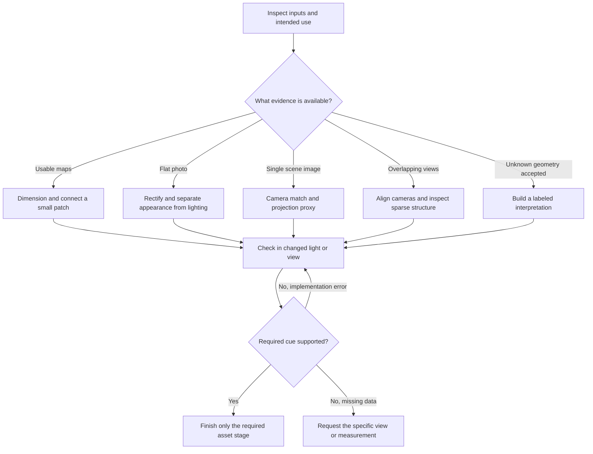

# From reference images to usable surfaces or geometry

**Use:** the task calls for incorporating image content, recovering a surface, projecting
a photograph or reconstructing geometry. For ordinary visual inspiration use the
[reference workflow](reference-workflow.md). These routes require different evidence;
one photograph is not automatically a seamless PBR material or a measured 3D object.

## Choose the smallest route that can answer the task

| Available input / intended result | Route | First useful proof |
| --- | --- | --- |
| Suitable licensed scan/maps already exist | [Metric image patch](techniques/metric-image-patch.md) and surface finish | One actual-sized patch/corner under fixed light |
| Sharp photo of one mostly flat surface; reusable texture | Rectify → separate lighting → tile/patch → estimate needed channels | One corrected patch, visible borders and relighting |
| One image; one intended camera or limited parallax | Camera match → simple mesh → projection → repair disocclusions | Target view and a nearby camera |
| Several overlapping photos of the same static object | Align → inspect sparse reconstruction → bounded mesh → cleanup/reproject | Camera alignment and silhouette from another view |
| One image; inferred full object is acceptable | Manual interpreted modeling or an available image-to-3D tool | Multiple views, hidden-side assumptions, usable topology |

Keep originals and a short record of source rights, scale anchors, edits and inferred data.
Observation-only references must not silently become shipped textures. An acquired map is
also not necessarily measured ground truth: check the source's capture/processing description.

## Flat photograph to material

1. Select a sufficiently sharp, unoccluded patch with recoverable illumination. Keep the
   full original alongside the crop. Decide whether a placed decal or finite patch is enough;
   tileability is only needed if it will repeat.
2. Correct known lens distortion before rectifying perspective. Choose corresponding planar
   corners and an aspect/scale anchor. A homography can rectify a plane, not parallax across
   relief or hidden surfaces. Unknown aspect/scale remains an estimate. Avoid upsampling a
   tiny distant crop and calling it new captured detail.
3. Separate cast shadows/specular highlights from intrinsic color. Prefer diffuse capture or
   a suitable existing scan when information is obscured; equalization/delighting estimates
   missing appearance. Check that removing illumination has not erased real stains or grain.
4. For repetition, inspect the edges in a tiled preview and the whole repeated field. Fix
   conspicuous landmarks as well as border seams, while retaining scale and registration
   across channels. Retain the original before destructive paint/inpainting.
5. Establish only the channels the view requires. Single-image normal/height/roughness
   estimates are hypotheses; a dark pigment mark is not proof of a pit. Start with conservative
   relief and roughness, then compare with visible material cues and another lighting direction.
   Recheck source/map roles and [texture authoring](texture-authoring-workflow.md).

An available Image-to-Material tool can reduce the manual work; it does not remove these
checks. Adobe documents both AI and procedural conversion, plus delighting. Choose the tool
actually installed/authorized; there is no dependency on Sampler in this skill.

## Camera-matched projection or interpreted modeling

Match the camera and primary masses first. Use dimensions/parallel edges/landmarks that the
source supports; do not deform every object to compensate for a wrong camera. Project onto
an explicit UV layer or use a controlled paint projection. Blender's UV Project uses a
projector's negative Z direction, with perspective/orthographic camera behavior.

Inspect grazing faces, vertices behind the projector, occlusion and the reverse side. Projection
stretch and low-poly interpolation can require more geometry or another patch. Move the review
camera slightly: painted lighting, holes and disocclusions should become apparent before detail
work. A successful fixed-camera backdrop may be complete; do not present it as a reusable
360-degree asset. For broader use, model/texture unseen regions from additional evidence or
explicit design assumptions, then check normals, thickness and joins through the modeling guide.

## Multi-view reconstruction

Review sharpness, exposure, overlap, object motion and coverage before a dense solve. Preserve
the camera images and calibration; a turntable/background needs deliberate masking. Specular,
transparent, featureless or deforming subjects may need a different capture method. Ask for
additional views only where coverage/scale is essential; do not invent their measurements.

First inspect matched cameras and sparse points. Resolve disconnected groups or inconsistent
alignment before spending on dense geometry. Reconstruct a bounded region, inspect silhouettes
and gaps from withheld/neighboring views, and set scale from a known measure. Preserve the
high-detail source; use [modeling](modeling-workflow.md), [UV](uv-workflow.md) and
[baking](baking-workflow.md) for cleanup, receiver geometry and reprojection. A dense textured
mesh is not automatically manifold, editable, animation-ready or relightable.

## What the agent can do, and when human input matters

Automate bounded operations with explicit inputs: named images, patch corners/plane, physical
scale, selected faces, intended views and a concrete comparison. Save a useful intermediate
before a costly solve. The human may need to supply a measurement, another side, a better capture
or the intended interpretation of an ambiguous feature. Ask for that specific missing evidence;
continue independent work instead of requesting approval for every processing stage.

These photo-recovery/reconstruction routes are documented guidance, not locally validated
automation or proof that Pi can operate the full chain. The licensed-map/metric-patch route has
an author-tested sample. Test raw-photo rectification, relighting and multi-view reconstruction
separately before expanding their implementation. Generated unseen detail remains inferred.

Primary sources, reviewed 2026-10-25:
[Image to Material](https://experienceleague.adobe.com/en/docs/substance-3d-sampler/using/filters/tools/image-to-material),
[Delighting](https://experienceleague.adobe.com/en/docs/substance-3d-sampler/using/filters/tools/delight-ai-powered),
[UV Project](https://docs.blender.org/manual/en/latest/modeling/modifiers/modify/uv_project.html),
[Agisoft capture guidance](https://www.agisoft.com/pdf/tips_and_tricks/Image%20Capture%20Tips%20-%20Equipment%20and%20Shooting%20Scenarios.pdf),
[Capture/alignment/reconstruction](https://experienceleague.adobe.com/en/docs/substance-3d-sampler/using/features-and-workflows/3d-capture).
