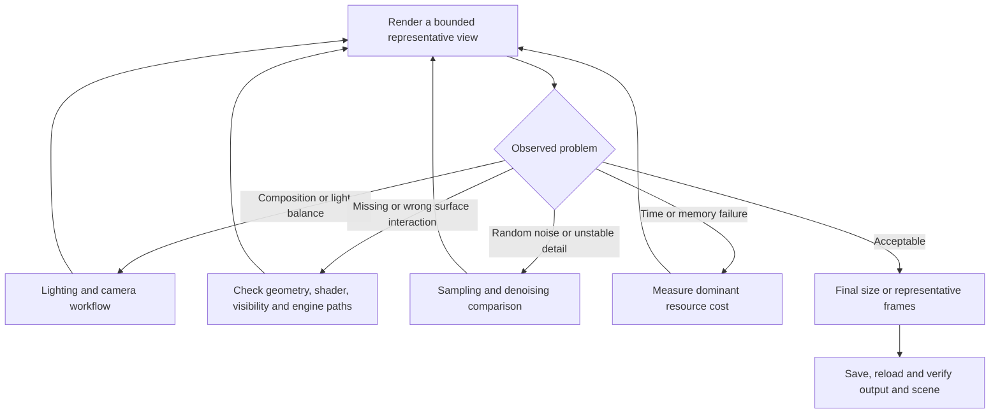

# Render the intended image and verify the saved output

Use for engine/device choice, quality diagnosis, production settings and reproducible output.
Use [lighting](lighting-workflow.md) for artistic light/camera decisions. A focused rendering
fix starts here with the existing scene; it does not require rebuilding assets or relighting
an approved shot. Continue with [compositing](compositing-workflow.md) for image assembly,
grading/effects and final image delivery; use [passes and mattes](compositing-passes-and-mattes.md)
to plan the render information those operations require.

For a known EXR/PNG or exposure discrepancy, use the [linear/display output check](techniques/linear-output-exposure.md).

## Define the render contract and prove the engine

Identify still/sequence, frames and FPS, camera, dimensions including percentage and pixel
aspect, alpha/background needs, output format/color interpretation and available time/memory.
Inspect the actual scene and runtime. Preserve requested/project choices unless a demonstrated
limitation requires a supported alternative. A renderer name alone does not establish support.

| Route | When it can fit | Prove before committing |
| --- | --- | --- |
| Workbench / viewport | Form, layout, draft motion or a deliberately viewport-style deliverable | It answers the requested question; it is not evidence of final shader/scene lighting |
| EEVEE | Fast iteration or final work whose appearance fits its approximations | Actual shadows, GI/probes, reflection/refraction, transparency, volume and engine-specific nodes at the intended camera |
| Cycles | Path-traced interactions and materials that need them | Required paths, sampling, denoising, memory and an available CPU/GPU backend |

In EEVEE, screen-space data has camera/occlusion limits; more samples do not recover unseen
geometry. Choose appropriate probes/tracing settings and test camera changes. Read current
documentation rather than copying obsolete SSR/contact-shadow/bloom toggles. The
[5.2 EEVEE changes](https://developer.blender.org/docs/release_notes/5.2/eevee/)
alter screen tracing, thickness handling and Fast GI, including removal of Far Thickness.
Compare migrated files before compensating for a changed image with material edits.

For Cycles, use an actually available device/backend and record it. Inspect errors/logs and
completed output; selecting GPU in a scene is not proof that a compatible device is configured.
Use CPU when suitable for a bounded test; do not change saved user preferences, install drivers
or upgrade Blender merely to follow a generic performance recommendation. Measure time on
the scene instead of assuming every GPU or setting is faster.

## Make the diagnostic itself valid

For an empty or nearly uniform frame, establish what the camera actually sees before changing
exposure, materials or normals. Check active camera/View Layer, framing/clipping, render
visibility and intervening geometry in that scene. A fresh process or factory startup does not
imply an empty scene: an inherited object can fill the view. Isolate the subject reversibly,
inspect a side view or use evaluated camera rays to identify an occluder. Limit removal/hiding
to the intended test data; preserve unrelated production content.

Test a suspected cause with one discriminating change or measurement, then compare the same
view. Changing camera aim, geometry and lighting together obscures which change helped.
For a cluster/material diagnostic, exclude unrelated support geometry from that view and frame
the actual sample. Keep diagnostic visibility separate from the production configuration.

A neutral form view needs a valid material and a visible, framed subject. After reopening,
verify or recreate the diagnostic material and its active Surface connection before assigning
it or using a View Layer override. A missing lookup must stop that diagnostic, not silently
assign empty material slots. If an unused local material must survive saving, retain it
deliberately with a [Fake User](https://docs.blender.org/manual/en/4.2/interface/controls/templates/data_block.html)
or another intended user, then verify persistence. Inspect the actual image before calling
it a clay/form check; a filename and successful render do not establish what it reveals.

## Separate artistic defects, bias and noise

| Symptom | First useful check |
| --- | --- |
| Unexpectedly dark glass / missing interior | Thickness/normals, Surface/Volume, environment, transmission/transparent bounce limits, caustic assumptions and engine support |
| Reflection disappears near a screen edge | Engine tracing/probe limits and offscreen content; compare the intended camera range |
| Isolated bright pixels | Small intense sources, difficult glossy/caustic paths, bad geometry/values; isolate the contribution before clamping |
| Waxy or smeared detail | Compare raw and denoised pixels at final scale; inspect sampling and denoiser inputs before enlarging texture contrast |
| Shadow leaks / halos / detached contact | Geometry gaps, source size, bias/thickness, shadow/probe resolution and stale baked data |
| Wrong frame, empty/cropped output | [Camera/visibility/occlusion check](#make-the-diagnostic-itself-valid), then frame, border/crop, compositor/sequencer routing and output path |

Bounce limits determine permitted paths, not just quality. Separate transmission from transparent
surface limits. Reducing paths, disabling caustics, Filter Glossy and clamping can remove energy
or highlights and change the look. Use such approximations deliberately and compare the affected
region. Do not prescribe one bounce count or clamp value for every scene. See
[Cycles light paths](https://docs.blender.org/manual/en/5.2/render/cycles/render_settings/light_paths.html)
and [noise causes/tradeoffs](https://docs.blender.org/manual/id/5.2/render/cycles/optimizations/reducing_noise.html).

## Converge the expensive part before scaling the render

Use a low-cost full frame to assess composition, then a representative crop at final pixel
scale for fine detail, glass, indirect shadows or volumes. A reduced-resolution image is
not a final-resolution noise test. A border crop must include enough context for the renderer;
screen-space methods can change when surrounding information is excluded.

In Cycles, adaptive noise threshold, minimum/maximum samples and time limits have different
roles. More samples usually reduce stochastic noise; they do not repair missing paths or
aliasing. Compare matched crops with unchanged camera, lighting, color settings and intentional
seed handling. Use raw and denoised versions of the same render when possible, plus a better
sampled reference if needed. Numerical differences require visual interpretation: a smoother
image may have lost detail. See [sampling](https://docs.blender.org/manual/en/5.0/render/cycles/render_settings/sampling.html).
The render time limit does not cover all preparation work; measure wall time too. For many
lights or small bright environment regions, consider Light Tree and available importance
sampling rather than only raising samples. Their benefit depends on the scene and supported
light behavior; compare time to comparable quality, not time per sample alone.

Choose denoiser and auxiliary data supported by the runtime/device. Inspect fine normals,
reflection edges, hair and small emissive detail; sufficient input samples remain necessary.
For animation, review consecutive frames for noise, denoising flicker, subpixel shimmer and
motion blur. A still-quality comparison or merely changing the random seed does not establish
temporal stability. Bound the test sequence before rendering a whole production range.

When cost is the problem, distinguish scene evaluation, BVH/shader startup, image textures,
geometry/subdivision, volumes, sampling, compositing and output I/O. Persistent Data trades
memory for repeated-render preparation cost. Simplify/texture limits can change visible detail;
restore intentional final settings. Cycles 5.2 Texture Cache can help texture-heavy scenes but
creates disk resources and trades some rendering cost for memory; test the real bottleneck.
See [5.2 Cycles](https://developer.blender.org/docs/release_notes/5.2/cycles/). It is unnecessary
to generate caches for a tiny procedural-material study merely because the feature exists.

## Preserve the output's meaning

Keep scene-linear render data separate from its display presentation. A PNG/JPEG preview
normally includes a view/output transform; an OpenEXR intermediate should preserve scene-linear
values in a declared working space. Record OCIO/working space and view settings so another
viewer can reproduce the intended appearance. An EXR viewed without the intended transform
need not resemble its PNG preview. Avoid applying the view transform twice or assuming all
EXRs use the same primaries. Preserve an established working space/view configuration unless
the task calls for a change; changing working space can require manual look corrections.
See [color spaces](https://docs.blender.org/manual/ja/latest/render/color_management/color_spaces.html)
and [displays/views](https://docs.blender.org/manual/en/5.0/render/color_management/displays_views.html).

Choose depth/compression for the signal: half-float may suit beauty, while some data passes
need full precision. Keep required HDR values and pass names; choose lossless intermediates
where recompositing or data fidelity matters. Select only useful View Layers, passes, AOVs,
mattes and denoising data; additional outputs cost memory/disk and require interpretation.
A single-layer beauty EXR does not contain every pass. Confirm actual saved channels rather
than relying on UI selections. A decoder may expand an RGB file to an RGBA pixel buffer;
use file metadata/channel names to establish what was written. See
[render passes](https://docs.blender.org/manual/id/5.2/render/layers/passes.html).

Film transparency, world illumination, holdout, shadow catchers and material transparency
solve different problems. Check alpha and edge treatment against the intended background;
keep straight/premultiplied interpretation consistent through the receiving compositor.
Do not deliver a preview checkerboard baked into RGB when transparent output is requested.

For long sequences, write resumable numbered frames with an explicit range/FPS, then encode
the presentation movie from verified frames. Check missing frames, dimensions and naming;
avoid committing the only production output to one fragile video encode. For a still, keep
the requested image and an editable scene; do not require a multipass package without a need.

## Reopen and deliver a reproducible state

Restore the chosen lighting/camera state and production resolution, percentage, border,
quality, visibility and output routing after diagnostics. Save the blend and required external
images, libraries and caches. Reopen and render the intended view or representative frame;
verify saved files exist, load, have the requested dimensions/channels and resemble the review.
A finished render job is not proof that output writing was enabled or that the intended layer
was saved. Blender 5.2 explicitly allows disabling render-output saving; inspect the current
setting/path when output is missing ([release notes](https://developer.blender.org/docs/release_notes/5.2/rendering/)).

Associate each review image with the scene/checkpoint that produced it. Sharing a helper script
does not establish identical objects, visibility, cameras or modifiers. If saving/rebuilding
changes that state, verify the new file's view instead of attributing an earlier image to it.

Compare in the declared color interpretation; bit-identical pixels across different devices,
versions or stochastic settings are not a universal requirement. Record settings, measured
cost, checks performed and any remaining approximation. Keep staging crops and effect-off
diagnostics identifiable so they cannot be mistaken for the final deliverable.
