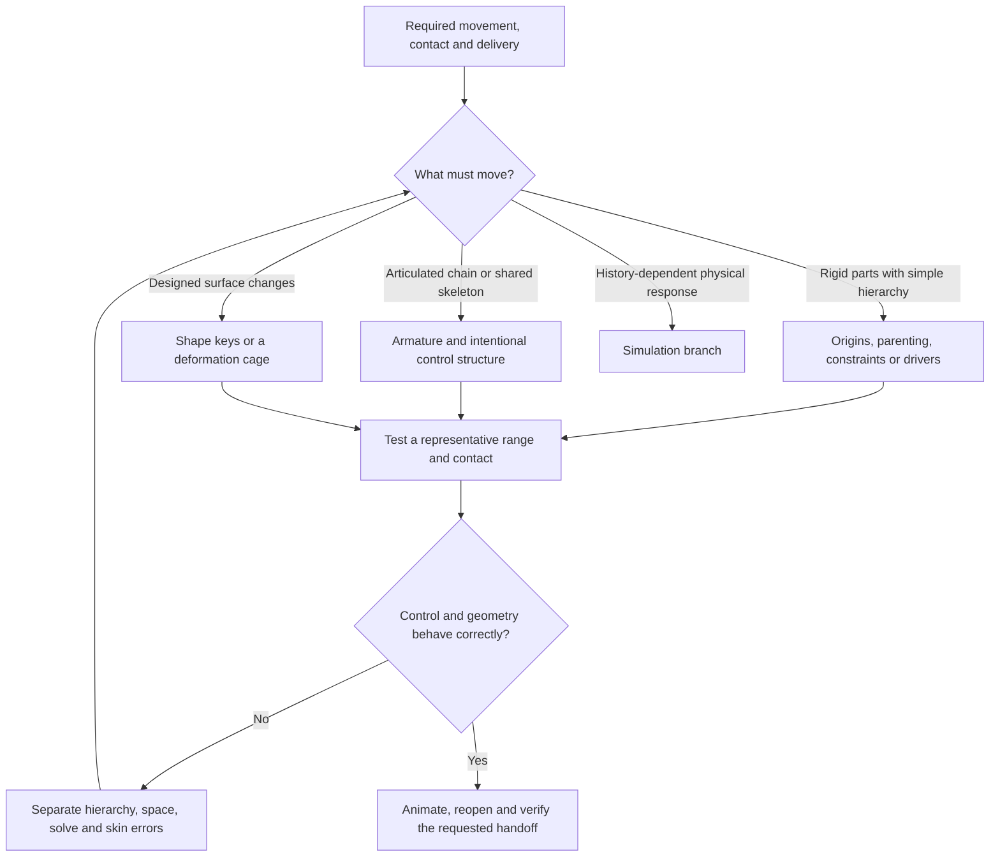

# Rigging: build the controls the motion needs

Use for articulated props, mechanisms, character controls, attachments and rig repair. Read
[animation](animation-workflow.md) for timing, Actions/NLA and motion delivery, and
[deformation](deformation-workflow.md) when the surface must change shape. A useful rig can
be a pivot and one controller; bone count and control complexity are not measures of quality.

For a known IK-plane, pickup/release, IK → FK matching or visual-bake operation, use the
[rig techniques](technique-index.md#rig-and-deformation) directly; this guide chooses the broader architecture.

When building a character rig, follow the [bind checkpoint, pose reset and reopened bend checks](../SKILL.md#building-a-character-rig).

## Establish the movement and ownership

Inspect the existing asset, rig and [motion/construction references](reference-workflow.md).
Identify pivots, degrees of freedom, contacts, travel limits, intended stretch, important poses
and who will animate it. A mechanical joint and an expressive limb have different constraints.
Define the requested output: poseable source, shot animation, reusable clips or target skeleton.
Keep an existing functioning rig unless its behavior requires a change.

Choose direct transforms for a hinge, a target/constraint for an aiming mechanism, IK for
end-point placement, FK for direct joint arcs, and a switch only if the animator needs both.
Use bone parenting or deliberately rigid weights for rigid pieces; smooth skinning should
not bend a metal housing. A deforming cable may use a curve or B-Bones instead of a long chain
of independent controls. A physics mechanism is not automatically better than an authored one.

Keep the reusable rig and its dependencies in the asset; keep shot motion at the intended
instance/override or Action. Shared armature data, mesh shape keys and Actions can affect
multiple users. Identify what is shared before editing. Do not create dependency cycles by
driving a target from the same evaluated chain that follows it.

## Establish rest state before control complexity

Check units, object transforms, armature/mesh relationship, symmetry convention and topology.
For a new setup, choose a clean transform policy before binding. For an existing rig, applying
scale, changing origins or applying a pose as rest can alter skinning, constraints and clips;
preserve and compare the old result instead of using blanket transform cleanup.

Place joints where the reference and deformation require them. Use a rest pose that separates
parts and makes the intended bending plane clear. Set bone roll deliberately: local Y follows
the bone, while roll orients its transverse axes. Mirrored position alone does not prove useful
mirrored local axes. Check axis displays and rotations on both sides before adding drivers.

Distinguish Edit Mode rest bones, Pose Mode transforms and the armature object's transform.
Changing one is not a substitute for another. Connected versus offset parenting, rotation
inheritance and scale inheritance are design choices. A nonuniformly scaled parent combined
with rotation can produce shear; test the needed inheritance mode, not just a unit-scale pose.

Separate animator controls, mechanisms and deform bones where that separation helps reuse or
debugging. Use bone collections, names, colors and custom shapes to make controls discoverable;
control/mechanism bones normally should not acquire accidental skin influence. Lock only
channels the user should not animate, expose useful ranges, and retain a clear reset pose.
Collections organize bones; hiding a collection is not the same as disabling deformation.

## Make spaces and constraints explicit

For each important constraint identify owner, target/subtarget, owner/target spaces, offset,
influence and interaction with parenting. World space, armature pose space and bone-local
space differ as soon as the rig moves or rotates. Test the rig away from the world origin.
In scripts, a pose bone's final matrix is in armature object space; compare points/transforms
in a common space using evaluated data, not raw location channels alone.

| Relationship | Candidate | Proof before reuse |
| --- | --- | --- |
| Fixed rigid attachment | Object/bone parenting | Correct pivot/offset and one inherited transform through the full range |
| Follow another transform | Copy Location/Rotation/Transforms | Spaces and mix mode produce the intended result; no unintended scale/shear |
| Aim a part | Track constraint with chosen forward/up axes | No roll flips near difficult directions; target is independent |
| Switch between world/body/hand spaces | Child Of or a suitable rig-space system | Maintain evaluated pose at the switch, then follow the new space |
| Limited mechanical travel | Limit constraint or bounded driver | Limits act in the intended space and do not conceal incompatible upstream motion |
| Repeatable mechanism relation | Driver from a named control | Correct property owner, units, range and evaluated response; no cycle |

For Child Of, establish the inverse at the intended attachment state. An influence change
alone does not promise a pop-free switch. Match the incoming space/control to the currently
evaluated pose, change influence and key the needed values at the same time. Compare world
transforms immediately before/after the switch and neighboring frames. Do not multiply an
already inherited movement again through a second constraint.

Constraint order matters, but IK has special evaluation: it solves the affected chain after
its other constraints. A constraint moved lower in the UI is not automatically a post-IK
operation. When required, transfer the solved result to another chain before further processing.

## Solve IK and match IK/FK deliberately

Define the chain root/tip, target point, bending plane/pole and whether length may change.
Set the intended chain length explicitly; IK chain length zero includes all ancestors and can
move a torso/root unexpectedly. Check whether the solver uses the tip's head or tail. End
position and end orientation are separate requirements; constrain the hand/tool rotation
deliberately when the IK solve does not supply it.

Give a two-bone limb a useful initial bend and pole direction. Straight/folded singular poses,
unreachable targets and poles crossing the limb axis need specific handling. Test them near
the allowed boundary; do not hide flips by merely increasing iterations. Choose stretch and
joint limits according to the asset, and verify actual segment lengths throughout the motion.
An accurate endpoint does not prove a correct joint solution. Check the intermediate joints,
hinge axes and bending plane in the asset's space; bone roll and pole angle can put an elbow
outside that plane even while the tool reaches its target. Judge the solved chain after root
movement as well as in the initial setup.

For IK/FK switching, first match the incoming controls to the evaluated outgoing solution.
FK matching includes the joint chain; IK matching includes the end transform, pole plane and
any intentional stretch/roll offsets. Then switch and key. Two complementary influence values
do not by themselves establish a correct transform blend or pose match. Inspect both endpoints,
intermediate blend values if supported, and the switch frame. State whether the rig supports
continuous blending or only matched discrete switches.

Use native tools or an existing rig's matching operators when available. For a custom matcher,
account for rest matrices, parents, inheritance and rotation modes; copying Euler channels
between unlike bones is insufficient. Verify the visible mesh as well as bone endpoints.

## Choose generated rigs and deformation systems by need

For a humanoid with Rigify, use [Fit and pose a Rigify Basic Human](techniques/rigify-basic-human.md).
For a look or tilt on an existing rig, use [Turn and tilt a Rigify head](techniques/rigify-head-direction.md).

Rigify can fit a conventional character when its installed feature set supports the anatomy.
Fit and retain the metarig as an editable source; keep regeneration/customization ownership
clear and checkpoint before regeneration. Inspect the generated controls and deform bones,
weights and required UI/script dependencies. A generated rig is not a finished skin or proof
that existing animation survives a change. Do not install or require an add-on for a simple rig.

Use [deformation](deformation-workflow.md) for weights, joint shape, corrective keys and cages.
First prove the skeleton/control behavior with cheap proxy geometry; then diagnose the skin.
A corrective shape should not conceal a wrong pivot, broken chain or double transformation.

## Validate and deliver the intended rig

Use a pose sheet and short motion segment appropriate to the brief: neutral, bend/twist
extremes, asymmetric poses, contacts, root movement, allowed scale and any space/IK switches.
Inspect silhouette, rigidity/volume, penetrations and attachment drift. Test a public control
change and reset. A rig that works only in one rest view is unfinished.

Save the editable source and dependencies, reopen, and evaluate non-sequential poses/frames.
For a baked delivery, use an independent copy and sample final evaluated motion with the
required objects/bones, frame range, rate and channels. Verify Action and slot assignment.
Remove/mute superseded constraints/drivers only on the delivery copy so motion is not evaluated
twice. Compare the baked and original world transforms and deformed surface across the clip;
include subframes where interpolation matters. Ordinary transform baking does not automatically
capture every shape-key, B-Bone, simulation or procedural deformation channel.
Matching sampled frames does not imply identical motion between them. For fast motion,
contacts or motion blur, inspect interpolation/subframes and refine sampling or curves within
the delivery contract; do not declare a whole clip equivalent from integer-frame agreement alone.

Test the actual receiving application when export is requested. A Blender bake/reopen is not
proof of a target import; preserve the original rig and report unsupported controls/deformation.
For delivery include the useful controls, neutral/reset state, clip ownership, dependencies,
tested range and known limits in the project's existing notes, without mandatory extra paperwork.

Primary sources: [bone roll](https://docs.blender.org/manual/en/latest/animation/armatures/bones/editing/bone_roll.html),
[inheritance](https://docs.blender.org/manual/de/4.5/animation/armatures/bones/properties/relations.html),
[constraint spaces](https://docs.blender.org/manual/nl/5.0/animation/constraints/interface/common.html),
[Copy Transforms](https://docs.blender.org/manual/sr/5.0/animation/constraints/transform/copy_transforms.html),
[Child Of](https://docs.blender.org/manual/id/5.2/animation/constraints/relationship/child_of.html),
[IK](https://docs.blender.org/manual/nl/5.2/animation/constraints/tracking/ik_solver.html),
[Rigify workflow](https://docs.blender.org/manual/en/latest/addons/rigging/rigify/basics.html?highlight=pose+mode),
and [Bake Action](https://docs.blender.org/manual/sl/5.2/editors/nla/editing/strip.html).
Check the installed interfaces through [recent features](recent-blender-features.md); historical
references explain concepts and do not establish API compatibility. See [provenance](provenance.md).
