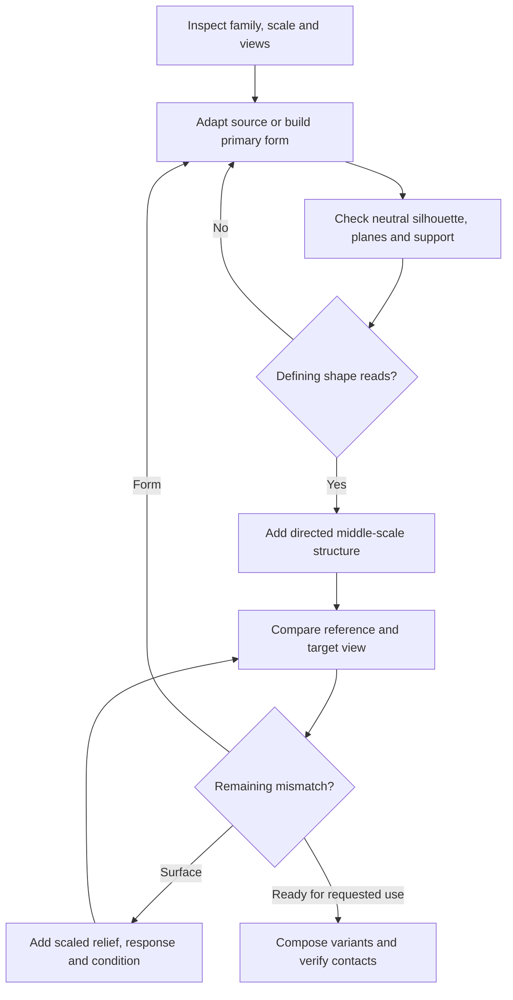

# Rocks: establish geological form before surface noise

Use for boulders, exposed rock, garden stones and reusable rock families. Start from the
requested finish and target views: simple masses can finish a blockout; a close production
rock needs the structural cues visible in its references. Read [modeling](modeling-workflow.md)
for mesh/sculpt choices and [modifiers](modifiers-workflow.md) for stack behavior.

## Choose a family from visual evidence

Inspect a whole form, a useful side/oblique view and surface detail where needed. Identify
silhouette, size, support/contact, large planes, layering/fractures, edge rounding and material
condition. A screenshot may establish a morphological family without identifying the geology.
Name that uncertainty instead of inventing a rock species. Search and actually view references
through [the reference workflow](reference-workflow.md).

| Observed character | Form strategy | Avoid |
| --- | --- | --- |
| Fractured or blocky rock | Unequal primary masses; coherent planes and breaks; selective worn edges | Uniformly softened corners or equally sized cuts everywhere |
| Layered or slab-like stone | Directed strata, terraces and local breaks; readable thickness and support | Unrelated isotropic noise replacing the layer direction |
| Water-worn boulder or pebble | Asymmetric rounded mass, broad flattening/contact and restrained wear | A perfect sphere, or imposing sharp fractures absent from the reference |

Review suitable scans/library assets before expensive custom work. Adapt mesh/sculpt, curves
for directed features, procedural construction or a hybrid when editability or a specific shape
requires it. Native-only construction is not inherently better; reuse is not a requirement.

## Build the three scales with different jobs

**Primary:** establish the silhouette, unequal masses, base and major planes in a neutral
material. Inspect this [blockout](blockout-camera-light.md) before implementing fracture/noise
and material stages. Compare the reference's distinctive ledges, breaks and plane
proportions; a plausible generic rock can still miss that specific form.
Choose subdivisions/smoothing to retain the intended planes; a uniformly smoothed
primitive with Displace is only a starting point if it still lacks the defining form.

**Secondary:** create connected structure such as a fracture direction, a ledge, strata, a
broken corner or weathered transition. Leave quieter areas. Relate these features to the
primary shape rather than stamping the same cut/noise everywhere. For layered stone, distinguish
color bands from actual steps and fractures: every visible band need not displace the surface.
Compare layer spacing, relief depth and continuity with the chosen whole-form reference.
Equally deep periodic grooves wrapping every side can turn broad planes into corrugated blocks;
retain quieter planes and localized breaks where the reference shows them. Recheck an oblique
light and the least flattering relevant angle before fine detail.

**Tertiary:** add grain, pores, tiny chips and relief only at scales that survive the shot.
Use geometry for silhouette/parallax changes and bump/normal for small relief. Set coordinate
scale and amplitude explicitly; Noise Detail adds octaves, not geological structure. Keep
pigment, relief and deposited material distinguishable through [shader nodes](shader-nodes-workflow.md).

For scripted construction, make application/rebuild behavior explicit. Preserve an editable
source or rebuild from a known checkpoint; do not stack and apply another subdivision/displace
pass on an already processed mesh every time a stage is rerun. For GN use the
[node workflow](geometry-nodes-workflow.md) before constructing the graph.

## Add surface history and assemble variants

Choose a base response from the reference, then local conditions: moisture near splash/runoff,
sediment in recesses, or vegetation in plausible retained-moisture regions. Height, normal and
proximity are useful art-directed masks, not universal physical explanations. Verify their
space and compare dry/wet/covered endpoints. Trace each intended color, roughness and relief
contribution to the output; a green tint alone does not establish moss structure at close range.

Keep recognizable family traits while changing proportions, dominant planes, breakage and
orientation. A seed-only family of the same lumpy sphere is weak variation. Compose large
anchors, supporting stones and gaps according to the scene; a uniform ring is appropriate
only when the intended construction calls for one. Inspect actual support and contact against
neighboring geometry, including partial burial where intended. Intersections can represent
embedded stone; floating pieces and unexplained slivers cannot.

## Accept at the viewing scale

Compare a neutral-material form view, a lit surface view and the target scene view. For moving
cameras or reusable assets, include exposed sides/back. If the target-view mismatch remains
silhouette or middle-scale structure, return there instead of raising bump, noise or polygon
count. Check scale, transforms, material mapping and measured cost on a useful variant before
population. A single hand-selected flattering view does not validate a 360-degree asset.

The form hierarchy is consistent with [JaviSkau's first-person rock workflow](https://javiskau.artstation.com/projects/nd02NO):
silhouette, medium planes/breakage, then surface refinement. Its ZBrush tools are examples;
the decisions above are a Blender workflow synthesis, not mandatory brushes or a fixed graph.
