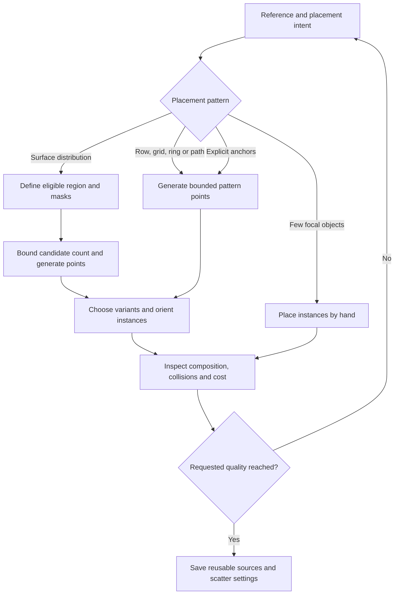

# Repetition, patterns and scatter

Use for seats, bolts, facade elements, fence posts, vegetation, stones or other repeated
placements. Repetition can follow an exact pattern, explicit anchors or a random distribution.
For emitted populations with birth/death, trajectories or collisions, use
[particle effects](particles-workflow.md). Static distribution does not require a simulation.
First decide what needs individual composition and what can follow a reusable rule. Establish
source variants, count or density, spacing, orientation, exclusions and intended views.
For plants, prove the source's form and leaf response through [vegetation](vegetation-workflow.md)
before scattering it; more instances or seed changes cannot repair an incorrect plant hierarchy.

## Choose a tool at the needed level

- For a few important objects, place linked/collection instances with snapping and intentional
  transforms. Keep control of framing instead of trying random seeds until a focal object fits.
- For a simple repeat, Array, linked duplicates or an installed Instance on Elements asset may
  suffice. Use native Geometry Nodes when editable pattern rules, selections, variant logic
  or composition of several rules justify a graph. GN applies to exact placement as well as
  surface scatter; a row of seats does not need a random surface-distribution workflow.
- Where available, the **Scatter on Surface** asset modifier is a useful starting point for
  bounded amount/density, a distribution mask and source objects/collections. Keep instances
  unrealized unless needed. See the [manual](https://docs.blender.org/manual/en/5.0/modeling/modifiers/generate/scatter_on_surface.html)
  and inspect the installed asset interface; these asset modifiers are GN groups, not assumed
  new `bpy.types.Modifier` enum values.
- Gscatter is a separate third-party workflow, useful when its surface/vegetation controls fit
  the task and the installed version works. It is neither a prerequisite for repeated placement
  nor the same tool as Blender's Scatter on Surface asset. Do not install or switch add-ons
  merely because a request contains the word scatter.

## Native Geometry Nodes placement patterns

For a bounded row/grid/ring and a callable implementation, go directly to the
[pattern technique](techniques/gn-patterns.md); [instance attributes](techniques/instance-shader-attribute.md)
cover the material boundary. Read the broader choices here when that small contract does not fit.

Think **layout points → eligibility → source/variant → orientation and scale → instances**.
The point layout determines the pattern; instancing reuses the asset. Read
[Geometry Nodes](geometry-nodes-workflow.md) for field context, domains, spaces and debugging.
These chains describe adaptable approaches, not fixed commands or guaranteed socket layouts.

| Layout | Example native graph | Predict and inspect |
| --- | --- | --- |
| Row / repeated assembly | Mesh Line in Offset mode → Instance on Points | N points at step vector d span `(N-1)*d`; distinguish total length from spacing |
| Rectangular grid / facade | Grid with Nx and Ny vertices → Instance on Points | `Nx*Ny` placements; sizes `(Nx-1)*dx`, `(Ny-1)*dy`; vertex counts are not face counts |
| Ring / radial bolts | Mesh Circle with no fill → Instance on Points | N unique positions on radius R; explicitly choose radial, tangential or fixed orientation |
| Custom radial pattern | Bounded point set → Set Position using angle `phase + 2*pi*i/N` | Convert polar coordinates to positions; avoid duplicate 0 and 2*pi endpoints; guard N=0 |
| Fence / path repetition | Curve to Points in Count or Length mode → Instance on Points, using its rotation as a starting frame | Open/cyclic behavior, fit versus exact spacing, curve tilt and source forward axis |
| Stagger / alternation | Grid or line → capture logical row/column or original index → mask/offset/variant selection | Establish ordering before filtering; alternate by the logical pattern, not a later accidental index |
| Sockets / selected anchors | Explicit anchor points or Mesh to Points on selected elements → Instance on Points | One placement per intended anchor; preserve IDs and an explicit orientation frame |
| Surface distribution | Eligible mesh → Distribute Points on Faces → Instance on Points | Region, density/spacing, normal orientation, seed and actual footprint clearance |

Mesh vertices can feed Instance on Points directly; Mesh to Points is useful when changing
the element domain, selecting faces/edges or intentionally producing a point-cloud component.
Do not insert conversion nodes without a purpose. For variant collections, configure separate
children and Pick Instance deliberately; otherwise a point may receive the entire collection.

Define degenerate cases. Grid needs at least two vertices on each axis: use a line for a single
row and an explicit point for a singleton. A Mesh Circle has a minimum useful vertex count;
if the interface allows one or two radial placements, use explicit angular positions instead.
For zero count, produce empty placement output intentionally instead of relying on a primitive's
clamp. Decide whether length-driven placement includes endpoints and what happens to leftover
space. Exact count, exact spacing and hitting both endpoints cannot always all be satisfied.

The manuals for [Mesh Line](https://docs.blender.org/manual/en/5.1/modeling/geometry_nodes/mesh/primitives/mesh_line.html)
and [Grid](https://docs.blender.org/manual/en/5.2/modeling/geometry_nodes/mesh/primitives/grid.html)
document count/size semantics. For path frames and closure, continue with
[curves](curves-workflow.md). Keep regular patterns field-driven where possible; Repeat zones
are for dependent iteration, not a prerequisite for repeating an object.

## Separate eligibility, orientation and variation

For a surface, build selection/density from painted weights, known UV images, height/slope,
proximity or named attributes. For a pattern, use explicit row/column rules or anchor selection.
Inspect the mask before adding expensive sources. Filtering a bounded layout is different
from asking a surface distributor for exactly N accepted objects. Preserve the original
surface separately only when it belongs in the result; avoid joining the same surface twice.

For source variants, inspect child transforms, local scale and pivot position. Test one
asymmetric source first so incorrect axes are visible. Decide whether objects follow the
surface normal, stay upright to gravity or use a blend; randomize yaw in that chosen frame.
Keep scale ranges plausible and avoid accidental nonuniform deformation or mirrored normals.
Surface-normal alignment, radial orientation and curve-tangent alignment need different frames.
A source modeled along +X may need a deliberate correction when a node supplies a +Z-aligned
frame. Inspect typed rotation sockets in the runtime; do not add Euler vectors as a universal
way to compose rotations. Test a transformed host and source before expanding the assembly.

## Bound generation before it runs

Follow [procedural bounds](procedural-geometry.md). Cap candidate points before expensive
generation; deleting excess points afterward does not cap the creation cost. For a strict
count, use an amount-based asset mode where supported or an explicitly bounded candidate set
with sampling/projection appropriate to the surface. A density multiplied by area is a useful
estimate, not by itself a hard stochastic count limit. Bound area, density and nested instances
as well, and account for all scatter layers and source-variant costs.

Check count and spatial coverage separately. Taking the first N candidates from a spatially
ordered traversal can fill only one end or height band; increasing N with the same truncation
ratio preserves the gap. Sample across the intended eligible region, with deliberate weighting
where needed, rather than relying on traversal order. Inspect sparse placement proxies and
regional occupancy before attaching expensive sources; bounding-box extrema alone can miss holes.

Poisson spacing limits point-center proximity; it does not guarantee that differently sized
objects or their branches do not overlap. Include source footprints/radii and actual clearance
checks where intersections matter. Enlarge path/door exclusions to account for those footprints.
Do not infer unobstructed traversal from an empty center-point mask alone.

## Keep randomness stable and art-directed

Keep a named seed and stable IDs for per-point variation. Preserve IDs through operations;
using the current element index as identity can reshuffle variants after filtering/reordering.
For animated surfaces, decide whether placement is anchored in rest space or regenerated each
frame. Inspect several frames for sliding, popping or flickering; a fixed seed alone does not
guarantee stable output when topology or eligibility changes.

The [distribution-node documentation](https://docs.blender.org/manual/en/4.4/modeling/geometry_nodes/point/distribute_points_on_faces.html)
describes its point IDs and orientation outputs; check the corresponding installed-version
page and live socket types before using older API examples.

Review density at the target camera, clusters versus uniform noise, silhouette, sightlines,
floaters/penetration and repeated recognizable patterns. Use large, medium and small placement
rules only where the scene calls for them. Reserve negative space and purposeful variation.

## Review actual production cost

Inspect nominal and allowed maximum configurations, evaluated instances/geometry and the largest
contributors. Viewport visibility percentages or simplified source variants can hide render
cost; verify production settings separately. Use target-side runtime measurements for real-time
claims. Keep source assets and distribution controls editable; create realized export variants
only when the target requires them, and compare their bounds, materials and placements.
