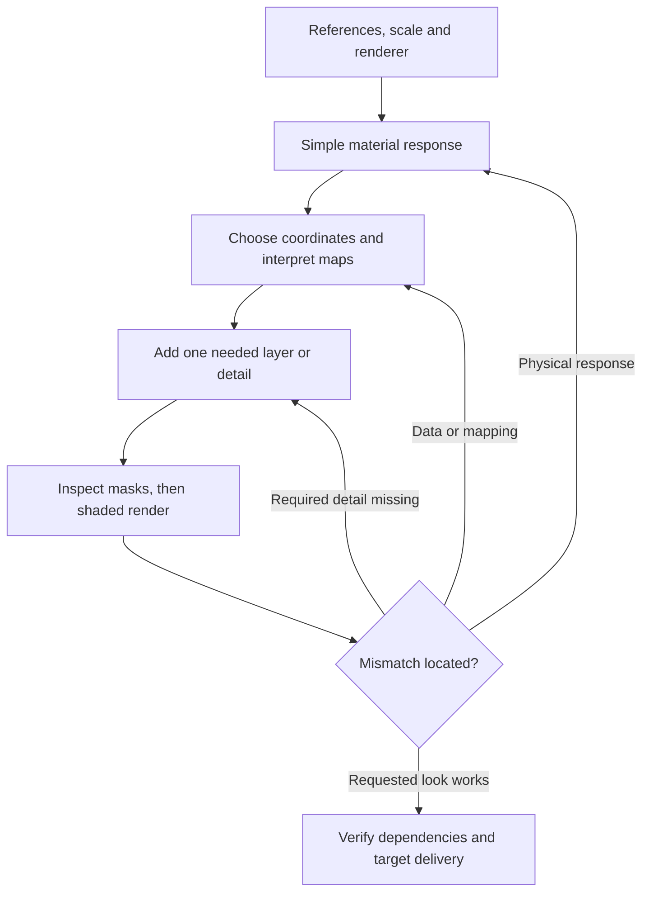

# Shader nodes: material intent, data and light response

For pigment following a deforming mesh, use [rest coordinates](techniques/rest-coordinates.md).

Use when developing or debugging a material, procedural surface or GN-driven variation.
Start from inspected material references and the object's physical scale. Identify what the
image demonstrates: base color, broad reflection, roughness variation, relief, layering or
transmission. A photograph's highlights and shadows are not automatically base-color detail.
For a blockout, a few simple materials may be sufficient; a final asset needs the response
visible at its intended distance. Keep geometry and material work connected through the
[production map](production-pipeline.md). For painting, source images and editable surface layers,
read [texture authoring](texture-authoring-workflow.md); for transferring fields or geometric
detail into saved maps, read [baking](baking-workflow.md).

For coatings, multiple BSDFs, transmission/scattering, anisotropy, emission or stylized effects,
read [material composition](material-composition.md). Texture maps supply data to a material;
they do not define the full range of shader behavior. Keep a complex native graph when the
deliverable calls for one, and choose any texture/export approximation deliberately.

## Establish a controlled comparison

For a known operation, start with [material-response techniques](technique-index.md#material-responses)
or the [instance-attribute bridge](techniques/instance-shader-attribute.md). Use this guide for
coordinates, interpretation and diagnosis beyond that small contract.

Identify the actual renderer, material assignment, active Material Output, target resolution,
color-management configuration and delivery target. Start with simple values under useful
neutral inspection light, then compare in scene lighting. Keep camera, exposure, view transform
and light placement consistent during A/B tests. Material Preview lighting is not necessarily
the scene's render lighting. Do not compensate for a lighting or exposure error by rebuilding
the material or adding unexplained emission.
Use [lighting](lighting-workflow.md) to refine the setup and [rendering](render-workflow.md)
to distinguish missing engine paths, sampling and denoising from a material defect.

## Keep socket meaning explicit

Color, scalar mask, direction/normal, displacement and shader closure are different data.
Set the mode before wiring Mix or Math nodes; implicit conversion can hide a bad connection.
Mode-dependent Mix inputs **and outputs** may share labels such as A/B/Result. Resolve the
available socket of the intended type/identifier on both ends using the
[active-socket checks](blender-methods.md#resolve-active-node-sockets-and-prove-their-effect),
not the first matching name or remembered index. Trace the evaluated path to the active
Material Output Surface and inspect one simple shaded sample before adding layers.
A shader output describes light scattering, not an RGB color to multiply as if it
were a texture. Mix colors to vary a parameter; use a shader mixture when two scattering
models need to coexist. Use Principled's appropriate layers when they express the material.

Build only the response needed by the reference. For common PBR work, begin with base color,
metallic/dielectric choice and roughness, then introduce transmission, coat, sheen or subsurface
where justified. Metallic is not a generic shininess slider. Transmission is not equivalent to
alpha cutout, and roughness is not relief. A reflective metal also needs an environment to
reflect. Check thickness and normals when diagnosing glass. The
[Principled documentation](https://docs.blender.org/manual/en/5.1/render/shader_nodes/shader/principled.html)
explains these parameter roles; use the installed version's names rather than numerical socket indices.

## Choose coordinates before adding texture complexity

Use [UV layout](uv-workflow.md) when creating or repairing image coordinates, density or packing.

| Need | Starting point and diagnostic |
| --- | --- |
| Painted art, trim sheets, unique bakes or export | Explicit UV map; inspect distortion, seams, texel scale and the UV map selected by each relevant node |
| Reusable spatial procedural material | Object coordinates, with a deliberate object/Empty if shared alignment is wanted; test scale, rotation and movement |
| Quick normalized mapping | Generated coordinates; their bounding-box-relative scale can make the same pattern differ across asset sizes |
| Continuous world-aligned effect | Explicit common coordinate frame; check whether moving/deforming objects should move through the pattern or carry it with them |

Set grain direction and feature size from the reference, rather than accepting each texture's
default mapping. Test a nonuniformly scaled object, curved area and a visible seam where relevant.
Choose triplanar/box projection when its blending and orientation suit the surface; it does not
replace all UV requirements. Do not apply transforms blindly to rigged or shared assets just
to hide mapping errors. See [Texture Coordinate](https://docs.blender.org/manual/id/5.2/render/shader_nodes/input/texture_coordinate.html).

For markings carried by deforming skin, use suitable UVs or a rest-position attribute retained
before deformation. Object coordinates alone do not guarantee attachment to the surface.
Check the mask in posed extremes; capture/rest data must match the current topology. The
[character motion recipe](recipes/character-gesture.md#timing-deformation-and-image-decisions) demonstrates this.

## Interpret image data before wiring it

| Map role | Interpretation / connection |
| --- | --- |
| Base color or emission color | Use the file's actual color space; commonly sRGB for display-encoded images, not universally so |
| Roughness, metallic, height, scalar masks | Numeric data, normally Non-Color; connect to the corresponding scalar input |
| Packed maps | Identify channel meanings from the source, separate channels explicitly; do not assume every pack is ORM |
| Normal map | Non-Color RGB through Normal Map, with the correct tangent/object space, UV map and axis convention |
| Opacity | Check the intended alpha channel, alpha representation and current renderer/material mode; verify silhouettes and shadows |

Input color space and output view transform solve different problems. Changing the view
transform cannot repair an incorrectly decoded roughness map. Image color-space settings
belong to image datablocks; changing a shared image can affect other materials. If one source
needs incompatible interpretations, separate those uses intentionally.
[Color Spaces](https://docs.blender.org/manual/sl/latest/render/color_management/color_spaces.html)
describes the color/data distinction. Keep missing textures, UDIM tiles and resource paths
visible during review instead of disguising them with fallback colors.

## Choose relief by the visible result

- Use a tangent normal map through **Normal Map**, not raw RGB into a Normal socket. Check the
  OpenGL/DirectX convention against the map source and the current node's options; do not flip
  the green channel twice. Use the UV map on which the map was baked.
- Use **Bump** for scalar height detail. To add small height detail over an existing normal map,
  feed Normal Map's output into Bump's Normal input, and height into Height; inspect the result
  rather than summing encoded RGB normals. Keep strength/distance plausible at object scale.
- Use true displacement or geometry when silhouette or parallax needs it. Displacement needs
  supported renderer/material settings and sufficient tessellation, with an explicit midlevel,
  scale and space. A connected Displacement socket alone does not prove that geometry moved.
  Check cracks, bounds and production subdivision cost through [procedural bounds](procedural-geometry.md).

These branches are grounded in the manuals for
[Normal Map](https://docs.blender.org/manual/sr/5.2/render/shader_nodes/displacement/normal_map.html),
[Bump](https://docs.blender.org/manual/id/5.0/render/shader_nodes/displacement/bump.html) and
[Displacement](https://docs.blender.org/manual/sr/5.1/render/shader_nodes/displacement/displacement.html).
Do not assume a particular engine's displacement or transparency behavior from another engine's preview.

## Add variation with a reason and a scale

Choose the structure and source through [surface look development](texture-authoring-workflow.md#prove-the-surface-before-spreading-it).
In the graph, distinguish a coverage mask from each channel's response. A shared paint-removal
mask can coordinate substrate exposure, roughness and relief while their values and signs
remain different. Unrelated dirt, pores and scratches need not share the same field. Control
feature size and amplitude deliberately; one noise wired identically into every parameter
creates correlation without explaining the material.

## Diagnose procedural noise before adding detail

Trace the actual saved material assignment, active output, mix factors and connected branches.
An old generator script or an unused noisy branch may not describe the visible surface.
For each intended layer, follow its mask and response to the actual Surface/Volume/Displacement
output. A created or labelled node with no contributing downstream path implements nothing.
Test layer-off/on or relevant mask endpoints under fixed conditions; check affected channels
separately, such as moss color versus moss roughness. Use the active-socket checks in
[Blender methods](blender-methods.md#resolve-active-node-sockets-and-prove-their-effect) when scripting.
On a temporary copy, hold camera/light/display settings fixed and bypass one contribution:
use constant Base Color, constant BSDF roughness, or disconnect the procedural normal chain.
If blotches survive the normal bypass but disappear with constant color, repair the color
field first. These controls locate a cause; a flat control is not a finished material.

Preview the implicated field before and after its remap as diagnostic color/emission, and
inspect its numeric range. Display transforms can hide clipping or exaggerate a range.
Separate intrinsic pigment, deposited dirt and relief instead of giving every random patch
the same response. For material blends, inspect endpoints and the transition.

Read the [Noise inputs](https://docs.blender.org/manual/ru/5.2/render/shader_nodes/textures/noise.html)
by their function: Scale changes the base frequency in the supplied coordinates; Detail adds
octaves, not image resolution or artistic quality. Lacunarity sets octave frequency spacing;
Noise Roughness changes octave contribution/pattern, not the BSDF's reflection roughness.
Distortion warps the field. Check dimensions/type and Normalize before assuming a 0..1 range;
use Fac for a scalar field and Color when its separate components are intentional.

Judge the resulting feature size on the object. Object coordinates are local, not automatically
world meters; inspect object/reference transforms and mapping. Generated coordinates normalize
to bounds. Increasing Scale can shrink features into subpixel detail, and increasing Detail
can amplify that problem. An inverse Scale is not a measured pore diameter for fractal noise.

For cloudy or uniformly speckled color, inspect the field alone, remap contrast, coverage and
whether its shape represents the observed material. Adjust the responsible feature or change
source through [texture authoring](texture-authoring-workflow.md#choose-the-source-and-the-useful-amount-of-authoring).
More octaves cannot invent joints, aggregate structure or directed wear.
For inflated relief, consider height variation relative to lateral feature size: Bump responds
to slopes, so shrinking features with unchanged height can strengthen their normal perturbation.
[Bump Distance](https://docs.blender.org/manual/ru/5.2/render/shader_nodes/displacement/bump.html)
scales height; it does not measure actual geometric depth. Strength blends the normal effect.

Inspect the recombined material at delivery resolution and a useful grazing view. If detail
smears, aliases or shimmers, compare a diagnostic denoising bypass or resolution/frame change
before blaming the texture. Reduce unresolved frequency/amplitude or test the available Bump
Filter Width; extra samples and larger baked images cannot repair a wrong pattern. Filtering
must retain the intended material response, not simply erase it.

## Connect geometry and materials

Define a named-attribute contract jointly with the
[Geometry Nodes workflow](geometry-nodes-workflow.md#preserve-only-the-attributes-you-need):
for example, `panel_wear`, float, instance domain, 0..1. Store it on geometry that actually
reaches the rendered object and give the source geometry the intended material.

In the shader Attribute node, choose **Geometry** for geometry attributes and **Instancer**
for per-instance values where supported. These are different lookups; a shader graph's label
does not establish the data's existence. Test two visibly different values on two instances
while they remain instances. Realization may change propagation, domain and lookup needs;
verify it separately if the target requires realization. Do not realize an entire scene merely
to obtain color variation. Nested-instance lookup has version limits; do not infer unlimited
inheritance. See [Attribute](https://docs.blender.org/manual/id/5.1/render/shader_nodes/input/attribute.html).

## Package and verify the material

Keep reusable material groups focused, with meaningful inputs, documented coordinate/scale
assumptions and intentional shared dependencies. A mask generator and a material response can
be separate reusable groups. Inspect live modes/sockets when scripting; shader-tree and
geometry-tree node availability can differ even for similar-looking operations.

Check correct material slots, selected faces, active output for the engine, normals, texture
dependencies and the final rendered view. Inspect a reference-derived feature at the intended
distance under both diagnostic and scene lighting. Save/reopen the editable result.
An exporter usually supports a subset of Blender materials: use the selected
[format profile](export-formats.md), test a representative export or
bake the necessary channels into a derived delivery material. A correct Blender render does
not certify the exported shader. Follow the baking and texture-authoring guides for saved map
verification and the UV guide for mapping. To expose a material mask or effect intensity to
compositing, use a named Shader AOV with matching View Layer name/type and verify the saved
signal; see [passes and mattes](compositing-passes-and-mattes.md). It does not change the
beauty by itself. [Compositing](compositing-workflow.md) handles the image delivery.
