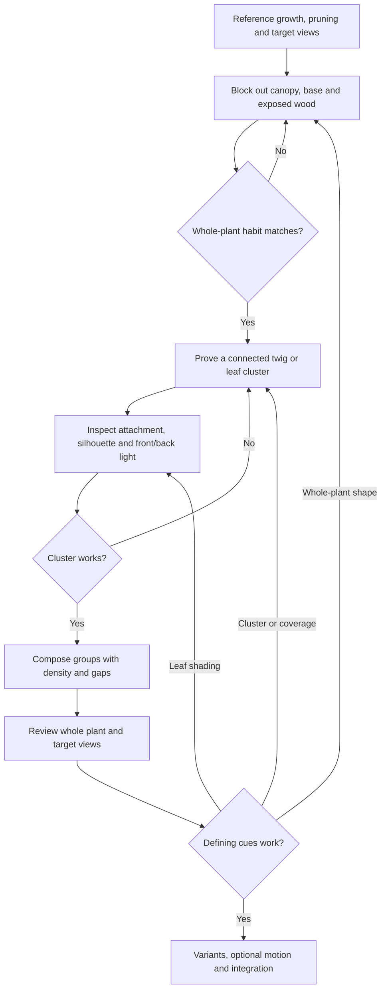

# Shrubs and dense crowns: build readable clusters

Use for compact bushes, clipped shrubs/hedges and dense foliage masses. Start with
[vegetation](vegetation-workflow.md) for source selection and leaf shading. For placement or
instancing use [scatter](scatter-workflow.md) and [Geometry Nodes](geometry-nodes-workflow.md);
for wind/keyframes read [animation](animation-workflow.md) before implementing motion.

## Decide what organizes the canopy

Inspect overall habit, pruning, size, leaf shape/scale, branch groups, density variation,
gaps and ground attachment. Choose a species or a stated morphological analogue. Compact
does not mean featureless: the silhouette and self-shadow often carry the leaf/cluster cues.

| Reference character | Useful construction route | What must survive the view |
| --- | --- | --- |
| Clipped mound or hedge | A designed envelope with [clustered foliage](#compact-broadleaf-mound-a-practical-route); hidden support as needed | Controlled overall outline with a leaf-scale edge, depth and believable base |
| Open woody shrub | Tapered branching and connected twig/leaf groups | Direction of growth, attachments, gaps and asymmetry |
| Ground-cover shrub | Low spreading groups related to the ground and growth centers | Layering, contact and local openings rather than a floating dome |
| Conifer crown pads | Branch-supported sprays/twigs carrying species-appropriate needle groups | Layered branching and a broken foliage edge from the required sides |

Run and view the [whole-canopy blockout](blockout-camera-light.md) before building a twig or
its material; the shape stage must work without that library. Compare width/height, the lower
foliage boundary, exposed wood and large gaps with the whole-plant reference. A compact clipped mound
should not become a bundle of long bare stems with foliage only at their tips. Choose the
branching/envelope to support that mass, then prove the cluster. A smooth ellipsoid may organize
distribution; replace its visible surface with the required leaf/cluster depth at production scale.

## Prove one cluster before filling the volume

Use a suitable existing asset/atlas, a modeled twig, leaf meshes or a baked cluster according
to distance, available angles, editability and cost. Show one useful sample with its attachment.
Check leaf dimensions, petiole/base, fold/camber where visible and orientation along the parent.
Uniform stars or freely rotated detached leaves rarely express the same growth structure.
Do not require hidden botanical detail that contributes nothing to the intended image.

For distant views, cards/baked clusters can be sufficient. For a close or orbiting camera,
check oblique/back views, parallax, alpha edges and overdraw; additional geometry may be needed.
Cluster-normal adjustments can soften foliage shading but cannot repair missing volume,
incorrect winding or a disconnected silhouette. Use the engine's appropriate thin-leaf response
and inspect front/back light through [material composition](material-composition.md).

## Distribute around growth and pruning

For an open shrub, place groups along branches/tips with coherent parent direction. For a
clipped canopy, use the volume and coverage decisions in the compact-mound route below.
Preserve the reference's local openings and ground connection; do not impose large holes on
a canopy that is actually dense.

Make variation hierarchical: whole-plant asymmetry, branch/group size and direction, then
smaller leaf differences. Bound scale and angles around those relationships with stable seeds.
Inspect point/instance coverage, including the lower canopy, before population; the intended
count alone can hide an omitted region (see
[bounded sampling](scatter-workflow.md#bound-generation-before-it-runs)). A wrong random range can
produce many nearly invisible leaves while the intended count appears correct; use the
[active-socket and output checks](blender-methods.md#resolve-active-node-sockets-and-prove-their-effect).
Test a transformed source/host so position and rotation are not accidentally tied to the origin;
distinguish [asset-local assembly from preserving world placement](blender-methods.md#assemble-a-local-asset-or-preserve-world-placement).

For pine-like pads, inspect a branch, its terminal twig/spray and the needle grouping visible
in the reference. An oval mass covered only on top with upright cones often exposes its shell
from other angles. Change the source hierarchy or representation before increasing density.

If wind is requested, keep shared branch bending coherent with attached foliage and layer
smaller leaf motion on it. Check calm, a useful bend and adjacent frames; independent random
vertex motion can detach groups or shimmer. Unrequested motion is not part of a static recipe.

## Compact broadleaf mound: a practical route

Use for a dense, low shrub whose reference shows small leaves grouped on short shoots, such
as a clipped azalea-like form. Adapt the branching and leaf arrangement to the reference;
this is not a construction rule for open shrubs, grasses or conifers.

1. **Shape the canopy and base.** Match width/height, ground contact, lower foliage boundary
   and pruning contour in the blockout. Use restrained, overlapping growth masses where the
   reference shows them; a clipped contour need not have exaggerated cloud-like lobes.
2. **Make a connected shoot.** Arrange leaf bases along a short tapered twig, with the
   observed tiers, overlap and tip grouping. Keep the twig base/pivot and growth axis clear.
   Check one shoot's silhouette and thin-leaf response before varying it. At a distance, a
   suitable baked cluster or library sprig can represent this structure without hidden twigs.
3. **Place groups with depth.** Use branch tips, a canopy volume band or layered envelopes
   to place shoots through the visible outer crown. Orient their growth from the supporting
   groups and pruning contour; vary individual leaves around their parent. A surface normal
   may guide placement, but does not specify every leaf's facing. Include sides and the lower
   lip; a top-facing distribution mask can leave those regions bare.
4. **Resolve coverage and support.** Overlap neighboring shoots enough to produce the
   reference's density while retaining leaf-scale edges and depth. An optional inner support
   must sit behind the foliage and avoid swallowing it. Inspect foliage alone before relying
   on that support to fill gaps. Tune local spacing, cluster size and depth at the intended
   camera; increase total count only after these relationships work.
5. **Keep useful controls.** Separate canopy proportions, leaf scale, shoot spacing, depth
   and variation seed. Preserve shared cluster sources where practical. In a GN route, build
   placement points and growth orientations, instance the proven shoots, then inspect coverage
   before realization; follow [Geometry Nodes](geometry-nodes-workflow.md) and
   [scatter](scatter-workflow.md) for implementation. Mesh/curve assembly or adapted assets
   can satisfy the same checks. Finish with the target view and measured cost below.

## Accept the plant and its variants

Compare whole-plant silhouette/density, one useful cluster detail and the intended scene view.
For a camera orbit inspect the back and sides. Look for a smooth exposed envelope, uniform
spacing, detached leaves, dark cards, ground gaps and temporal aliasing where relevant.

If a close-view canopy reads as a solid lump with scattered leaves, temporarily inspect foliage
and support separately from the same camera, then together; restore their intended visibility.
Compare the reference's leaf-scale edge, overlap and depth across the visible crown, including
the lower boundary. If the support supplies most of the visible surface, revise cluster depth,
placement or representation before adjusting its roughness, AO or bump. A roughened shell can
still have the same missing foliage structure. Choose coverage from the target view and plant
habit rather than a fixed leaf count; a background proxy may legitimately need less detail.

Fix the failing cue before adding instances. Bound expanded geometry and alpha/render cost;
instances can still produce an expensive canopy. Vary family members only after the source
works, and verify that variants preserve attachment and target-view density.

[NC State's Rhododendron indicum reference](https://plants.ces.ncsu.edu/plants/rhododendron-indicum/common-name/southern-indian-azalea/)
illustrates a compact, dense shrub with crowded leaf tiers; it is one morphology, not a rule
for every bush. [SpeedTree's generation concepts](https://docs9.speedtree.com/modeler/doku.php?id=generation_properties)
separate count, placement and direction relative to a parent. These inform the hierarchy above
without requiring SpeedTree or copying its controls into Blender.
