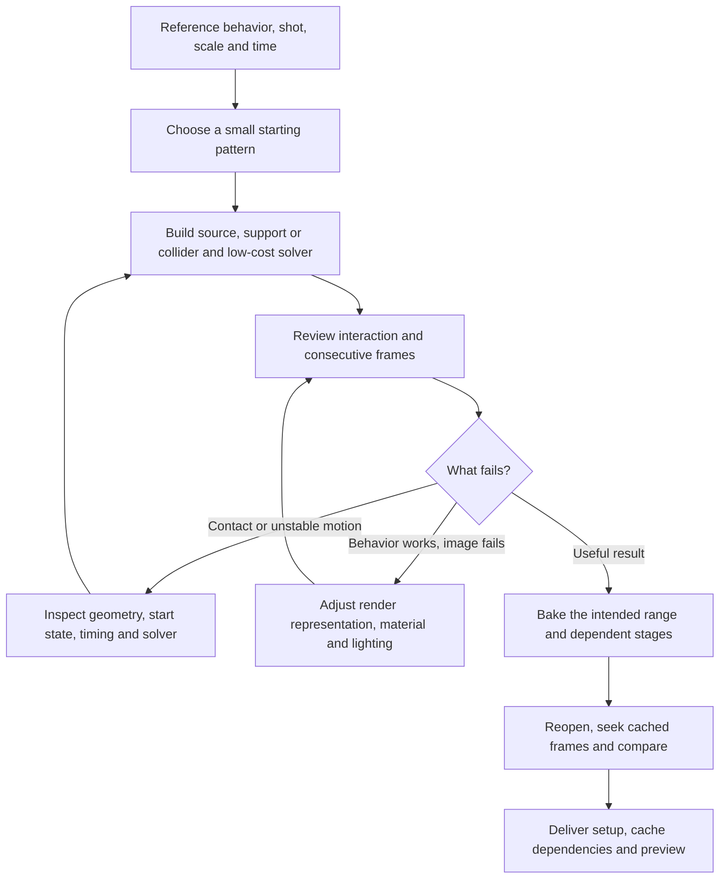

# Specialist simulation: choose behavior, then prove replay

Use for rigid bodies, cloth, hair dynamics, liquids, smoke and fire. For creating a groom,
start with [grooming](grooming-workflow.md); a static groom does not require simulation.
[Particles](particles-workflow.md) and custom [GN state](particle-simulation-nodes.md) remain
useful for other effects. A still or art-directed motion can be a complete deliverable when
the brief does not require a physical response.

For the specific saved-state checks, use [GN bake/replay](techniques/gn-bake-replay.md) or
[rigid-world cache](techniques/rigid-cache-replay.md); these are distinct cache systems.

## Pick a starting pattern

These are adaptable production templates, not required settings or scripts. Select only the
needed branch; keep working project systems unless changing them resolves a real need.

| Visible requirement | Starting route | First useful proof |
| --- | --- | --- |
| Falling props, settling debris, stacked objects, constrained mechanism | [Rigid body](rigid-body-workflow.md) with simple contact proxies | Release, first impact and rest; no tunneling, hovering or explosive separation |
| Draped cloth, flag/curtain, garment or soft bag | [Cloth](cloth-workflow.md) with deliberate support/pins and rest state | One fold/contact and an attachment through motion |
| Short fur, long hair, brows or a stylized groom | [Grooming](grooming-workflow.md), adding dynamics only when needed | Silhouette, root attachment and surface deformation before dense interpolation |
| Spill, pour, filling vessel or impact splash | [Liquid](fluid-workflow.md#liquid-patterns) domain, source and fluid effectors | Containment, source timing, first contact and an actual liquid surface |
| Plume, smoke burst, flame or small fire | [Gas](fluid-workflow.md#gas-patterns) domain and appropriate flow | Emission, transport around an obstacle, dissipation and volume shading |

## Establish space, time and cost together

Use observed motion where timing matters through the [reference workflow](reference-workflow.md).
Name the behavior that must read: sliding versus bouncing, heavy fabric versus light cloth,
clumped wet hair, a finite spill versus a tap, cool drifting smoke versus buoyant hot gas.
Record uncertainty rather than deriving motion from a single still.

Set physical size, units, gravity, FPS, frame range and any preroll before tuning. Check actual
geometry/transforms: changing the scene's unit display alone does not repair a badly scaled
solver setup. Do not apply transforms blindly to an existing rig or animation. Keep simulation
geometry, contact geometry and render geometry deliberately related; a beautiful collider can
be both expensive and less stable than a simpler proxy.

Bound the short test's objects, simulated vertices/strand points or grid dimensions, frame
range, substeps and storage. Raising resolution in all three dimensions can multiply grid work
roughly cubically before additional solver costs. Detail/noise, secondary particles and dense
children come after the base behavior. Measure the actual short bake before extending it.
Before committing to a full-range solve, check the geometry and contacts that would invalidate
it if changed, and inspect the short interaction in a useful shot. This is an internal decision,
not an automatic user approval stop. Independent material polish can continue later; a
simulation study need not wait for every production asset to be finished.

## Verify the actual collision system

Collider flags are solver-specific. Bullet rigid bodies, classic Cloth Collision, Mantaflow
effectors, and experimental GN Collider assets are different interfaces. One flag does not
enable every interaction. Test a deliberate contact at the relevant speed and a low view;
an apparent bounce or a final posed frame is insufficient evidence.

Check external contact, self-contact and cross-system coupling as separate capabilities.
One working collider does not establish interaction between two simulated regions. Choose
the solver from the behavior required, including current experimental limitations, before
building a dense scene that depends on an unavailable feature.

Specify coupling direction. For example, a baked rigid object's motion can drive a cloth or
fluid collider without the receiving solver pushing it back. Agree on solve order and bake
upstream motion first when needed. Separate solvers do not automatically create a shared
two-way world. If the brief needs buoyancy forces or mutual deformation across systems,
prove that coupling or choose an appropriate integrated solver; report a one-way approximation.

## A cache is part of the deliverable

Use the chosen solver's cache, not a universal Bake command. Save a useful source scene first.
Keep an understandable cache identity/location, solver/runtime, source revision, frame range,
FPS, relevant seeds and baked stages in existing project notes or the template's text block.
Give simultaneous variants separate owned paths. A bake-finished flag or a nonempty directory
does not prove the required frames and stages exist.

Topology, transforms/rest state, source timing, collider/force changes, FPS or solver settings
can invalidate dependent results. Reset and rebake affected owned stages in dependency order;
never delete unrelated caches. Preserve a useful bake until its replacement is reviewable.
Distinguish live playback cache, protected disk/packed bake, and exported animation/geometry.
Packing images or saving the blend does not guarantee every simulation cache is included.

When automating edits, ensure the affected owner and dependencies are reevaluated before
sampling or rebaking; a read-back input value alone does not prove a changed solve. Test one
interaction that the control should change. If a reset/rebake still reproduces stale motion,
preserve the useful baseline and restart the variant from a clean unbaked source with an
isolated cache context. Check animated/driver overrides too. Do not accept a successful
operator return, or reject a working bake solely by a status flag, in place of actual replay
and changed-control evidence.

For delivery, reopen in a fresh process and directly seek representative cached frames out
of order without first playing from frame one. Compare actual evaluated transforms/vertices,
strand positions, liquid mesh or volume grids as appropriate. Missing-cache replay must not
be mistaken for a successful fresh calculation. Inspect consecutive frames around impact,
folding or emission changes and produce a short preview when timing is part of the result.
Restore intended state after testing one meaningful control on a separate variant.

Keep behavior, numerical quality, image quality and replay as separate conclusions. A changed
control and a perfectly preserved cache can reproduce an unacceptable solve. Measure the
relevant residuals over time: constraint/anchor drift, local stretch, surface penetration,
liquid volume or boundary influence. Use limits appropriate to the shot and scale, and state
failures rather than converting a successful technical demonstration into production approval.

Deliver the requested source/template and cache or a tested self-contained baked representation,
with dependencies, preview/final distinction and measured limits. A stock example is a starting
point, not a validated production-scale simulation. Target export is a separate consumer test.

Cache mechanisms differ: [Rigid Body World](https://docs.blender.org/manual/sr/5.2/physics/rigid_body/world.html),
[Cloth cache](https://docs.blender.org/manual/nl/5.2/physics/cloth/settings/cache.html),
[Fluid cache](https://docs.blender.org/manual/vi/5.2/physics/fluid/type/domain/cache.html),
and [GN cache/replay](particle-simulation-nodes.md#cache-and-replay).

Worked example: [saved rigid-body cache replay](techniques/rigid-cache-replay.md).
Read the chosen card's evidence and limitations before adapting it.
