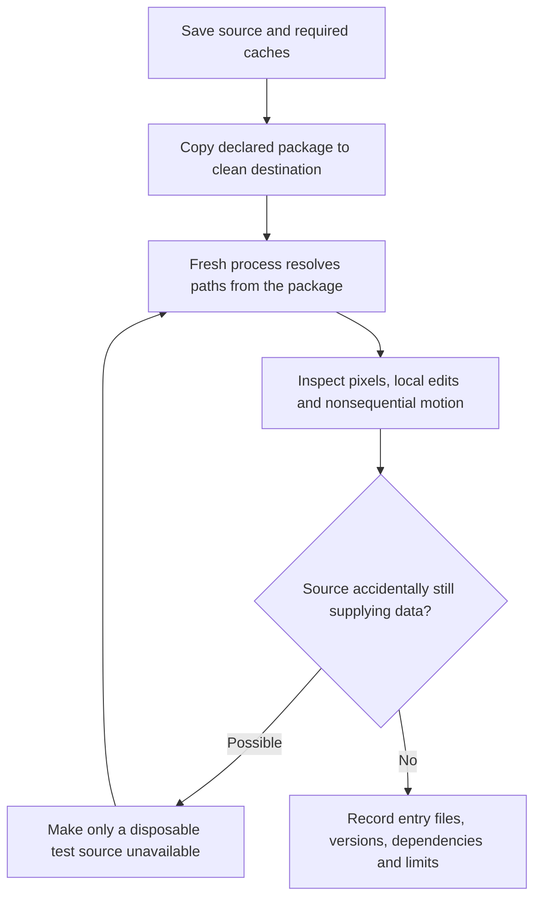

# Prove a native package away from its source

Use when delivering editable .blend scenes with libraries/textures/caches. Start with saved
authoring files and their actual dependencies, including library-owned relative resources.
Keep the established project layout; this technique does not prescribe one file per asset.

Verify [owner-relative paths](owner-relative-resources.md) and inspect actual loaded pixels,
not just packed flags. Compare matched views before/after relocation. For a delivered
Alembic/GN/physics cache, seek end → early → middle without rebuilding; compare evaluated
geometry/transforms. Those cache systems have different packaging rules. A durable cache
does not automatically preserve editable simulation controls.

A source-unavailable test may rename **only a disposable source copy created for the test**,
with resolved source/destination paths verified and guaranteed restoration in finally. Never
rename a shared live library to perform this proof. An isolated copy plus explicit dependency
resolution is a weaker but useful check when unavailability cannot safely be tested. State
which test was actually performed. A fresh process with access to old absolute paths is not
an isolation proof.

Include a compact entry note with runtime, intended use, source/release identity, frame/FPS,
resource/cache locations, checked controls and remaining limits. Distinguish live linked
consumers, [fixed snapshots](native-snapshot-ownership.md), cache replay and derived exports.
For promised source updates, also run the [two-consumer update](linked-override-update.md).
For target-format compatibility, use [GLB round-trip](glb-surface-roundtrip.md) or the actual
receiver. A native relocation check does not validate a game engine, render farm or new version.

[Extraction evidence](provenance.md#delivery-extraction-batch).
