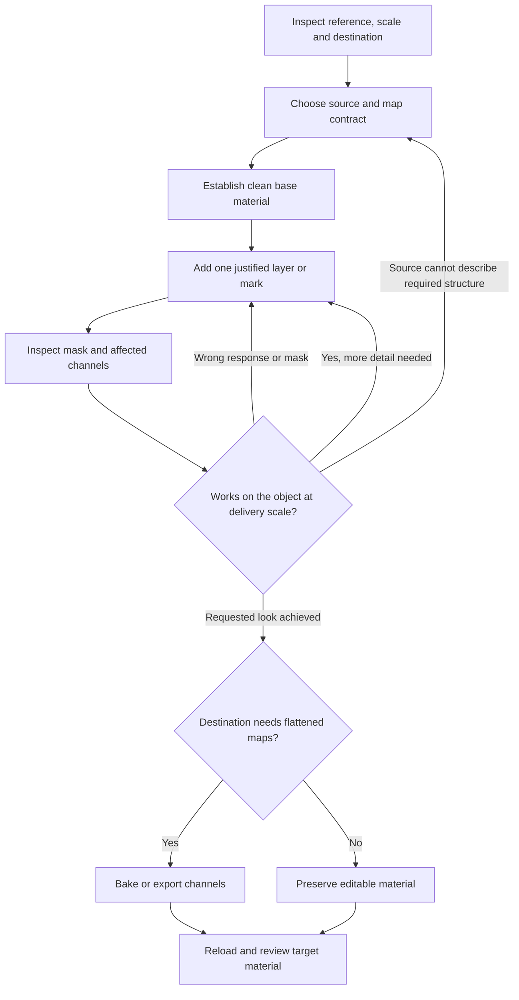

# Texture authoring: design a surface that survives its destination

Use when choosing or authoring surface detail, including procedural materials, acquired maps,
painting and local masks. Work from inspected references and the asset's scale/viewing distance.
Use [shader nodes](shader-nodes-workflow.md)
for response, coordinates and node connections, and [baking](baking-workflow.md) when converting
geometry/materials into maps. Texture authoring can precede unique UV layout when developing a
tileable or procedural material; painting/baking to a mesh needs a suitable
[UV/mapping contract](uv-workflow.md).

For shader mixing, optical coatings or effects beyond texture channels, use
[material composition](material-composition.md). Image authoring is one part of surfacing;
retain the native shader behavior when the requested destination supports it.

## Choose the source and the useful amount of authoring

For recurring wood, plastic, concrete, metal, skin or packaging, use
[surface families](surface-families.md): identify substance, finish and condition, prove the
characteristic cue, then adapt a reusable base. Recoloring one noise graph across unrelated
substances is not a material-family strategy.

Identify what distinguishes the reference: substrate, manufacturing direction, coating,
wear distribution, roughness, color variation and scale of relief. Separate observed evidence
from an assumed hidden construction. A photo's cast shadow or reflection is not an intrinsic
surface mark. Inspect acquired textures and their documentation before building around them;
retain source, permitted use, physical size and map conventions in existing project notes.

| Route | Useful when | Resolve early |
| --- | --- | --- |
| Existing material/scan library | A suitable material already exists and can be adapted | License/attribution, map roles, physical size, baked lighting, seams and actual quality |
| Procedural shader or texture graph | Repeated materials, controllable scale and reusable variations | Coordinate frame, editable controls, visual repetition, cost and target support; bake only if useful |
| Texture Paint / 2D painting | Directed marks, masks, graphic design or local corrections | Canvas, UVs, layer ownership, channel interpretation and saving edited images |
| Photo/stencil/clone projection | A particular observed mark or texture must fit a surface | Perspective, illumination removal, projection stretch/occlusion and transitions between views |
| Geometry/sculpt-derived maps | Relief and shape-dependent masks should agree with the asset | Receiver/source compatibility, projection and rebake dependencies |
| Hybrid | Reusable base plus selected asset-specific marks | A small, understandable division between common material and unique masks/decals |

A requested simple material may be complete with constants or a shared procedural group.
Choose unique maps, tileables, trims, decals or UDIMs from the target and asset use, not from
the assumption that every object needs a full unique set. A purchased tool or extension is
an option only when available and suitable; this workflow works with native Blender tools.

Choose the route by which reference features it can reproduce at the required view. A scriptable
noise graph is not automatically the best source for a distinctive finish or graphic. When
comparison still shows the wrong structure after a targeted adjustment, revisit the source:
inspect a suitable photograph/scan, paint a directed mask, add a local decal, or combine these
with the procedural base. Do not keep increasing noise detail or object count without a visible
gain. Conversely, retain a simple procedural solution when it already matches the required cues.

For a photo-derived texture, use the [reference-derived route](reference-derived-assets.md)
before treating its pixels as albedo/relief. For already suitable directional maps, the
[metric patch technique](techniques/metric-image-patch.md) gives a small tested UV interface.

## Prove the surface before spreading it

Choose an important surface or connected fragment from the target view. Describe the visible
structure before choosing nodes: substrate/covering, material boundaries, feature size,
direction and spatial distribution. Use the [reference search](reference-workflow.md#search-to-close-a-visual-gap)
when these are unclear. A color sampled from a lit screenshot is not measured albedo.

| Reading scale | Decisions to establish | Useful comparison |
| --- | --- | --- |
| Whole shot | Broad material/value regions, manufacturing divisions, calm versus busy areas | Thumbnail and target view: does the material hierarchy still read? |
| Recognizable surface features | Joint rhythm, chipped patches, deposits, wear paths, grain direction | Comparable reference/detail crop: size, coverage, clustering and boundaries |
| Fine response | Pores, weave, scratches and roughness variation | Grazing/neutral light and delivery-size crop: useful response without swollen relief or shimmer |

These are viewing scales, not three mandatory noise layers. Clean or stylized surfaces may
need little variation. Place marks by a plausible cause visible in the reference: handling
around a grip, runoff below a joint, abrasion along a route, deposits in sheltered areas.
Allow unaffected areas and different histories between instances. Random flecks everywhere
and identical damage on every edge do not establish that structure. Preserve panel/joint
logic; a mask may need to stop at an assembly boundary or follow a drainage direction.

Prove the selected treatment on actual representative geometry, including a relevant corner,
seam or grazing region. Use neutral light to judge material identity and the intended scene
light to judge integration; a sphere preview alone may miss mapping and scene-scale problems.
Compare the clean base, the consequential layer/control change and the resulting target view.
Keep camera/display settings stable within each A/B pair. Resolve incorrect feature size,
distribution or response before propagating the material. Detail that vanishes at delivery
scale may still affect roughness, but increasing bump indiscriminately can change the substance.
After removing an artifact, verify that the surface still has its defining cues. A smooth,
featureless result is a diagnostic baseline when the reference requires grain, aggregate or
damage. For depth, coating loss and cracks, choose the [defect's representation](surface-families.md#roughness-and-defects-need-specific-roles)
before tuning its texture.
For cloudy, grainy or inflated procedural results, use the [channel-isolation and noise diagnostics](shader-nodes-workflow.md#diagnose-procedural-noise-before-adding-detail)
before adding another layer or changing the lighting.

The [Adobe material-authoring guide](https://experienceleague.adobe.com/en/docs/substance-3d/general-knowledge/openpbr/openpbr-overview#best-practices-for-material-creation)
supports observing material structure and checking it under different lighting. This workflow
does not require OpenPBR or assume its parameters map directly to Blender's Principled node.

## Establish a map contract before adding layers

Decide which channels the material actually uses. Record names/roles, coordinates or UV set,
texture size/tiles, color encoding, precision, normal convention and alpha/channel packing.
Keep one authoritative interpretation per image usage. Authoring maps may stay separate even
when delivery packs them. Define empty-channel defaults explicitly, not by filename convention.

The shader guide owns map wiring and relief choice; preserve that interpretation during
export. Diagnose lighting, geometry or mapping errors before compensating with contrast or dirt.

For a metal/roughness material, coordinate the channels according to the substance: a paint
layer over metal behaves as the coating; exposed substrate needs its own response. Rust/dust
should not inherit bare-metal settings merely because the object is metal. Gray mask transition
pixels can encode coverage; metallic is not a general polish control. Broad lighting belongs
outside base color for relightable materials. [Adobe's PBR guide](https://www.adobe.com/us/learn/substance-3d-designer/web/the-pbr-guide-part-2)
supports these channel relationships; its numerical examples are not universal limits for
stylized art, every OCIO configuration or every shader model.

## Keep useful structure editable

Separate substrate, coating and meaningful marks with masks or focused groups where revision
benefits. An external layer editor may store these as layers; in Blender, separate image masks
and node groups can preserve the same logical separation. Do not imply native Texture Paint
provides a complete multilayer PBR stack identical to another application. Keep a flattened
delivery separate from editable masks, source graphs and relevant source images.

Give each layer a reason, spatial scale and affected channels. A scratch may remove coating,
change roughness and reveal a lower surface; it does not necessarily raise the surface or
darken every channel. Curvature and AO can help locate candidate regions, but neither identifies
the cause or history of wear. Inspect and art-direct the resulting mask. Keep channel responses
distinct through the [shader workflow](shader-nodes-workflow.md#add-variation-with-a-reason-and-a-scale).

Choose mapping with orientation in mind: grain, brushed finish, fabric weave and machining
marks need coherent direction. Inspect curved areas, seams and transformed instances. For
tileables, inspect repeated tiles in both axes at the intended scale, including roughness and
normal/height continuity. A seamless base-color image does not guarantee a seamless material.
Control conspicuous repeating features before multiplying the material across a scene.

## Paint into the intended canvas

In Texture Paint, identify Material slot mode versus Single Image mode, the actual image and
the UV map. The visible material, selected image in an editor, painting canvas and bake target
are related but distinct state. Test a reversible mark in a scratch copy and verify which
image changed before broad painting. Check shared image users before an asset-specific edit.
See [Texture Slots](https://docs.blender.org/manual/ko/5.2/sculpt_paint/texture_paint/tool_settings/texture_slots.html).

Use tools for their visible effect: Draw or Fill for regions, Clone for sampled repairs,
stencil/projection for placed imagery, and Soften/Smear only where blending is intended.
Choose brush falloff, spacing and scale to match the feature; inspect a short stroke first.
For procedural/scripted edits, verify the pixel buffer, dimensions and channel encoding with
a known patch. Painting scalar data through a color-managed UI can hide a numeric mismatch;
check representative values and the shader response.

With projection, inspect both the face receiving the mark and the opposite/hidden surfaces.
Face selection masks, occlusion, backface handling, stencil masks and clone sources can restrict
the operation differently. A stencil mask is not simply the same thing as a brush texture.
For example, [mask controls](https://docs.blender.org/manual/ja/latest/sculpt_paint/texture_paint/tool_settings/mask.html)
can use their own image and UV layer. Do not paint through a thin wall unintentionally.

Use seam bleed suitable for the layout and texture size, then inspect the 3D seam after filtering.
Overlapping/mirrored UVs paint multiple surfaces at once; use this intentionally or resolve it
before unique marks. Grazing-angle projection stretches pixels and hides occluded regions;
use a better view/mapping or a separate patch rather than stretching the source until it fits.
The [paint options](https://docs.blender.org/manual/ru/latest/sculpt_paint/texture_paint/tool_settings/options.html)
expose bleed, occlusion and external projection controls.

Brush management changed to asset libraries in Blender 4.3. Inspect the installed brush and
its applicable paint mode instead of assuming an old name in `bpy.data.brushes` exists. Preserve
custom brush textures/dependencies when saving a reusable brush; do not rewrite the Essentials
library. See [brush assets](https://developer.blender.org/docs/release_notes/4.3/sculpt/).
Operators that paint in screen space also need the correct view/editor context; a successful
background script setting a brush property does not demonstrate that a stroke was painted.

## Export data and preserve authoring sources

Choose precision for the signal: subtle height gradients or HDR/vector data may need higher
precision than a compact color map. Lossy compression is usually unsuitable for normals,
categorical masks and exact packed data. Check the target's supported formats and compression;
the largest possible image is not automatically better. Inspect small details after downsampling
and, when relevant, across frames to catch shimmer.

Pack channels only to a declared target schema. Confirm channel order, whether a source needs
inversion (such as glossiness versus roughness), resampling, alpha use and whole-image color
interpretation. RGB data channels must not inherit sRGB decoding because a packed file happens
to look colorful. Do not combine color and numeric channels casually; follow the target format's
explicit rules. Recheck normals after conversions/compression, and keep unpacked sources editable.

Save modified external images explicitly or deliberately pack them, then save the blend.
Check generated images, modified loaded images and every required tile; saving the blend alone
does not reliably commit external paint edits. [Texture Paint introduction](https://docs.blender.org/manual/pt/5.2/sculpt_paint/texture_paint/introduction.html)
calls out this separate image-save step. Keep paths usable from the delivery directory and
verify resources after reopening or relocating a copy.

Export texture data with the appropriate file encoding, without a presentation view transform.
Reserve Save as Render for display/render outputs where intended; it can apply view, exposure
and related transforms. See [Displays and Views](https://docs.blender.org/manual/sl/5.2/render/color_management/displays_views.html).
Use a known color/scalar patch to verify the whole save/load/shader path instead of assuming
that a thumbnail or one buffer access proves correct encoding.

Review the reloaded maps on the asset under neutral and intended light, at close and delivery
distances. Inspect material boundaries, roughness response, relief direction, seams, repetition,
alpha edges and visible wear causes. If exporting, rebuild or import the actual target material
and compare it. Record source dependencies, authoring route, maps delivered and observed limits;
separate a technically valid map set from an artistically finished surface.
