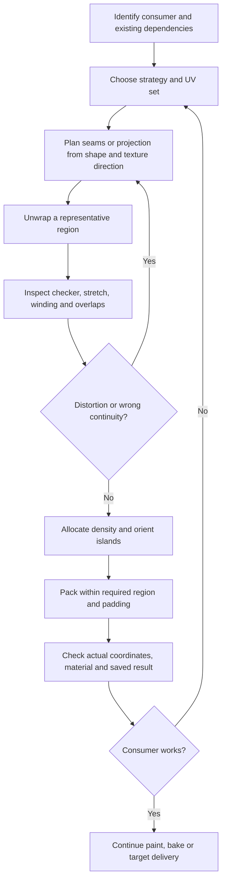

# UV layout: a coordinate contract for the intended surface

Use when creating, repairing or changing texture coordinates, arranging islands, preparing
image baking/painting, or supplying a target UV channel. Begin with the surface strategy and
destination, not an automatic Unwrap → Pack for every object. Native spatial procedural
materials may need no UVs; unique paint/bakes, trims, labels, directional patterns and many
exports do. Connect this work to [materials](shader-nodes-workflow.md),
[texture authoring](texture-authoring-workflow.md) and [baking](baking-workflow.md).

## Define what this UV set must support

Inspect the actual mesh, object scale, existing UV sets, seams, shared data, material inputs
and modifiers. Identify painted/baked dependencies before moving coordinates. Preserve the
authoritative layout or make a derived version when comparing alternatives; repacking can
invalidate already authored images even when it improves utilization.

| Strategy | Contract that changes the layout |
| --- | --- |
| Unique asset texture/bake | Unambiguous destination samples for unique detail, enough padding, useful seam placement and a chosen pixel budget |
| Tileable material | Consistent physical scale and direction; coordinates outside 0..1 may be intended; decide Repeat/other extension behavior |
| Trim sheet | Map regions to the intended strips, matching width/orientation and repetition along the strip; preserve deliberately assigned positions |
| Atlas / decals | Reserve known regions and padding, preserve labels and asymmetry; unrelated assets sharing the atlas must not write over each other |
| Mirrored or stacked sharing | Deliberately reuse samples; check asymmetry, labels, tangent handedness and unique-bake conflicts |
| UDIM | Choose actual tile count, per-tile resolution and resource naming from the asset budget and supported destination |
| Lightmap / other target channel | Follow the target's distinct overlap, bounds, padding and channel requirements; material UVs may be unsuitable |

Record the map name/consumer, intended tiles/region, resolution, texel-density priorities,
orientation constraints and permitted overlaps in existing notes. Texture-coordinate layout,
material slot and texture image are different entities; a new image does not create new UVs.
For lightmaps, for example, [Epic's guidance](https://dev.epicgames.com/documentation/unreal-engine/understanding-lightmapping-in-unreal-engine)
requires unique nonoverlapping coverage and adequate padding. Do not impose that constraint
on every repeating material, or assume a lightmap unwrap is also good for hand painting.

For a simple cylindrical region use [seam-defined strip](techniques/uv-seam-strip.md);
for texture scale and gutters use [density and padding](techniques/uv-density-padding.md).

## Choose cuts and mapping for the form

Place cuts where the surface can flatten with acceptable distortion and where the texture
can tolerate a discontinuity. Construction joints, hidden/back regions and material changes
can be useful, but not every geometric edge needs a seam. More islands reduce some distortion
at the cost of continuity, padding and authoring effort. Keep important logos or a coherent
grain region together where practical. Inspect the actual assigned UVs, not seam marks alone.
See [seam planning](https://docs.blender.org/manual/en/5.2/modeling/meshes/uv/unwrapping/seams.html).

| Shape/task | Starting tools and review |
| --- | --- |
| General seam-defined mesh | Compare Angle Based, Conformal or Minimum Stretch on the difficult region; choose by distortion and stability rather than a universal winner |
| Flat label/panel | Planar or view projection with the intended axis/aspect; inspect sloped/back faces that projection may overlap or stretch |
| Pipe or cylinder | Cylindrical mapping or a seam-defined strip with separate caps where appropriate; inspect the wrap seam, cap junction and grain direction |
| Regular quad strip / trim region | Follow Active Quads can preserve an orderly grid; prepare the active quad's UV shape and choose spacing consistent with geometry |
| Sphere / organic surface | Seams or an appropriate projection; inspect poles, face/feature regions and area/angle distortion |
| Fast hard-surface draft | Smart UV Project can provide a starting point; review fragmentation, tiny islands, directional consistency and bake cost before acceptance |
| Existing partly fixed layout | Pins, live unwrap, relax/minimize stretch, stitch/split and manual alignment, preserving the fixed image contract |

Follow Active Quads propagates the active quad's layout; a distorted seed spreads that error.
Its result can extend beyond a tile. Smart projection and automatic packing do not infer an
art-directed trim or label placement. Blender's
[UV operators](https://docs.blender.org/manual/id/5.2/modeling/meshes/editing/uv.html)
document the methods, projection contexts and aspect correction.

Use a checker with distinguishable cells/orientation and compare on the **3D surface** plus
the UV layout. Square-looking cells in a perspective render alone do not quantify distortion.
Inspect a straight-on region, curved areas and the intended deformation poses if relevant.
Stretch overlays help locate area/angle mismatch; examine the mesh and checker before
accepting an overlay color as a quality verdict. Fix the responsible seam or local shape
instead of repeatedly packing an already distorted island.

## Allocate texels before maximizing packing

Choose density in physical units and relate it to the closest intended view and detail.
Uniform density is useful across a kit; a hero face may deliberately receive more pixels
than a hidden underside. State that allocation rather than calling every difference an error.
Compare using evaluated/world-space area where that is the consumer's surface. Nonuniform
object scale and later deformation can change the apparent density without changing UVs.

For one image of width W and height H, an area-based estimate is
`density = sqrt(UV_triangle_area * W * H / world_triangle_area)` in pixels per world unit.
Convert world units to the project's physical units. Sum appropriate areas for an island
estimate; handle different UDIM resolutions separately. This estimate detects area allocation,
not directional stretching: an island can preserve area while stretching one axis and shrinking
the other. Inspect checker shape, angular distortion or local directional scale as well.

Average Island Scale can normalize relative island allocation; it does not by itself establish
an absolute pixels-per-meter target. Resizing or packing with Scale enabled can change that
target again. Check density after final packing. If the requested density plus padding cannot
fit, choose a larger texture/more tiles, different sharing or explicit priority tradeoffs;
do not silently lower all islands and claim the original density survived.

For non-square images, account for pixel aspect/dimensions in unwrap and measurement. Verify
which image supplies Correct Aspect; the installed Blender may require an active selected
image node. Keep wood grain, fabric weave, text and tangent-driven highlights oriented correctly.
Permit packing rotations only within those constraints.

## Pack to the actual image, atlas region or tile

Decide what is allowed to move, rotate and rescale. Pin/lock appropriate islands, reserve trim
or atlas regions, and intentionally preserve stacked islands only where sharing is valid.
Merge Overlapping in the packer preserves overlapping groups; it does not resolve unwanted
overlap. High occupancy is useful only after shape, density and padding requirements hold.

Treat pixel padding as a measured requirement at the intended resolution/mip use. For example,
an 8-pixel gutter on each side of neighboring islands needs 16 pixels between their boundaries.
Express equivalent UV distances using image dimensions, distinguish an island's gutter from
the full inter-island gap, and measure the packed result. Fraction, Add and Scaled margin modes
use different definitions; do not assume the same numeric input means the same final spacing.
Fraction and exact-shape packing can be slower, so use them for a needed constraint rather
than blindly maximizing quality settings. See
[Pack Islands](https://docs.blender.org/manual/de/latest/modeling/meshes/uv/editing.html).

Allow room for bake dilation/filtering without contamination from the next island. Padding
in the UV layout and pixels extended into that padding are separate requirements. Verify
the actual bake/paint output at a reduced size too; inspect wrap behavior at tile edges.
Do not use distance between island centers as proof of clearance between their boundaries.

For UDIM, ensure the actual image tiles/files exist and are used by the material; moving
UVs into a new tile does not create its texture file. Standard numbering starts with 1001,
with 1002 to its right and 1011 above 1001. Choose count/resolution per use rather than a
mandatory tile recipe. Check export and engine support before adopting it. The
[UDIM workflow](https://docs.blender.org/manual/ka/latest/modeling/meshes/uv/workflows/udims.html)
describes tile coordinates and file tokens; use [image/bake checks](baking-workflow.md) for
writing, loading and inspecting every required tile.

## Keep UV identity and selection explicit

The UV layer selected for editing can differ from Active Render. Texture Coordinate's UV
output uses Active Render; a named UV Map node can select another layer explicitly.
Normal Map, paint/bake settings and exporter channel selection must agree with their intended
consumer. See [UV sets](https://docs.blender.org/manual/de/5.2/modeling/meshes/uv/uv_texture_spaces.html)
and [UV Map node](https://docs.blender.org/manual/en/5.2/render/shader_nodes/input/uv_map.html).

UV coordinates belong to face corners: a shared mesh vertex can have different UV coordinates
on opposite sides of a seam. When scripting or using GN, preserve the correct domain, layer
identity and values through topology changes. Do not assign one UV per vertex and accidentally
weld a seam. Check an evaluated/exported mesh after operations that create topology; transfer
or generated UVs need real inspection rather than trusting that an attribute named UVMap exists.

Verify Object/Edit Mode, active object, selected faces/UVs, hidden geometry and UV Sync Selection
before operators. Blender 5.0 changed UV selection behavior, including shared selection across
UV maps; old scripts/tutorial assumptions may not hold. Blender 5.2 adds Select by Winding,
island overlap selection and original-bounds unwrapping. Use these as diagnostics, with actual
results checked, rather than as automatic repair rules. See
[5.0 UV changes](https://developer.blender.org/docs/release_notes/5.0/modeling/) and
[5.2 UV changes](https://developer.blender.org/docs/release_notes/5.2/modeling/).

## Accept the mapping in its consumer

Check finite coordinates, nonzero UV areas, expected winding, permitted bounds/tiles,
unintended overlaps and boundary spacing. Mirroring can be intentional; assess it against
normal-map handedness, asymmetry and the target, not a blanket ban. Overlap detection is
only a diagnosis until compared with the declared sharing strategy.

Inspect density and distortion per relevant region, continuity of directional detail, seams
and important paint/bake areas. Stabilize receiver topology/triangulation/normals when baking
tangent maps; changing them later may require rebaking even if the UV layout looks unchanged.
Save/reopen with the correct UV names and materials; verify actual target channel mapping
through [export](export-workflow.md) where requested. For baked target lighting, verify
[lightmap use in the consumer](performance-workflow.md#collision-and-lightmaps-belong-to-their-consumers). Deliver a useful mapped asset and evidence of its constraints,
not merely a densely packed screenshot.
