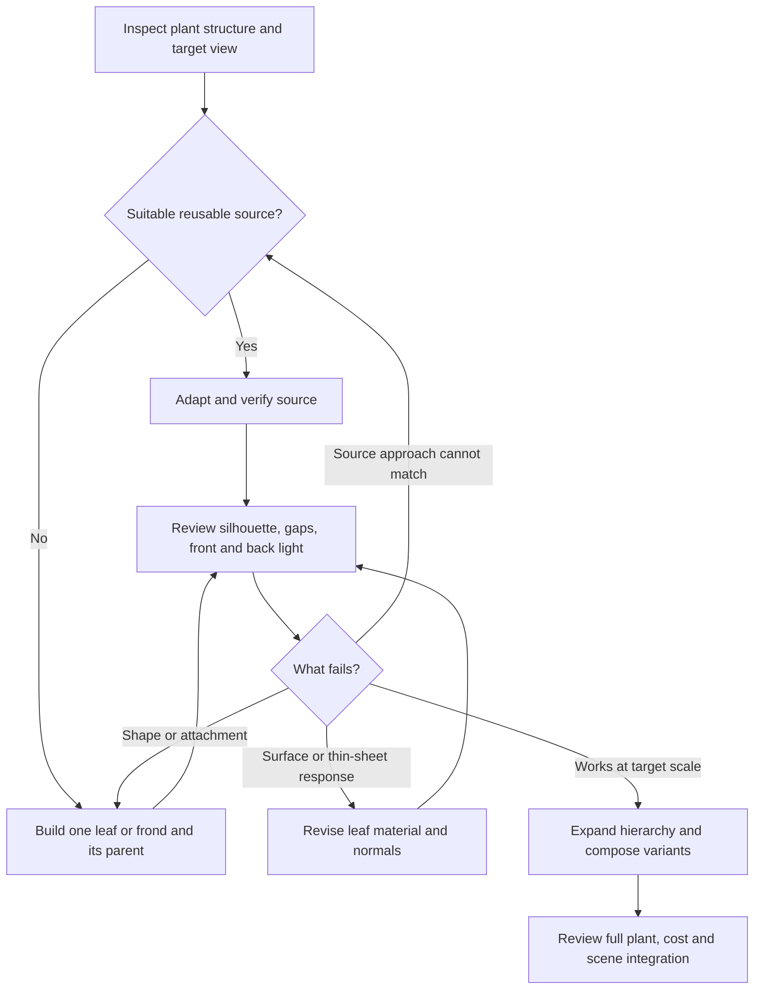

# Vegetation: prove the plant before populating the scene

Use when a plant/tree's form or leaf response matters. [Scatter](scatter-workflow.md) distributes
assets; it cannot repair an unconvincing source. Enter at the needed scale: a distant mass may
be sufficient, while a hero frond needs individually readable construction and lighting.
For compact bushes, clipped hedges or dense crown masses, use
[shrub and canopy recipes](shrub-recipes.md). A canopy envelope can guide construction; its
smooth visible surface is only sufficient when it survives the requested view/finish level.

## Choose the structure and representation

Inspect the intended species or morphological analogue: overall habit, crown outline and gaps,
trunk/stem, branch/frond hierarchy, leaf shape, attachment and size progression. Record uncertainty
when a screenshot does not identify a species. A palm is not a generic tree with radial leaves;
feather-like, fan-like and other leaf structures need different sources or generators.

Review available plant assets, atlases and generators before expensive custom construction.
Choose by silhouette, age/condition, required angle, editability, dependencies and budget.
Imported assets still need scale, shading and target-renderer review. Native mesh/curve/GN
construction remains useful for a custom silhouette or controllable family; no add-on is required.

## Build variation around growth relationships

Prove a parent plus a representative leaf/frond before multiplying it. Preserve the attachment,
central support, silhouette, taper and cross-section that define the observed form. Then vary
related controls: position along the parent, age, length, opening angle, twist, droop and condition.
Use reproducible randomness within those relationships. Equal radial angles and identical
profiles can produce a mechanical star; unstructured random rotations can destroy the plant.
Do not increase count to hide the wrong silhouette or repeat one defect on every leaf.

For a pinnate palm, inspect trunk → crown/leaf base → petiole/rachis → leaflets. Test how leaflets
join the rachis, their changing length/angle along it, fold and taper, and the full frond's sag.
Inspect crown gaps and overlapping age/height groups. These are questions for the reference,
not a mandatory number of fronds or a rule that every species has the same arrangement.
The [UF/IFAS anatomy guide](https://ask.ifas.ufl.edu/publication/EP473) distinguishes palm leaf
types, attachment and cross-section; use its figures as construction evidence where applicable.

Curves can control a rachis or bending profile; mesh strips can carry folded/twisted leaves;
GN or linked instances can reuse tested parts along a hierarchy. Choose enough subdivisions
for the required bend, not a dense uniform mesh. Leaf cards/atlases are useful when silhouettes,
overdraw, shading and view changes remain acceptable; important near leaves may need explicit
shape. Inspect the back and an oblique view, not only the most flattering front.

## Shade and evaluate thin foliage deliberately

Keep color/roughness structure aligned to a leaf's length and veins where visible. Distinguish
front/back finish and thin-sheet light transmission from alpha cutout, glass and emission.
Use the actual engine's supported thin-wall/translucent model through
[material composition](material-composition.md); test front light and backlight before using it
on the crown. Dark backfaces are not automatically a reason to add emission or randomize normals.
Check winding, shadows, alpha edges if used, and leaf/cluster normal treatment at the intended
distance. A physically thin leaf need not become a thick watertight slab merely to pass a solid check.

Compare the whole plant in silhouette for crown density/gaps, a useful frond detail, and the
actual scene view at delivery scale. Verify attachments and sufficient thickness/shape cues,
then bound expanded leaf/card counts and render cost. For animation, also test deformation,
wind coherence and temporal aliasing; a still is not a wind/LOD validation. Use
[animation](animation-workflow.md) before implementing wind/keyframes, and
[Geometry Nodes](geometry-nodes-workflow.md) before procedural instancing or deformation.
Record the actual sample view and remaining mismatch before population; describing a source
as proven in generator code does not substitute for looking at it.

[SpeedTree's generation concepts](https://docs9.speedtree.com/modeler/doku.php?id=generation_properties)
separate count, position and orientation along a parent. Its
[card guidance](https://docs9.speedtree.com/modeler/doku.php?id=card_generator) distinguishes leaf
deformation and cluster-normal treatments. These inform native Blender choices; they do not
require SpeedTree or establish that its controls exist unchanged in Blender.
